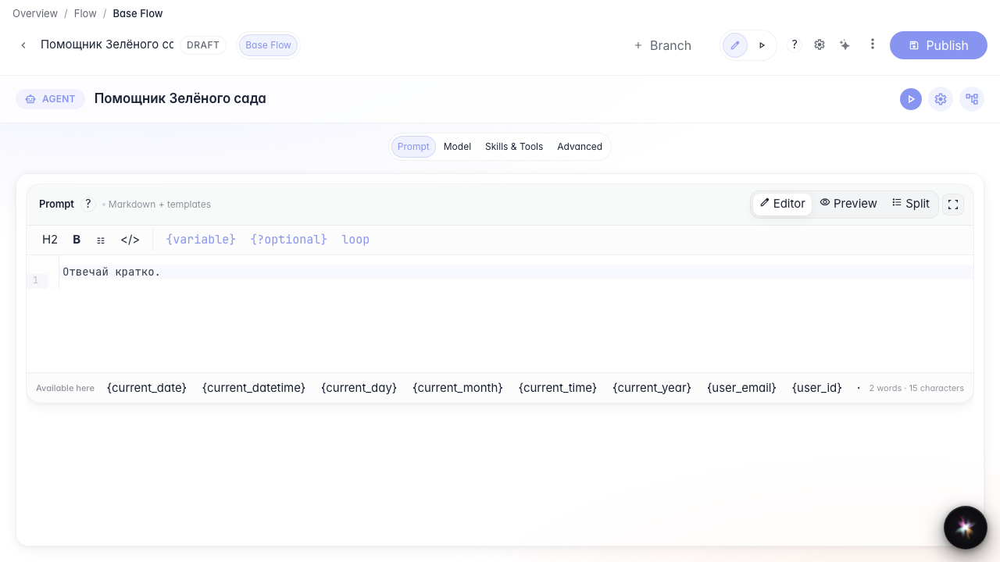
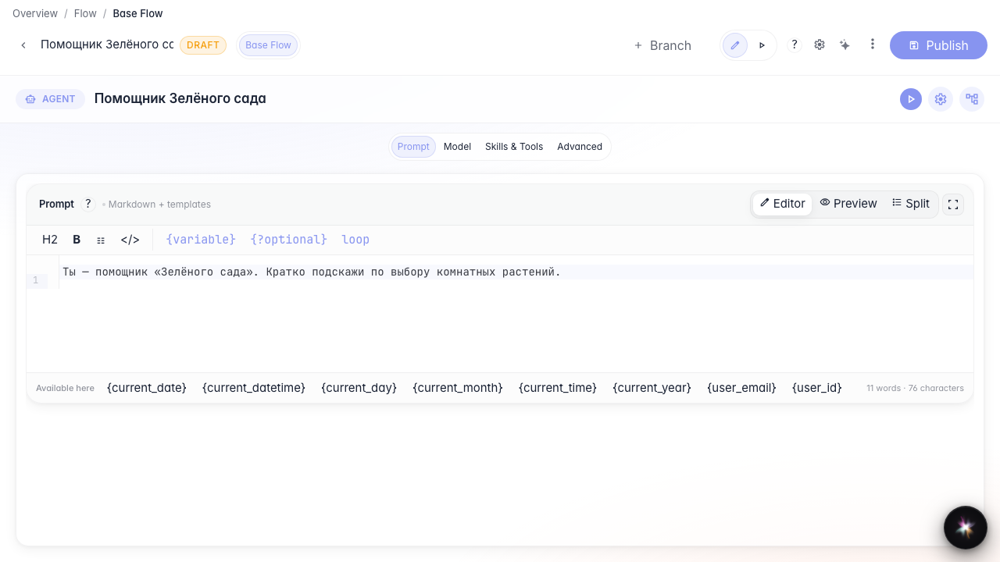
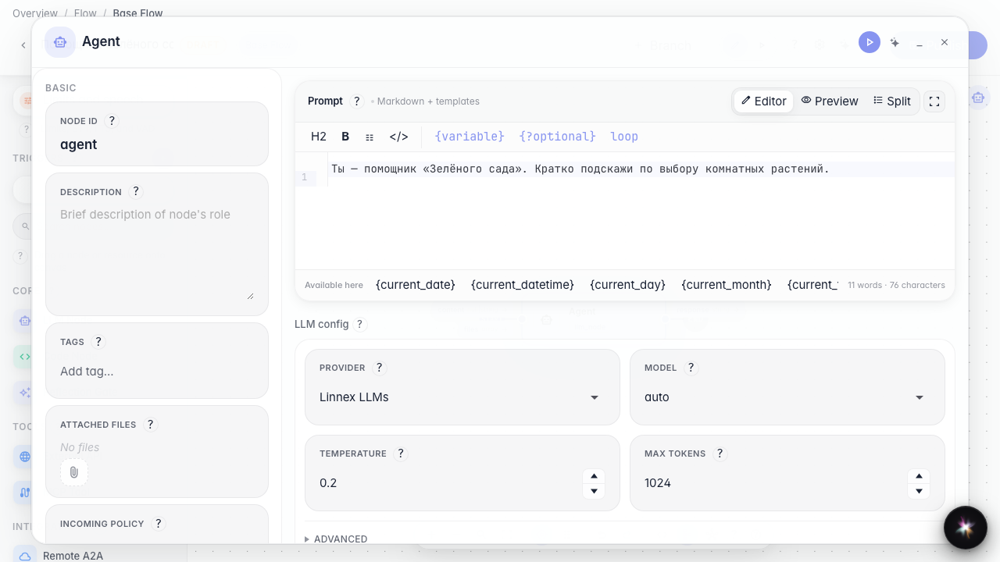

# Studio and canvas: two editor modes

**What for:** this guide shows how Studio differs from the canvas graph and how to switch between them.

**Problems it solves:** after creating an agent it is unclear where the canvas went or why there are two screens for one node.

**Result:** one prompt change is visible both in Studio and on the canvas.

## Step 1. Open the agent in Studio mode

For a single answer-node agent, switch to Studio: prompt, model, Skills and tools, advanced. A focused screen without the graph canvas.

## Step 2. Change the prompt in Studio

In the prompt section set the Green Garden instruction. The change goes into the agent draft immediately.

## Step 3. Switch to the canvas graph

Click the canvas switch (graph icon). The canvas opens with the same node — useful when you add branches and more blocks.

## Step 4. Confirm the node is on the canvas

The same answer node is on the canvas. One agent — a different editor screen.

## Step 5. Return to Studio and verify the change

**Result demonstration.** Back in Studio the Green Garden text is still there. Switching modes does not lose settings.

**Summary.** You can work in Studio and on the canvas and switch between them.

