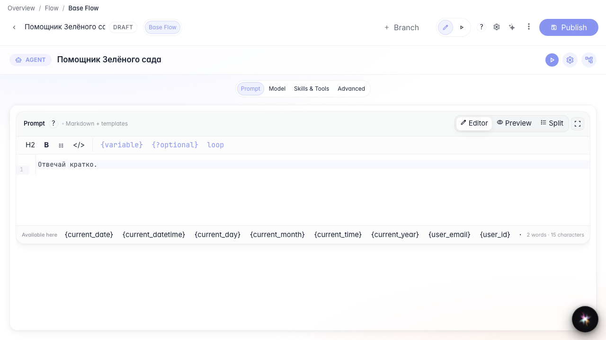
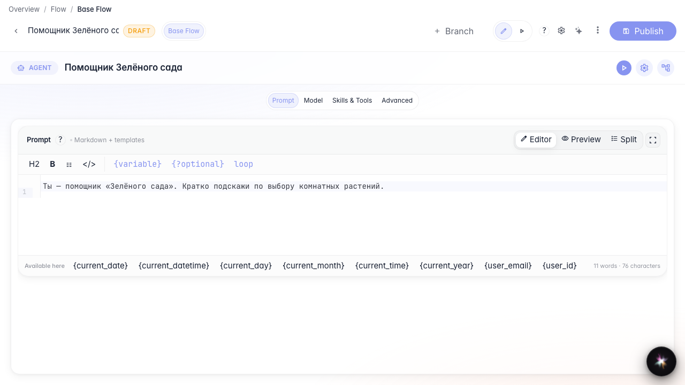
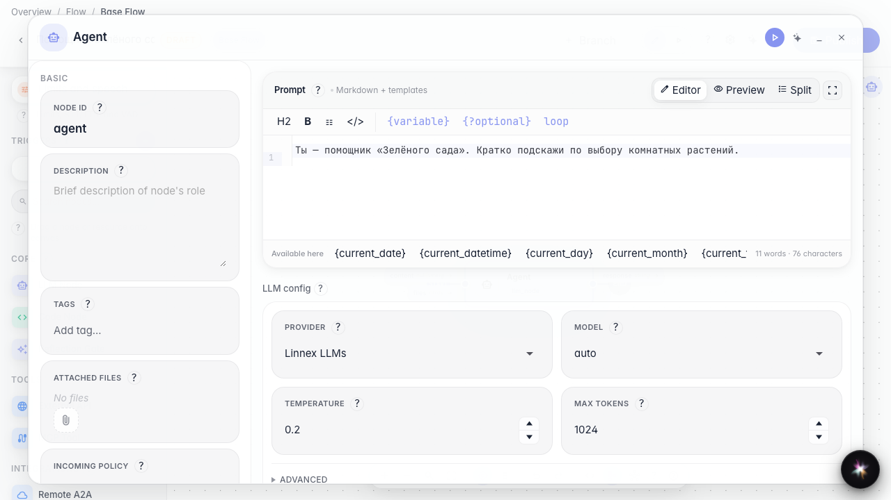

# Студия и схема: два режима редактора

**Для чего:** эта инструкция покажет, чем режим студии отличается от схемы (канвы) и как переключаться между ними.

**Какие проблемы решает:** после создания агента непонятно, куда пропала канва или зачем два экрана для одной ноды.

**Результат:** одно изменение промпта видно и в студии, и на схеме.

## Шаг 1. Откройте агента в режиме студии

Для агента с одной нодой ответа переключитесь в студию: секции промпт, модель, Skills и tools, дополнительно. Это удобный экран без схемы графа.

## Шаг 2. Измените промпт в студии

В секции промпта задайте инструкцию для «Зелёного сада». Изменение сразу попадает в черновик агента.

## Шаг 3. Переключитесь на схему (канву)

Нажмите переключатель схемы (иконка графа). Откроется канва с той же нодой — удобно, когда появятся ветки и несколько блоков.

## Шаг 4. Убедитесь, что нода на схеме

На канве видна та же нода ответа. Это один агент — другой экран редактора.

## Шаг 5. Вернитесь в студию и проверьте изменение

**Демонстрация результата.** Снова студия — текст про «Зелёный сад» на месте. Переключение режимов не теряет настройки.

**Итог.** Вы умеете работать в студии и на схеме и переключаться между ними.

