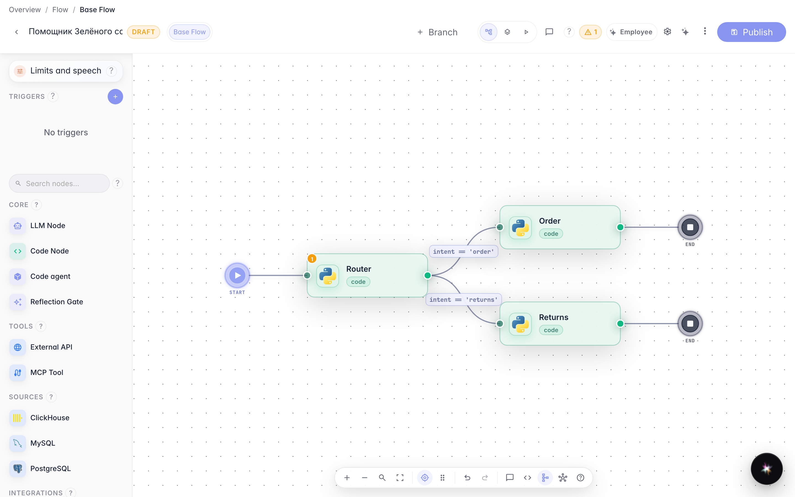
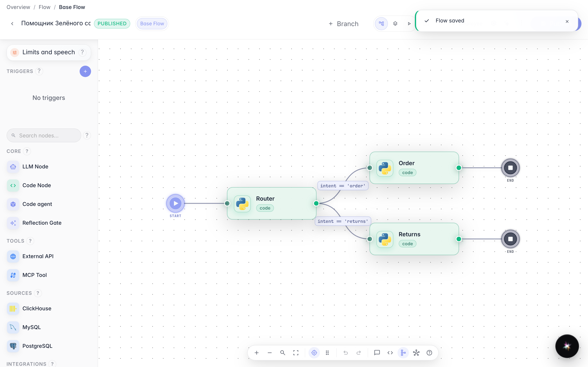
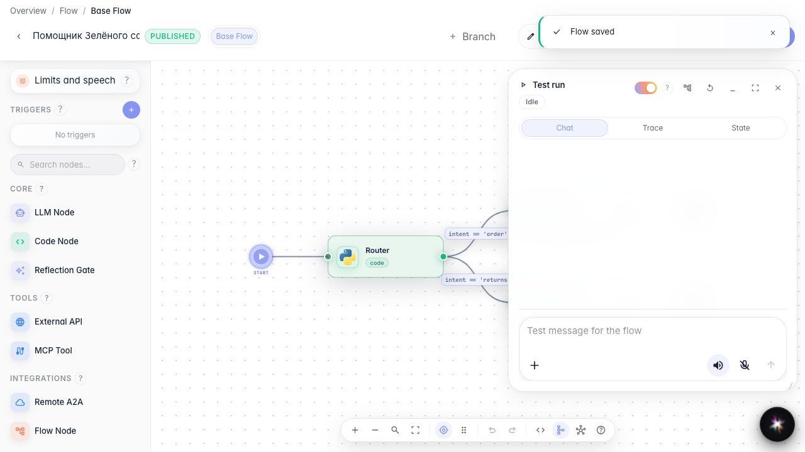
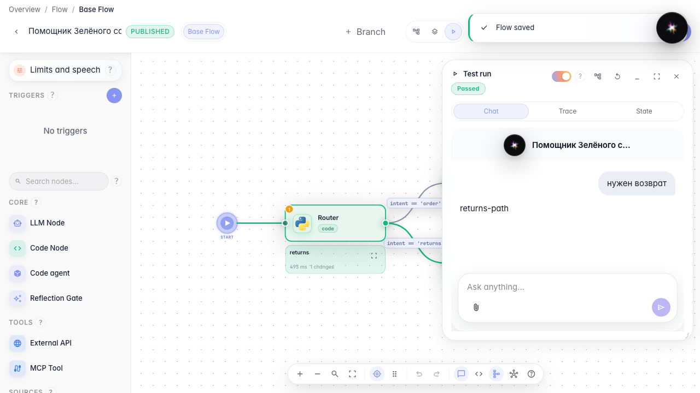

# Branch the dialog with edge conditions

**What for:** this guide helps route Green Garden customers down different branches, such as order handling versus returns.

**Problems it solves:** the agent treats every request the same even though order and return scenarios need different answers.

**Result:** a return request follows the Returns Agent branch, visible during a test run.

## Step 1. Open the agent with a branch

In the Green Garden Assistant editor there is already a router and two branches: a regular order path and the Returns Agent. This shows where different request types can go.

## Step 2. Set the condition on the returns link

Click the label on the link to the Returns Agent block and set a condition: variable intent equals returns. The branch runs only for return requests.

## Step 3. Publish the changes

Click Publish so the link condition becomes the live agent version. Without publishing, a test run would still use the old rules.

## Step 4. Switch to run mode

In the editor header, choose Run mode. A chat panel opens on the right where you can test the agent without leaving the editor.

## Step 5. Verify the returns branch

