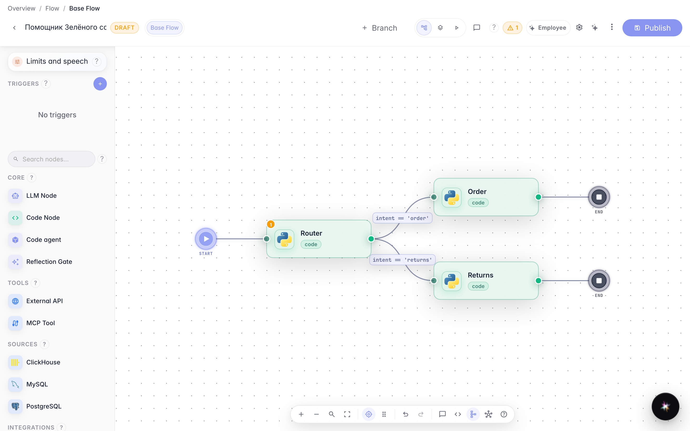
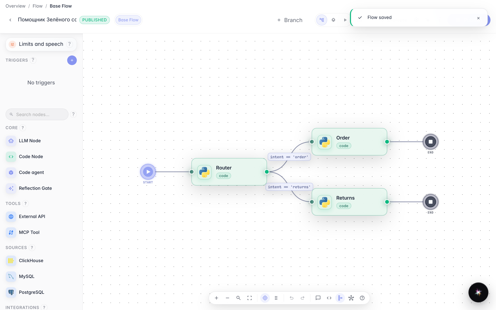
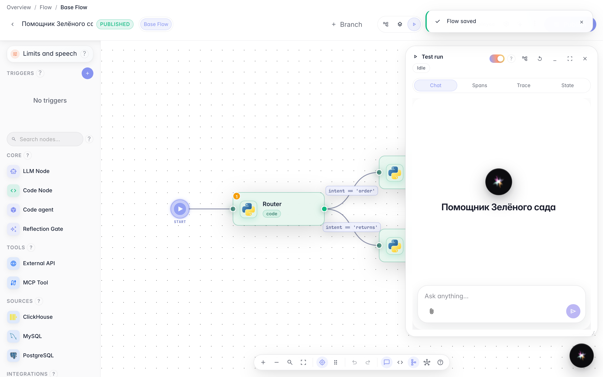
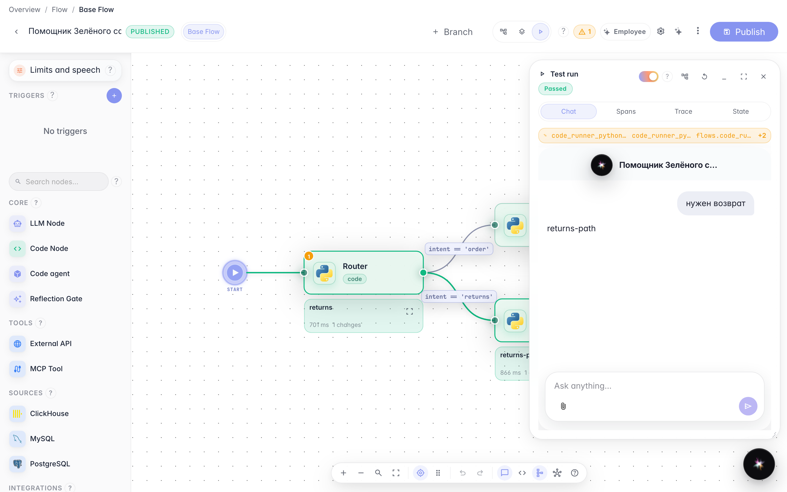

# Развилка в диалоге: условия на связях

**Для чего:** эта инструкция поможет направлять покупателя «Зелёного сада» по разным веткам — например, заказ и возврат.

**Какие проблемы решает:** агент обрабатывает все обращения одинаково, хотя сценарии заказа и возврата требуют разных ответов.

**Результат:** запрос о возврате идёт по ветке «Агент возвратов», и это видно при тестовом запуске.

## Шаг 1. Откройте агента с развилкой

В редакторе «Помощника Зелёного сада» уже есть маршрутизатор и две ветки: обычный заказ и «Агент возвратов». Так вы видите, куда можно направить разные типы обращений.

## Шаг 2. Задайте условие на связи к возвратам

Кликните подпись связи к блоку «Агент возвратов» и задайте условие: переменная intent равна returns. Так ветка сработает только для обращений о возврате.

## Шаг 3. Опубликуйте изменения

Нажмите «Опубликовать», чтобы условие на связи стало рабочей версией агента. Без публикации тестовый запуск будет использовать старые правила.

## Шаг 4. Переключитесь в режим запуска

В шапке редактора выберите режим «Запуск». Справа откроется панель чата, где можно проверить агента, не выходя из редактора.

## Шаг 5. Проверьте ветку возвратов

**Демонстрация результата.** Отправьте «нужен возврат» и дождитесь ответа returns-path в чате запуска — значит сработала ветка «Агент возвратов». На канве подсвечивается пройденный путь.

**Итог.** Теперь вы умеете направлять покупателей «Зелёный сад» по разным веткам с помощью условий на связях.

