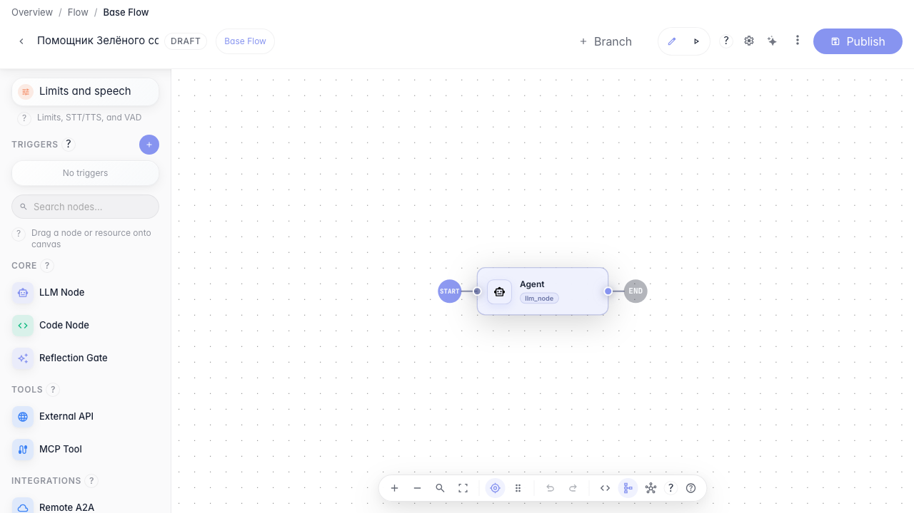
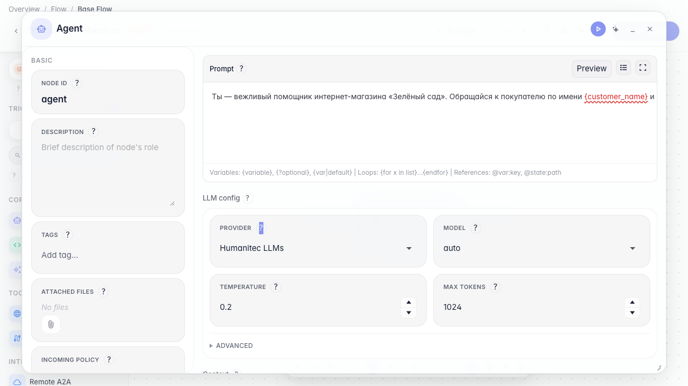
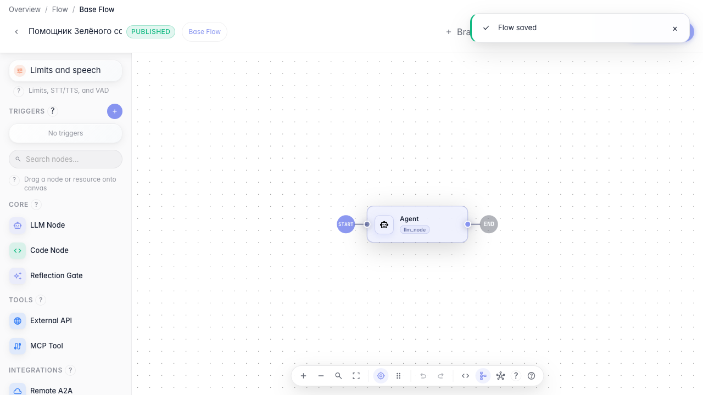
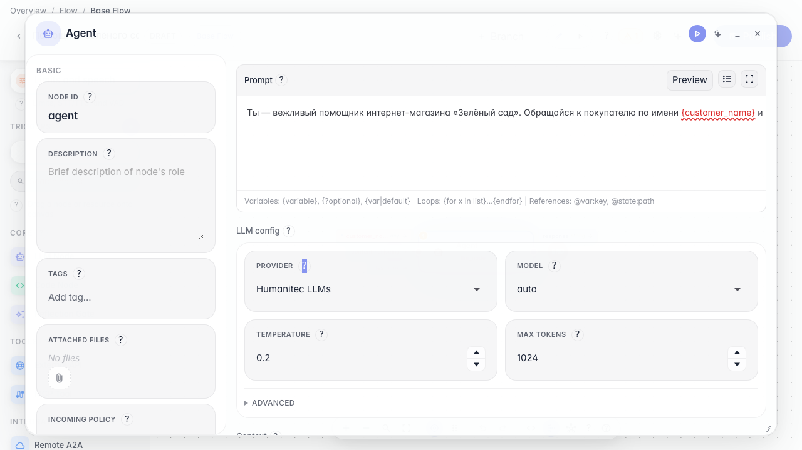

# Shape agent answers: prompt and model

**What for:** this guide helps you set the agent's behavior and answer model, then change the setting and save it.

**Problems it solves:** the agent answers differently than the shop needs, and it's unclear where to change the instruction and the model.

**Result:** the agent answers politely on behalf of Green Garden, and changes are published and persist after reopening.

## Step 1. Open the agent in the editor

The editor canvas contains the agent answer node. It defines how the agent talks to the customer.

## Step 2. Write the agent instruction

In the node editor, type the instruction (prompt). You can insert variables such as the customer name in curly braces, and the agent uses them in its reply. This is the main way to set the tone and rules of communication.

## Step 3. Publish the draft

Click Publish. The draft becomes the live version, so the agent now answers using the new instruction.

## Step 4. Change the instruction and publish again

Extend the instruction (for example, ask it to always clarify delivery) and publish again. This is how you refine the agent's behavior over time.

## Step 5. Reopen the agent and verify settings

**Result demonstration.** Close and reopen the node — the updated instruction is still there, which means the setting was saved.

**Summary.** You can now set and change the agent instruction and publish changes.

