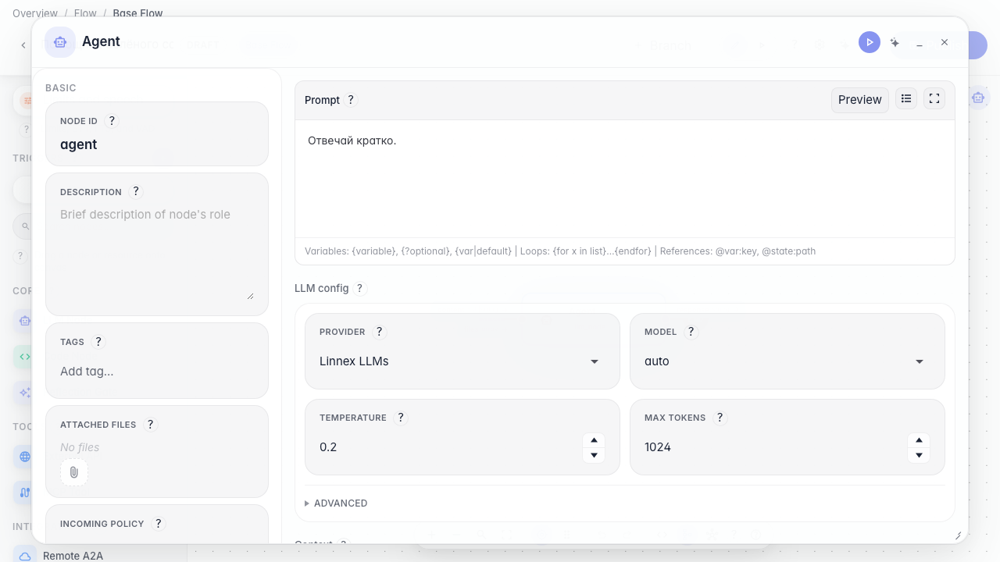
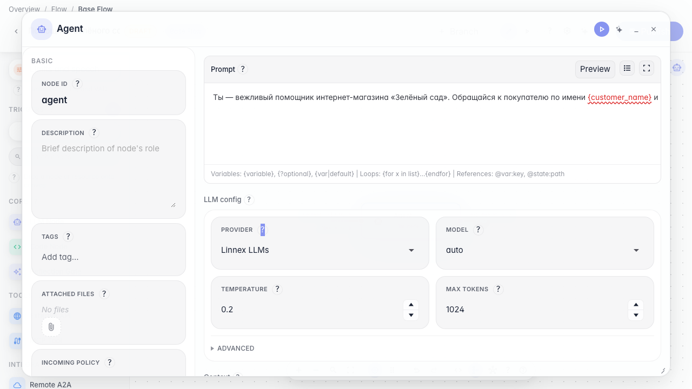
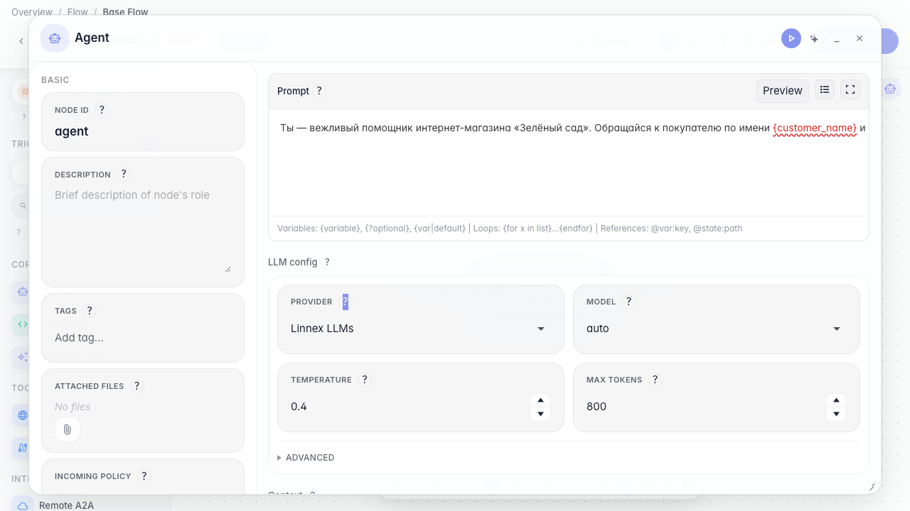
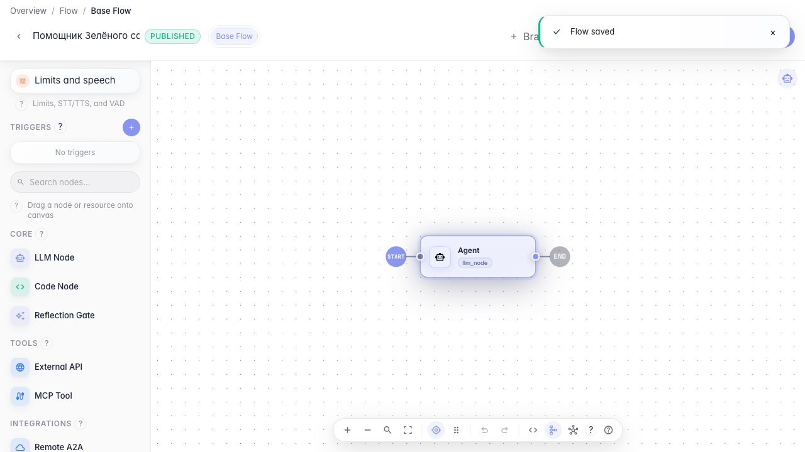
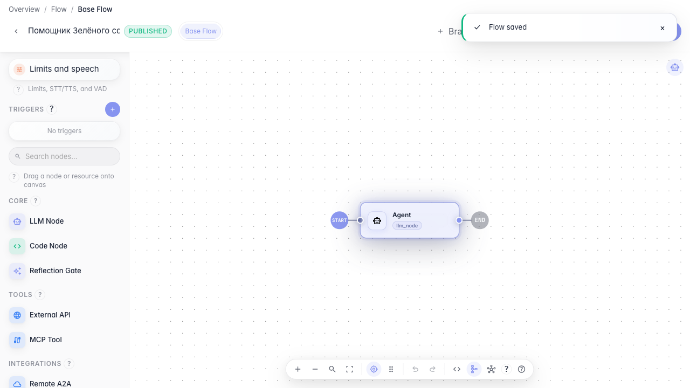
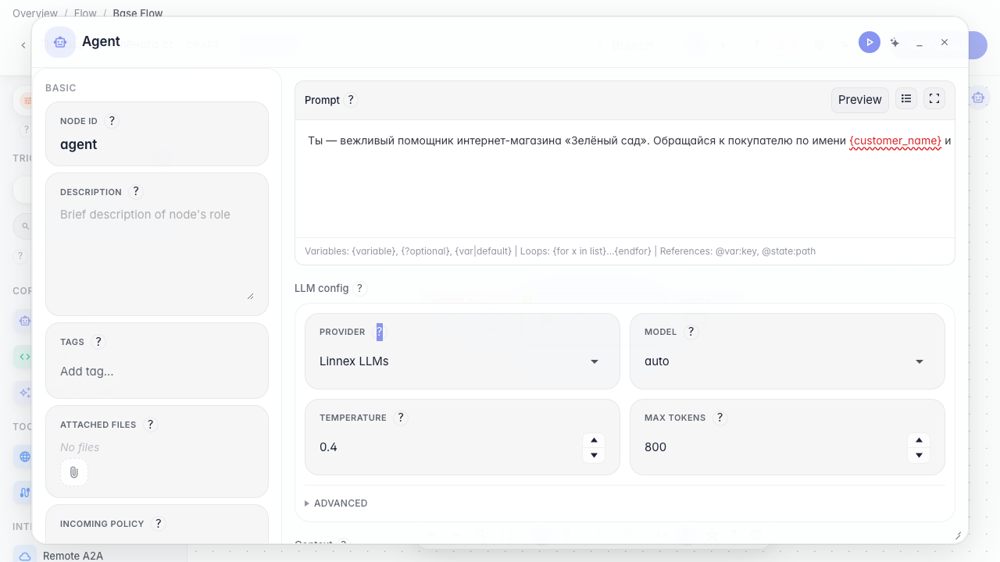

# Настраиваем ответы агента: промпт и модель

**Для чего:** эта инструкция поможет задать поведение агента и модель ответа, а затем изменить настройку и сохранить её.

**Какие проблемы решает:** агент отвечает не так, как нужно магазину, и неясно, где менять инструкцию и модель.

**Результат:** агент отвечает вежливо от лица «Зелёного сада», а изменения опубликованы и сохраняются после переоткрытия.

## Шаг 1. Откройте агента в редакторе

Откройте «Помощника Зелёного сада» в редакторе. Нода ответа задаёт, как агент разговаривает с покупателем. Для агента с одной LLM-нодой доступен и режим студии — о нём отдельная инструкция.

## Шаг 2. Напишите инструкцию агента

Впишите инструкцию (промпт). Можно подставлять переменные вроде имени покупателя в фигурных скобках — агент использует их в ответе.

## Шаг 3. Выберите модель и параметры ответа

В блоке модели задайте провайдера, модель, температуру и лимит длины ответа. Так вы управляете стилем и объёмом ответа магазина, не меняя граф.

## Шаг 4. Опубликуйте черновик

Нажмите «Опубликовать». Черновик становится рабочей версией — агент отвечает по новой инструкции и модели.

## Шаг 5. Измените инструкцию и опубликуйте снова

Дополните инструкцию (например, всегда уточнять доставку) и снова опубликуйте. Так вы дорабатываете поведение по мере необходимости.

## Шаг 6. Переоткройте агента и проверьте настройки

**Демонстрация результата.** Снова откройте ноду — обновлённая инструкция и параметры модели на месте, значит настройка сохранилась.

**Итог.** Теперь вы умеете задавать промпт и модель агента и публиковать изменения.

