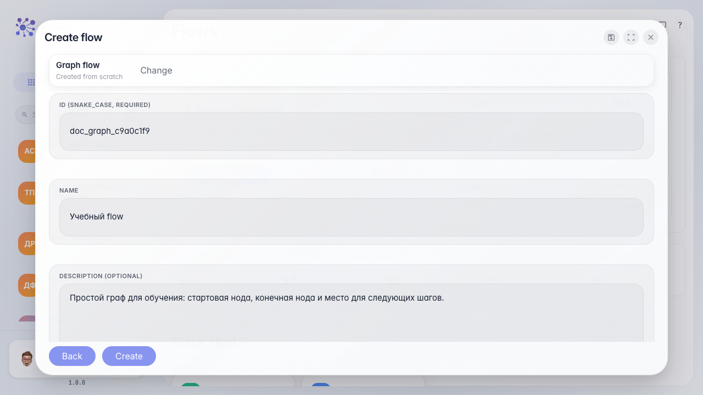
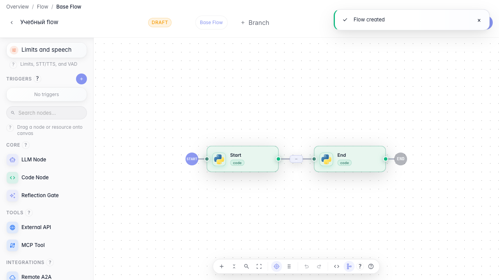

# Flows: creating a flow

A step-by-step guide for a regular user: open Flows, pick a template, fill in the fields, and land in the editor with a ready canvas.

## Step 1. Open Flows. This is your flow list where you can find an existing agent or create a new one.

## Step 2. Click the plus button. The creation wizard opens: first you choose the type of flow.

## Step 3. Fill in ID, name, and description. The ID is for the system; the name and description are for people.

## Step 4. After creation you land in the editor. The canvas already has two nodes: Start and End.

