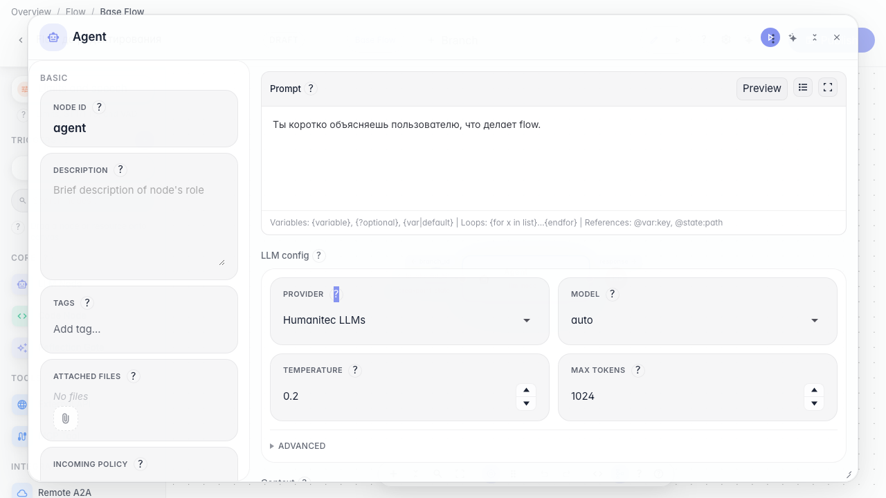
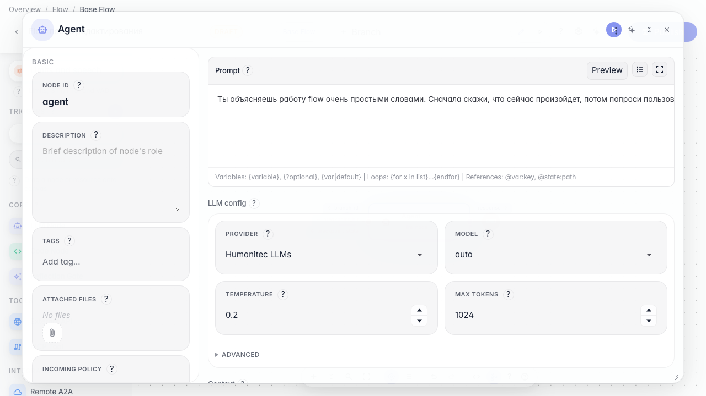
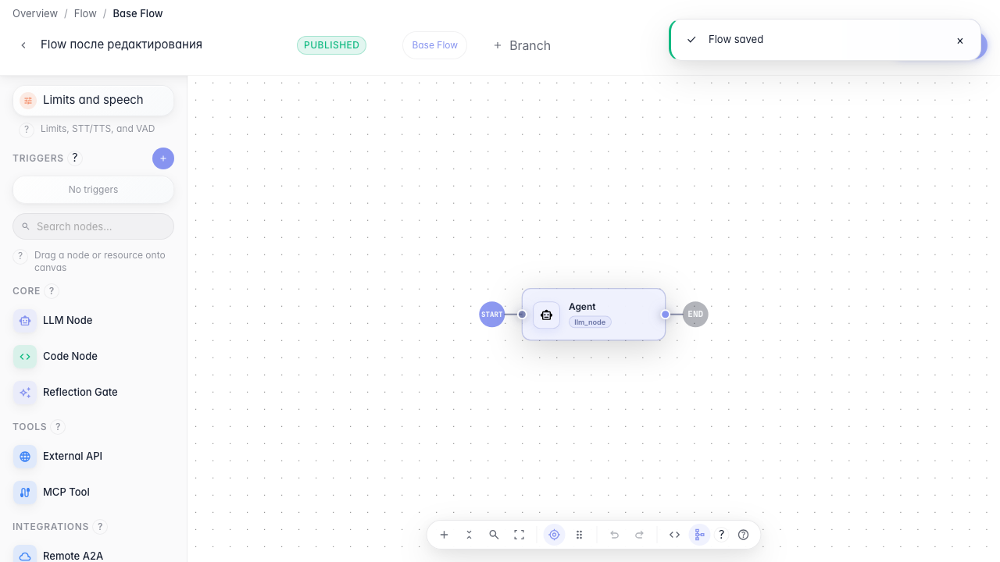

# Flows: editing a flow

Guide for editing an existing flow: open a ready flow, change the name, update the LLM node prompt, and save changes.

## Step 1. Open an existing flow and click the LLM node. Its settings appear on the right again.

## Step 2. Change the flow name and rewrite the prompt. This is everyday editing — like renaming a file and fixing its text.

## Step 3. Save changes with Publish. After that, the new name and prompt are in the saved version of the flow.

