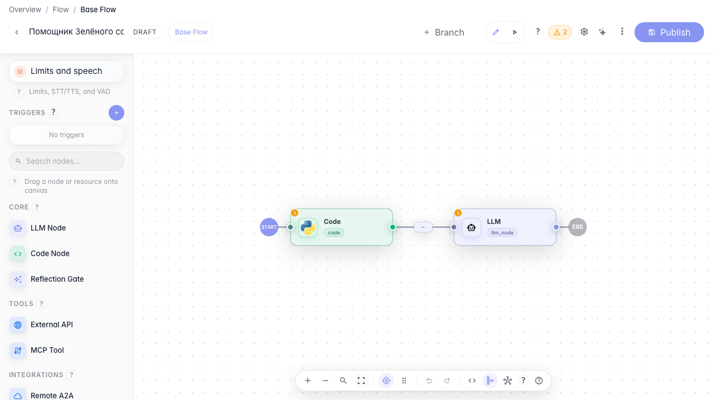
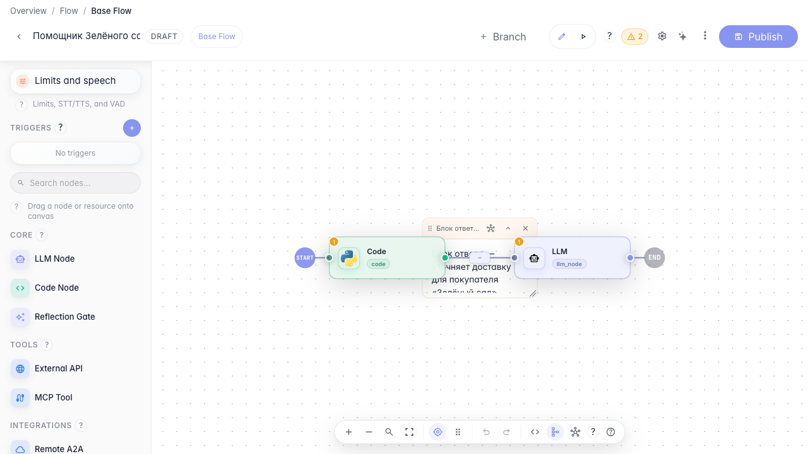
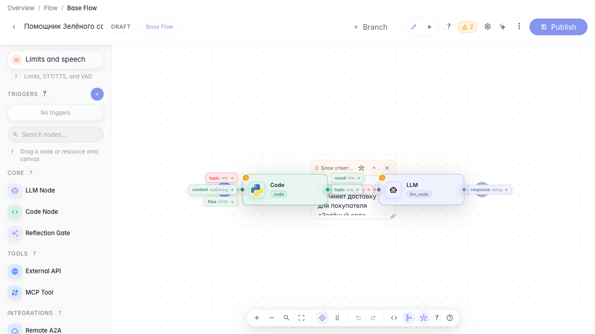

# Keep a large graph readable

**What for:** this guide helps keep a complex Green Garden agent readable and find data wiring issues quickly.

**Problems it solves:** the graph grows, data links get lost, and warnings appear about missing inputs.

**Result:** the graph is annotated with notes, the broken link is found and fixed, and the warnings list is empty.

## Step 1. Fit the canvas view

On the bottom toolbar, click Fit view so all Green Garden Assistant blocks fit on screen. This makes a large graph easier to navigate.

## Step 2. Add an explanatory sticky note

Add a note next to the answer block and briefly describe its role — for example, that delivery is clarified here. Notes help teammates understand a large graph without extra questions.

## Step 3. Show data links

On the bottom toolbar, turn on data link display — the chain icon. You can see which variables pass between blocks and where a link is still missing.

