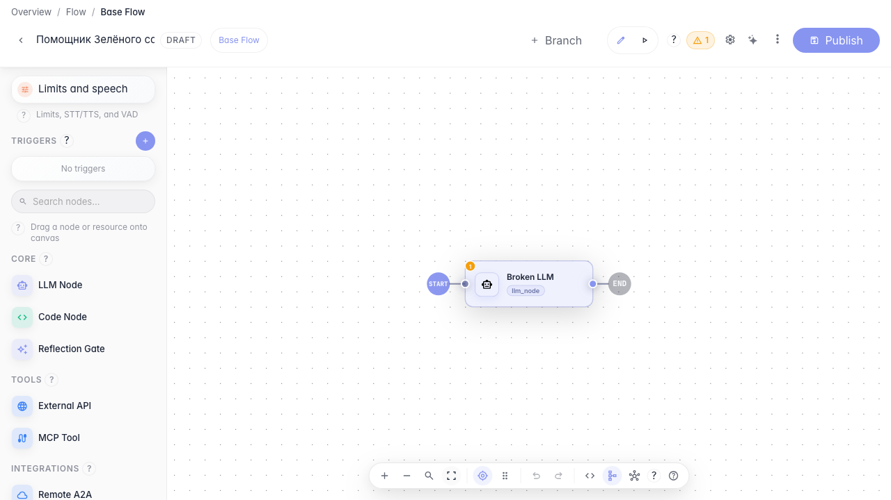
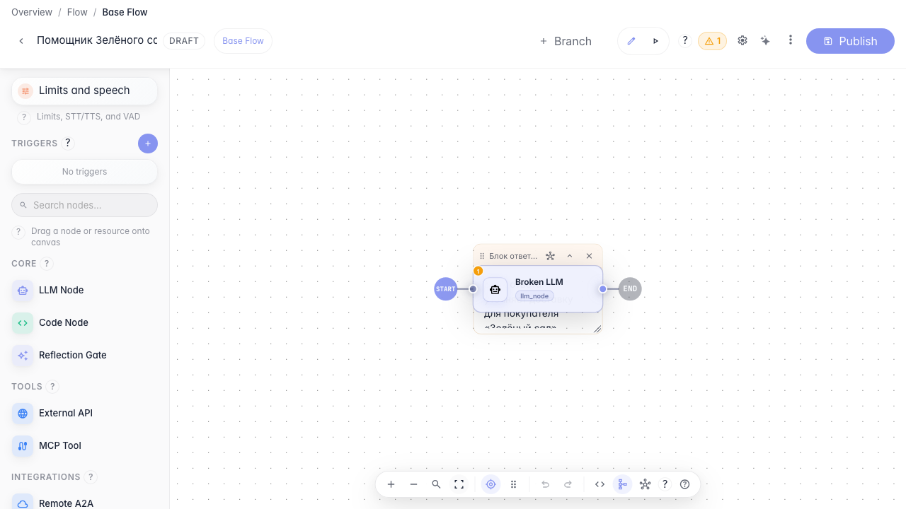
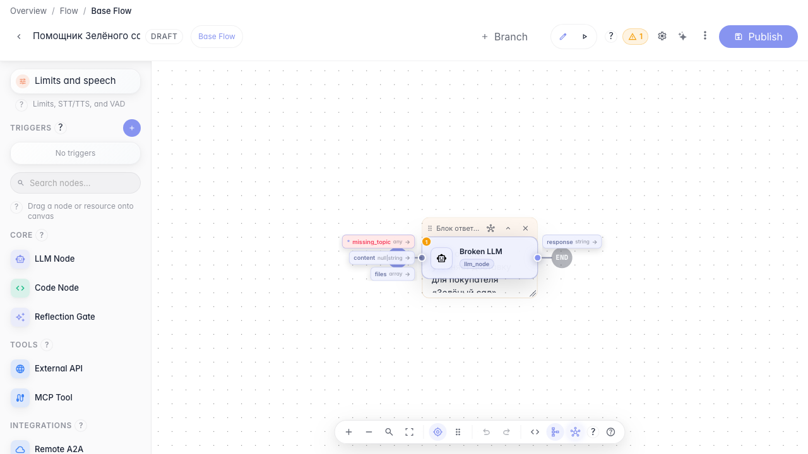
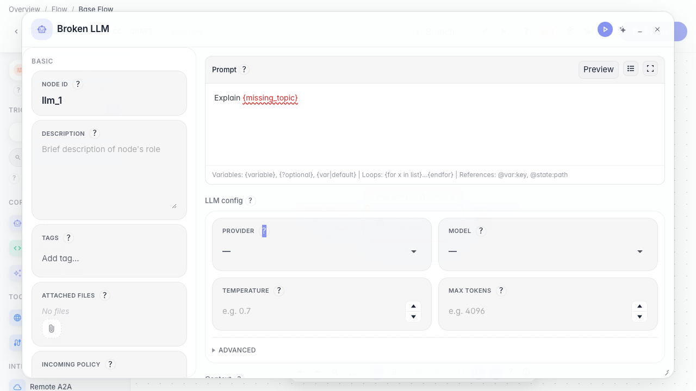
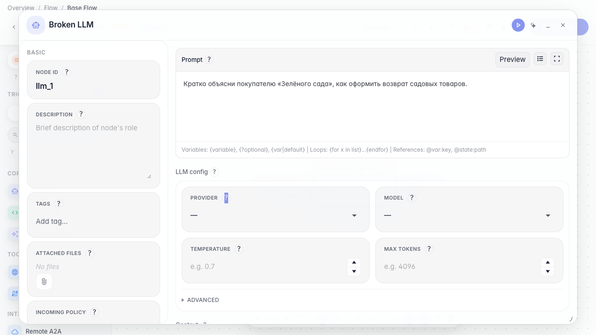
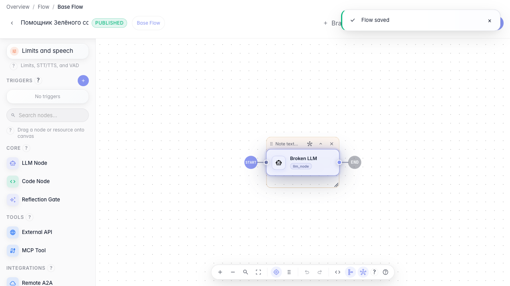

# Наводим порядок в большом графе

**Для чего:** эта инструкция поможет держать сложного агента «Зелёного сада» понятным и быстро находить ошибки в связях данных.

**Какие проблемы решает:** граф разрастается, теряются связи между блоками и появляются предупреждения о нехватке данных.

**Результат:** граф аккуратно размечен заметками, проблемная связь найдена и исправлена — список предупреждений пуст.

## Шаг 1. Подгоните масштаб канвы

На нижней панели нажмите «Подогнать вид», чтобы все блоки «Помощника Зелёного сада» поместились на экране. Так проще ориентироваться в большом графе.

## Шаг 2. Добавьте поясняющую заметку

Добавьте заметку рядом с блоком ответа и кратко опишите его роль — например, что здесь уточняется доставка. Заметки помогают коллегам понимать большой граф без лишних вопросов.

## Шаг 3. Включите показ связей данных

На нижней панели включите отображение связей данных — пункт со значком цепочки. Так видно, какие переменные передаются между блоками, а где связь ещё не проведена.

## Шаг 4. Откройте блок LLM с неизвестной переменной

Откройте LLM-блок с промптом, где используется переменная missing_topic. При включённых связях данных такие блоки подсвечиваются как проблемные.

## Шаг 5. Исправьте инструкцию проблемного блока

Замените промпт с неизвестной переменной на понятную инструкцию без фигурных скобок, которую агент сможет выполнить.

## Шаг 6. Опубликуйте и убедитесь, что предупреждений нет

**Демонстрация результата.** Опубликуйте черновик — промпт больше не ссылается на несуществующую переменную.

**Итог.** Теперь вы умеете размечать граф заметками, включать связи данных и исправлять проблемные блоки «Зелёный сад».

