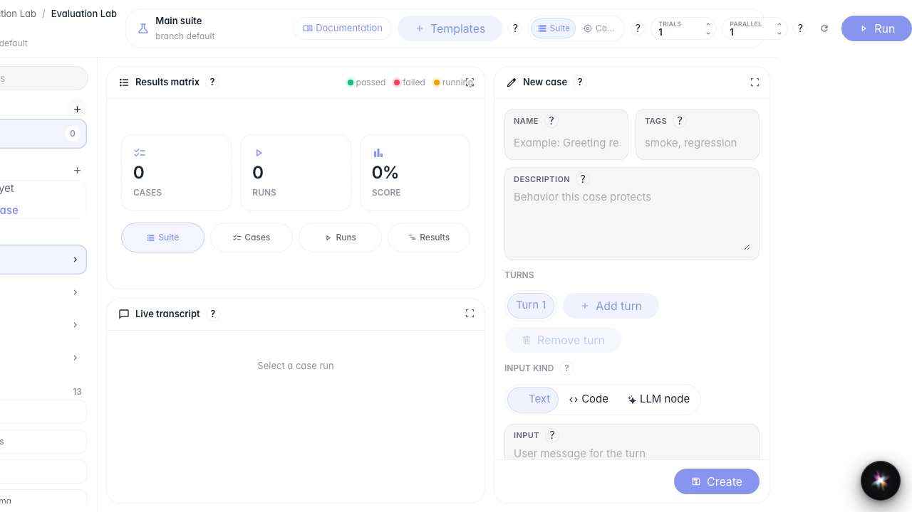
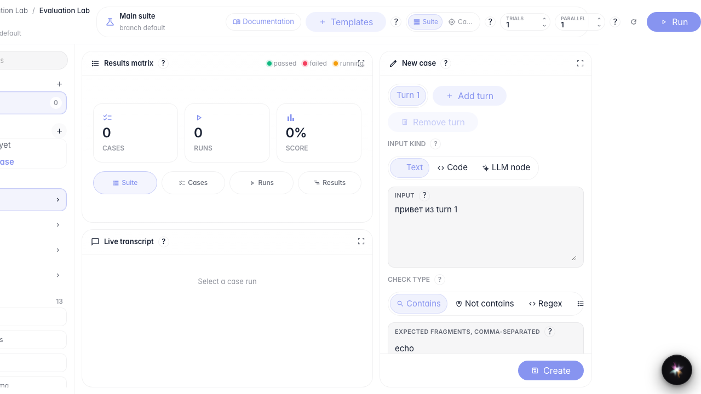
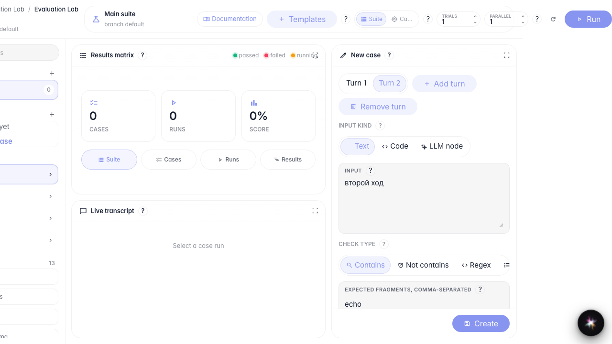
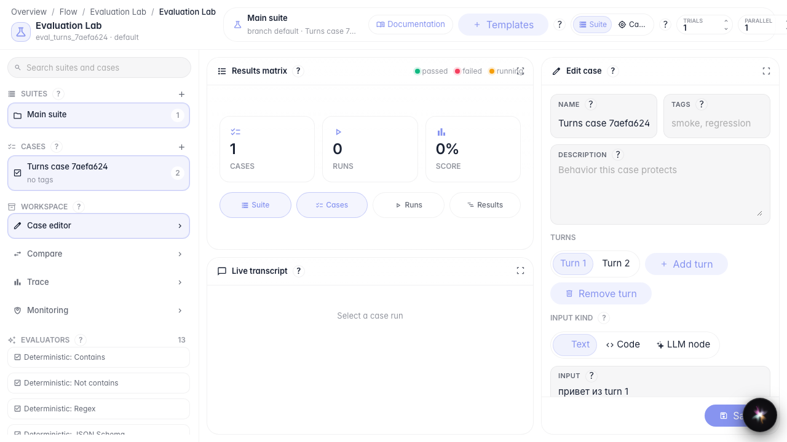

# Build a multi-turn evaluation case

**What for:** this guide helps you build a test case with several turns and different input kinds.

**Problems it solves:** it is unclear how to add a second dialog turn and switch input from text to code or an LLM node.

**Result:** the case is saved with two turns and survives reload.

## Step 1. Open Evaluation Lab and create a suite

Open Evaluation Lab for the agent and click + next to Suites. A suite keeps related cases in one place.

## Step 2. Create the first turn with text input

Click Create case, set a name, and keep the Text input kind. Enter the user message and the expected response fragment.

## Step 3. Add a second turn and switch input kinds

Click Add turn. Switch input kind: Text → Code → LLM node → Text again. You will see all three input modes; keep text for the saved case.

## Step 4. Save the case and verify after reload

**Result demonstration.** After save and reload the case opens again with two turns — the structure is persisted.

**Summary.** You can build a multi-turn case and switch input kinds.

