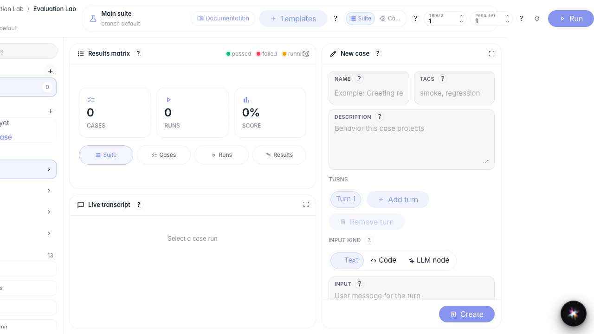
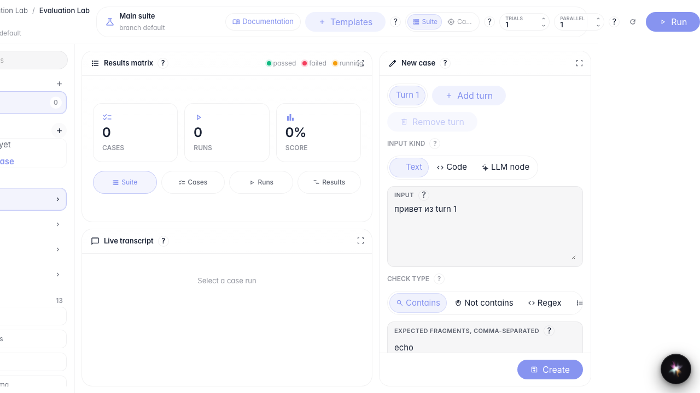
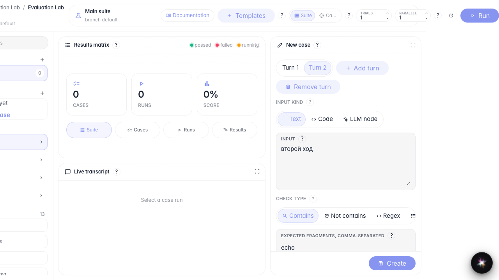
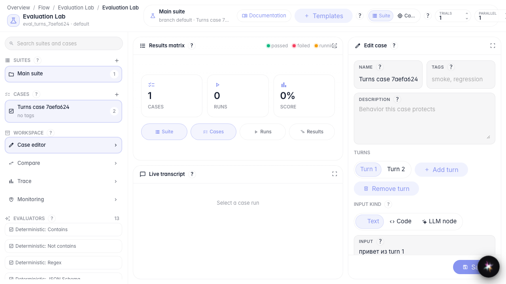

# Собираем кейс из нескольких turns

**Для чего:** эта инструкция поможет собрать тест-кейс с несколькими turns и разными типами входа.

**Какие проблемы решает:** непонятно, как добавить второй ход диалога и переключить вход с текста на код или LLM-ноду.

**Результат:** кейс сохранён с двумя turns, после перезагрузки данные на месте.

## Шаг 1. Откройте Evaluation Lab и создайте набор

Откройте Evaluation Lab у агента и нажмите «+» у Suites. Набор нужен, чтобы хранить связанные кейсы в одном месте.

## Шаг 2. Создайте первый turn с текстовым входом

Нажмите «Создать case», задайте название и оставьте тип входа «Текст». Введите сообщение пользователя и ожидаемый фрагмент ответа.

## Шаг 3. Добавьте второй turn и переключите типы входа

Нажмите «Добавить turn». Переключите тип входа: Текст → Код → LLM node → снова Текст. Так вы увидите три режима ввода; для сохранения оставьте текст.

## Шаг 4. Сохраните кейс и проверьте после перезагрузки

**Демонстрация результата.** После сохранения и перезагрузки страницы кейс снова открывается с двумя turns — значит, структура сохранена.

**Итог.** Теперь вы умеете собирать multi-turn кейс и переключать типы входа.

