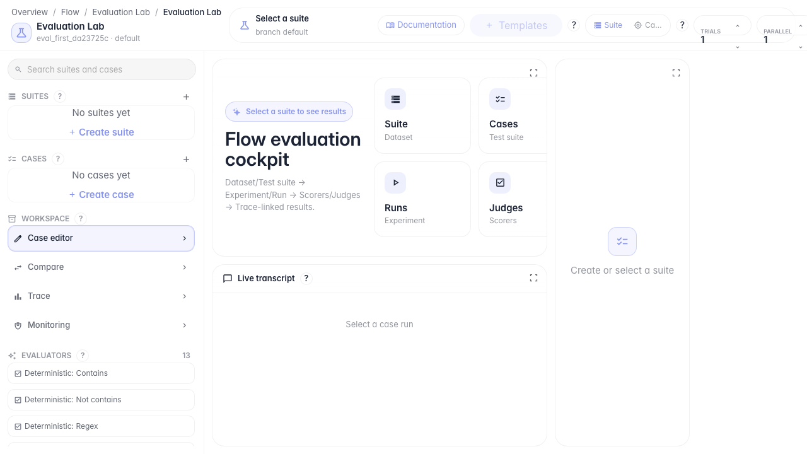
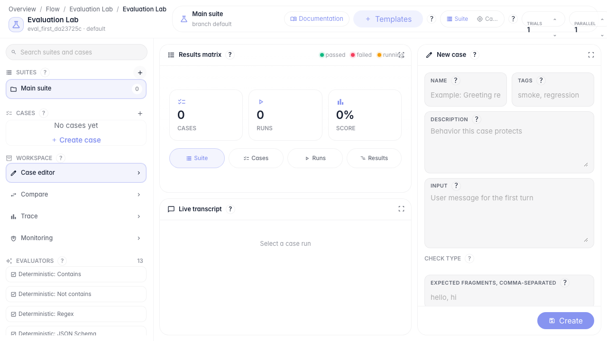
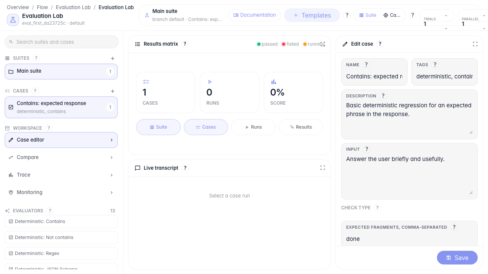
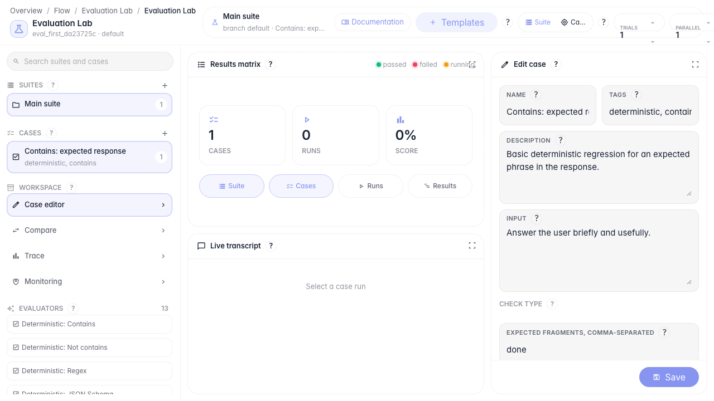

# First agent quality test

**What for:** this guide helps you create the first check suite and test case for an agent.

**Problems it solves:** it is unclear how to start controlling answer quality and which template to pick.

**Result:** the first test case is saved in a new Evaluation Lab suite.

## Step 1. Open Evaluation Lab

In the editor menu, choose Evaluation Lab. Suites and cases are on the left, the results matrix is in the center, and the case editor is on the right.

## Step 2. Create a test suite

Click + in the Suites block. A new suite appears — a container for related checks of one agent.

## Step 3. Add a case from a template

Click Templates and choose the response-contains-fragment check. The template instantly creates a case with a ready check type.

## Step 4. Verify the saved case

**Result demonstration.** The new case appears in the Cases list — your first quality check is created and ready to run.

**Summary.** You can now open Evaluation Lab, create a suite, and add the first test from a template.

