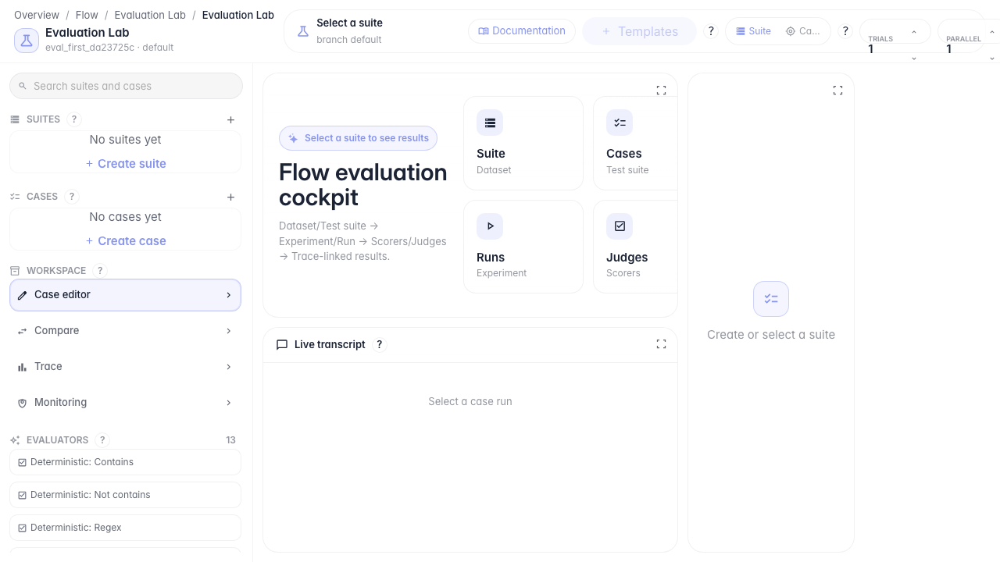
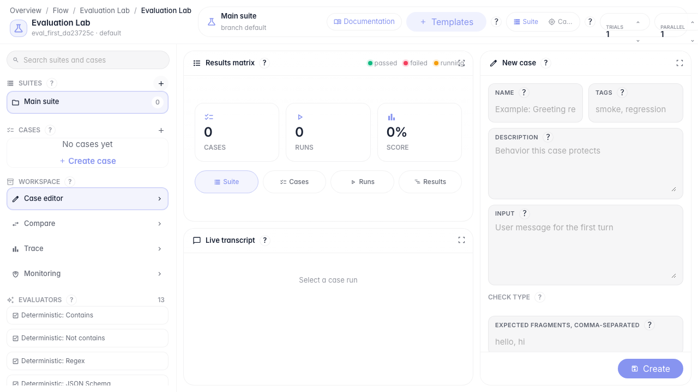
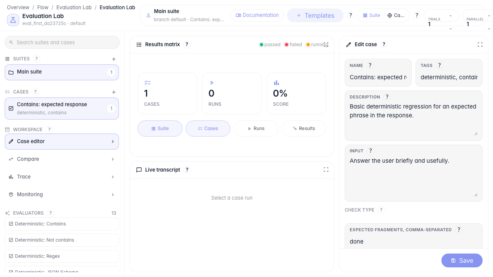
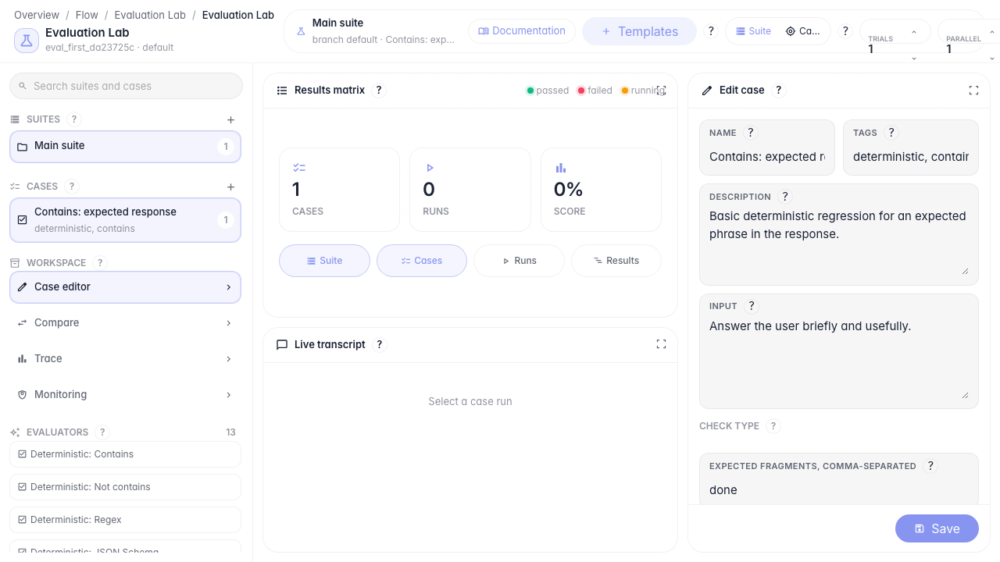

# Первый тест качества агента

**Для чего:** эта инструкция поможет создать первый набор проверок и тест-кейс для агента.

**Какие проблемы решает:** непонятно, с чего начать контроль качества ответов и какой шаблон выбрать.

**Результат:** в Evaluation Lab сохранён первый тест-кейс в новом наборе.

## Шаг 1. Откройте Evaluation Lab

В меню редактора выберите Evaluation Lab. Слева — наборы и кейсы, в центре матрица результатов, справа — редактор проверки.

## Шаг 2. Создайте набор тестов

Нажмите «+» в блоке Suites. Появится новый набор — контейнер для связанных проверок одного агента.

## Шаг 3. Добавьте кейс из шаблона

Нажмите «Шаблоны» и выберите проверку «ответ содержит фрагмент». Шаблон сразу создаст кейс с готовым типом проверки.

## Шаг 4. Проверьте сохранённый кейс

**Демонстрация результата.** Новый кейс виден в списке Cases — значит, первая проверка качества создана и готова к запуску.

**Итог.** Теперь вы умеете открыть Evaluation Lab, создать набор и добавить первый тест из шаблона.

