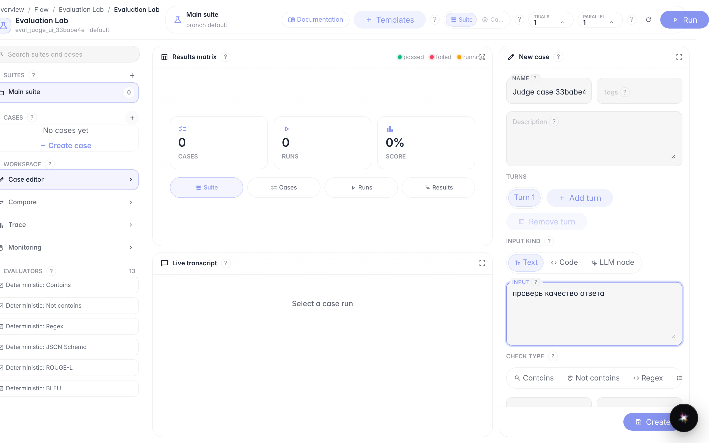
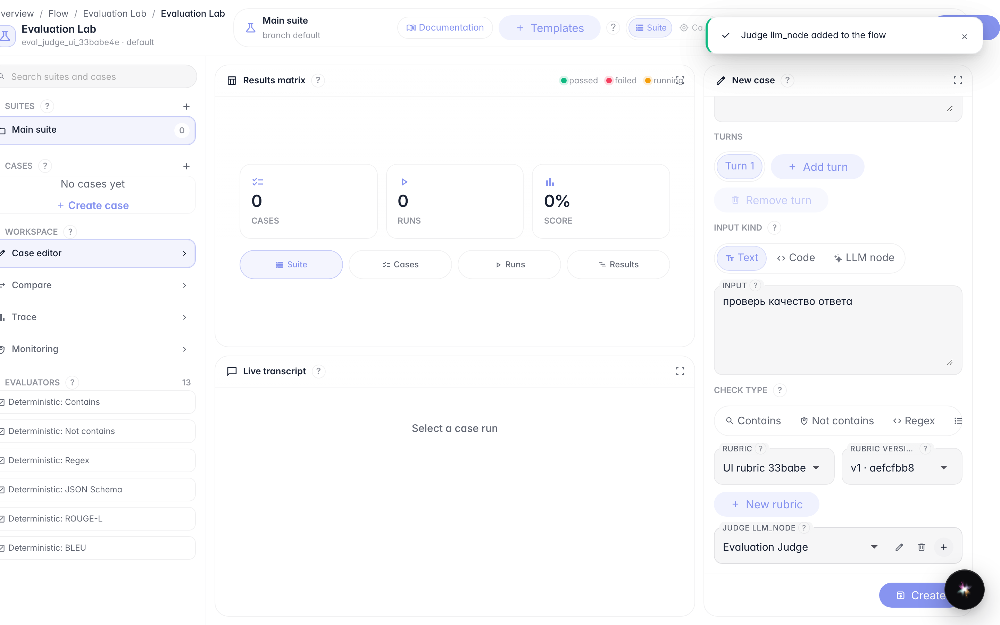
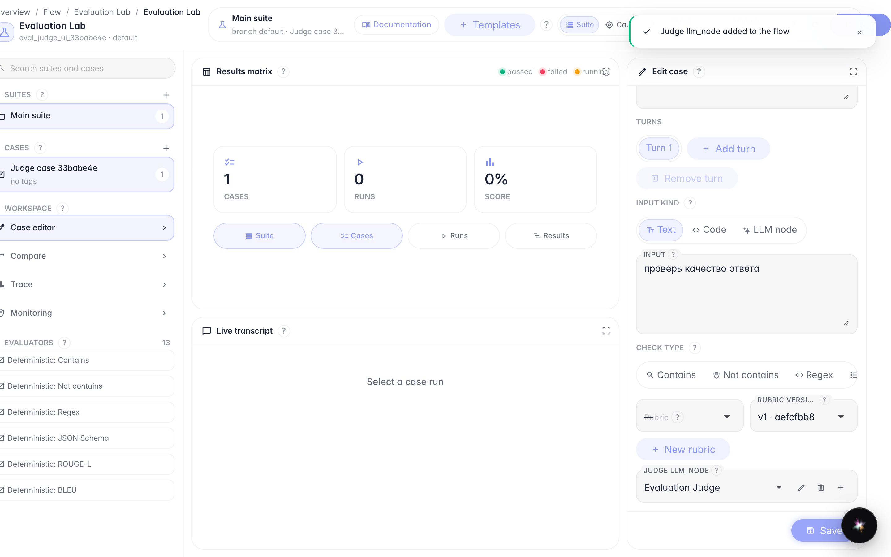
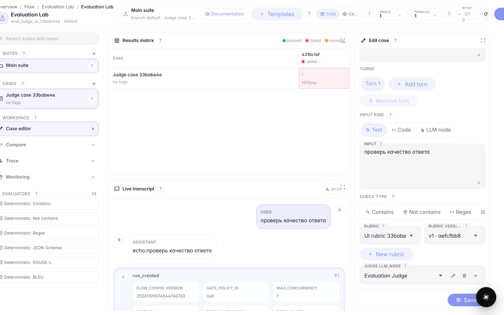

# Score an answer with an LLM judge

**What for:** this guide helps you create a rubric, a judge node, and run a case with LLM judge scoring.

**Problems it solves:** it is unclear where criteria live and how to see the score after a run.

**Result:** an LLM judge case is saved (ids only) and the run shows a score.

## Step 1. Create a case and select LLM judge

Create a blank case, set a name and text input. In check type choose LLM judge — rubric and judge node fields appear.

## Step 2. Create a rubric and judge node in the flow

Click New rubric, fill name, threshold and criteria prompt, then Create rubric. Next click Create judge node — the node is stored in the agent FlowConfig.

## Step 3. Save the case and confirm only ids are stored

Click Create. The case appears in the list: the check stores judge_node_id and rubric_version_id, while the judge body lives in the flow.

## Step 4. Run the case and inspect the score

**Result demonstration.** After Run the results matrix shows a score and the transcript shows judge feedback.

**Summary.** You can create a rubric with a judge node and run an LLM judge until the score is visible.

