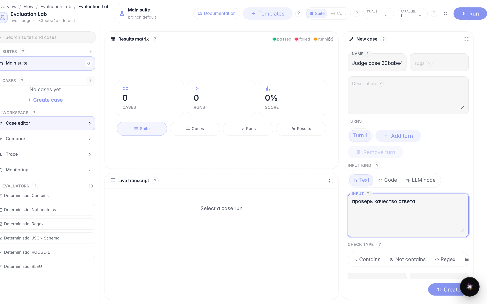
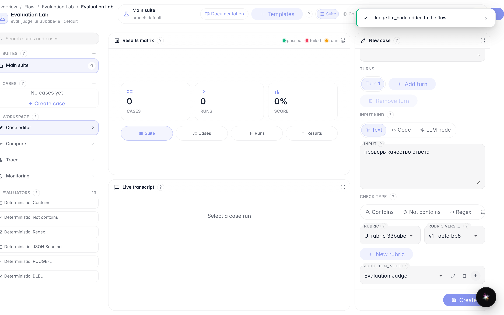
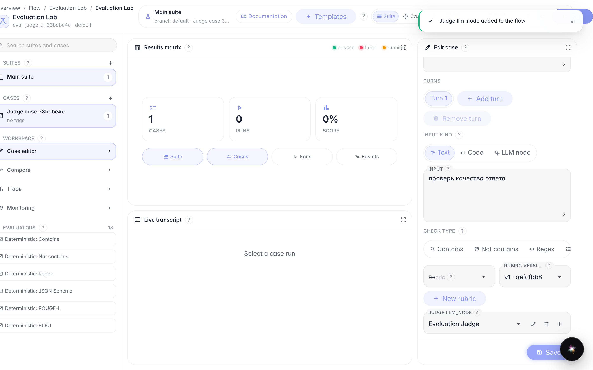
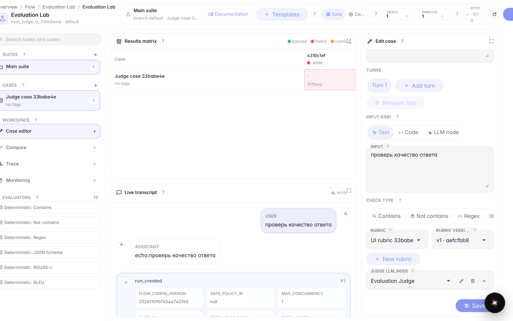

# Оцениваем ответ судьёй LLM

**Для чего:** эта инструкция поможет создать рубрику, judge-ноду и прогнать кейс с оценкой LLM judge.

**Какие проблемы решает:** непонятно, где хранить критерии оценки и как увидеть score после запуска.

**Результат:** кейс с LLM judge сохранён (только id), прогон показывает score.

## Шаг 1. Создайте кейс и выберите проверку LLM judge

Создайте пустой case, задайте название и текстовый вход. В типе проверки выберите «LLM judge» — появятся поля рубрики и judge-ноды.

## Шаг 2. Создайте рубрику и judge-ноду в flow

Нажмите «Новая рубрика», заполните название, threshold и промпт критериев, затем «Создать рубрику». После этого нажмите «Создать judge node» — нода появится в FlowConfig агента.

## Шаг 3. Сохраните кейс и убедитесь, что хранятся только id

Нажмите «Создать». Кейс появляется в списке: в API у проверки есть judge_node_id и rubric_version_id, а тело judge-ноды лежит в flow.

## Шаг 4. Запустите кейс и посмотрите score

**Демонстрация результата.** После «Запустить» в матрице результатов виден score, а в transcript — feedback судьи.

**Итог.** Теперь вы умеете создать рубрику с judge-нодой и прогнать LLM judge до видимой оценки.

