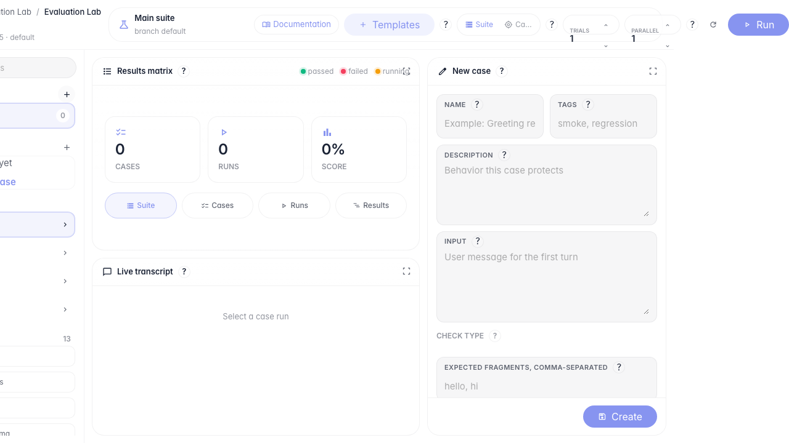
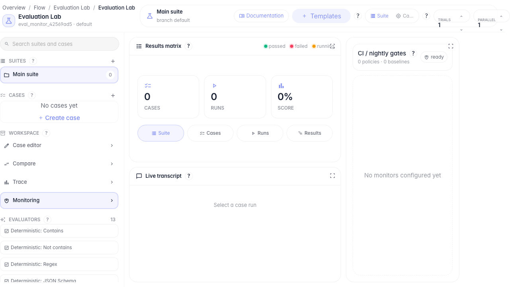
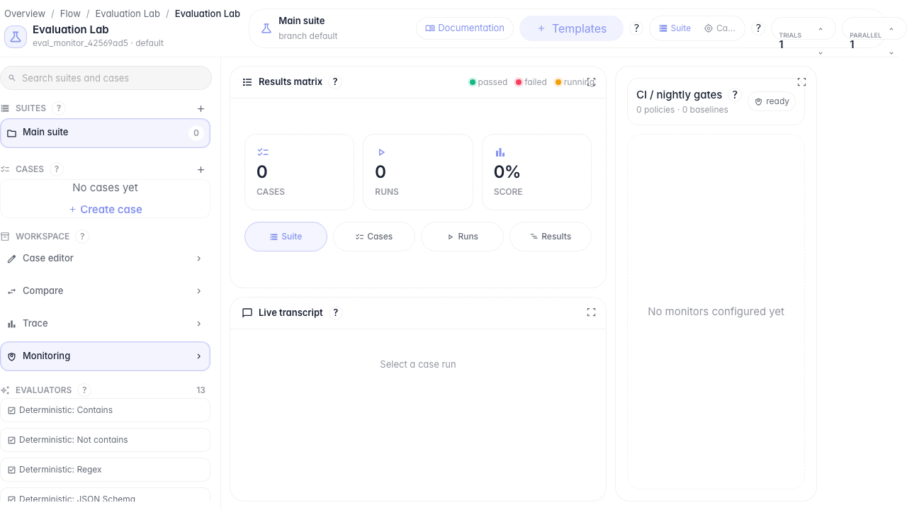

# Monitor quality in production

**What for:** this guide shows where to review quality monitoring and gate policies.

**Problems it solves:** after launching an agent, it is unclear how to track answer degradation on real conversations.

**Result:** the monitoring panel with baselines and gate policies is open.

## Step 1. Open Evaluation Lab

Evaluation Lab is the single place for manual checks and in-production quality monitoring.

## Step 2. Open the monitoring panel

In the Workspace block, choose Monitoring. Gate policies, baselines, and online monitors for quality observation are collected here.

## Step 3. Check monitoring status

**Result demonstration.** The panel shows baselines and monitoring status — the quality observation layer is ready to configure.

**Summary.** You now know where to open quality monitoring and what to look for before configuring gate policies.

