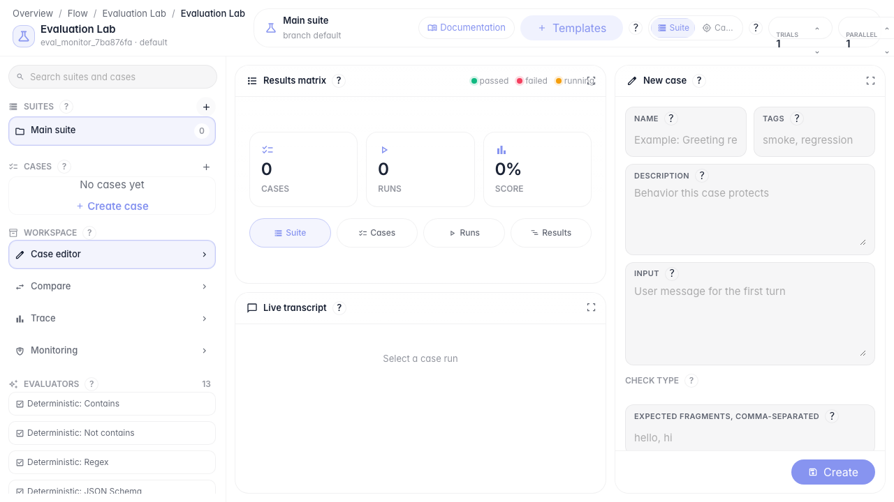
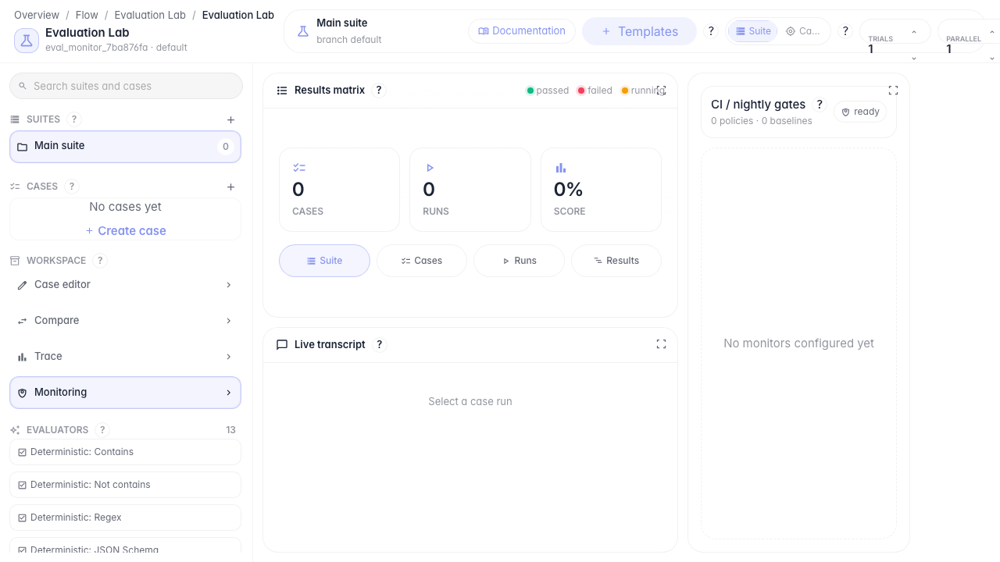

# Следим за качеством в работе

**Для чего:** эта инструкция покажет, где смотреть мониторинг качества и контрольные пороги.

**Какие проблемы решает:** после запуска агента непонятно, как отслеживать деградацию ответов на реальных диалогах.

**Результат:** открыта панель мониторинга с baselines и gate policies.

## Шаг 1. Откройте Evaluation Lab

Evaluation Lab — единое место и для ручных проверок, и для мониторинга качества в работе.

## Шаг 2. Откройте панель мониторинга

В блоке Workspace выберите Monitoring. Здесь собраны gate policies, baselines и online monitors для наблюдения за качеством.

## Шаг 3. Найдите блок gate policies

На панели найдите раздел gate policies и baselines. Здесь задаются пороги качества, при нарушении которых система сигнализирует о деградации.

## Шаг 4. Проверьте статус мониторинга

**Демонстрация результата.** На панели видны baselines и статус мониторинга — значит, контур наблюдения за качеством доступен для настройки.

**Итог.** Теперь вы знаете, где открыть мониторинг качества и что искать перед настройкой gate policies.

