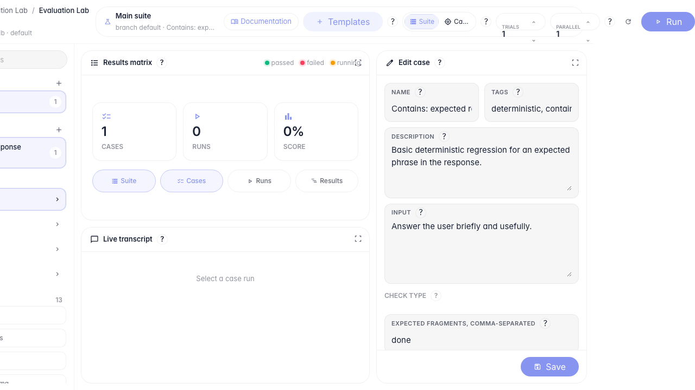
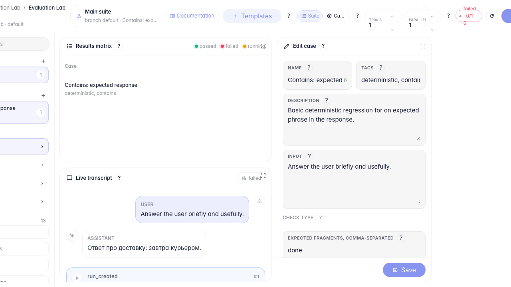
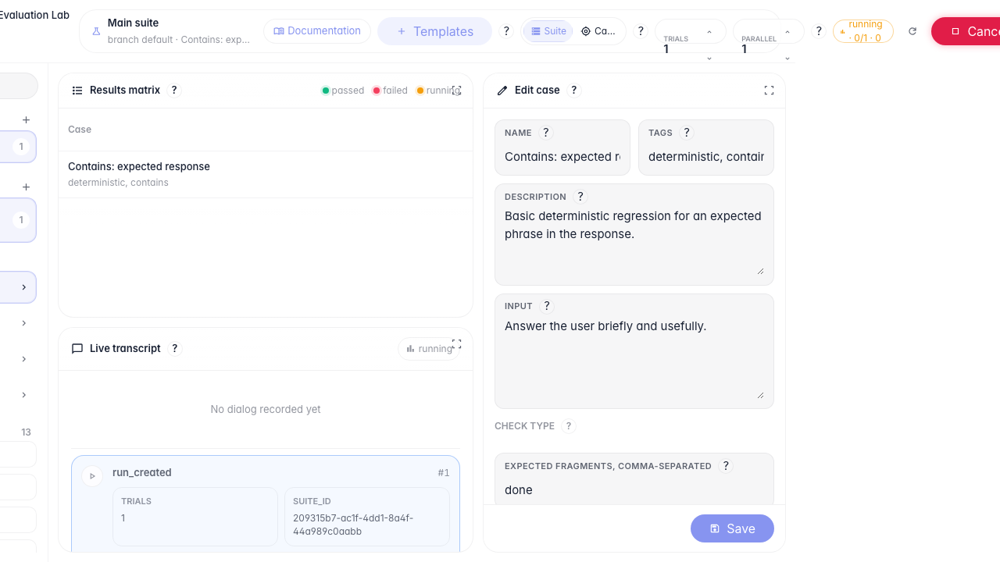

# Run tests and compare versions

**What for:** this guide helps you run checks and compare two execution runs.

**Problems it solves:** after changing an agent, it is unclear whether quality improved and how to set a baseline.

**Result:** two runs completed, comparison opened, baseline selected.

## Step 1. Prepare a suite with a case

Create a suite and add a case from a template. Before running, make sure the right suite and case are selected.

## Step 2. Run the first evaluation

Click Run. Evaluation Lab submits the check in the background and shows status in the top toolbar and results matrix.

## Step 3. Run a second evaluation for comparison

Run again with the same case. The matrix shows two runs — you can compare them and pick a baseline.

