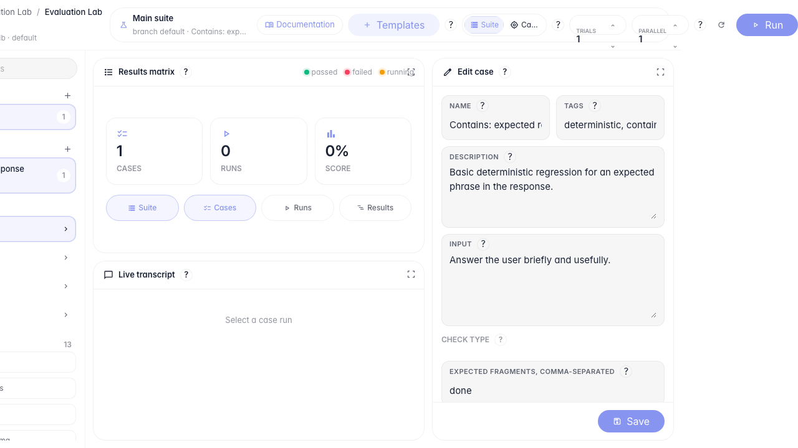
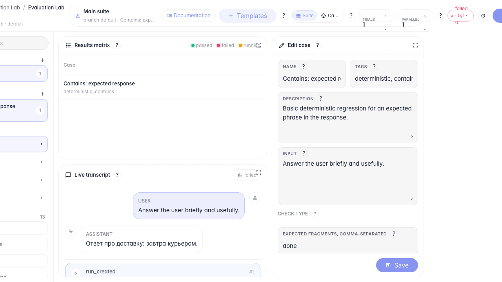
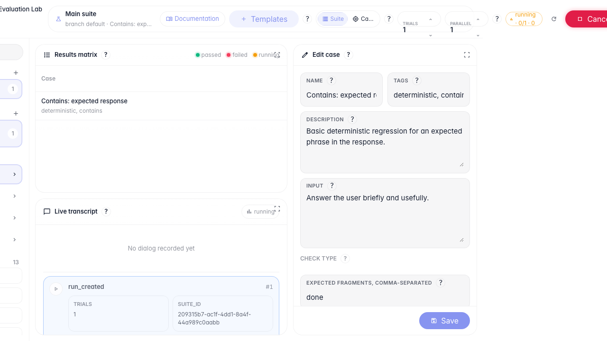

# Запускаем тесты и сравниваем версии

**Для чего:** эта инструкция поможет прогнать проверки и сравнить два запуска.

**Какие проблемы решает:** после изменения агента неясно, улучшилось ли качество и как зафиксировать эталон.

**Результат:** два прогона выполнены, сравнение открыто, baseline выбран.

## Шаг 1. Подготовьте набор с кейсом

Создайте набор и добавьте кейс из шаблона. Перед запуском убедитесь, что выбран нужный suite и case.

## Шаг 2. Запустите первый прогон

Нажмите «Запустить». Evaluation Lab отправит проверку в фон и покажет статус в верхней панели и матрице результатов.

## Шаг 3. Запустите второй прогон для сравнения

Повторите запуск с тем же кейсом. В матрице появятся два прогона — их можно сравнить и выбрать эталон.

