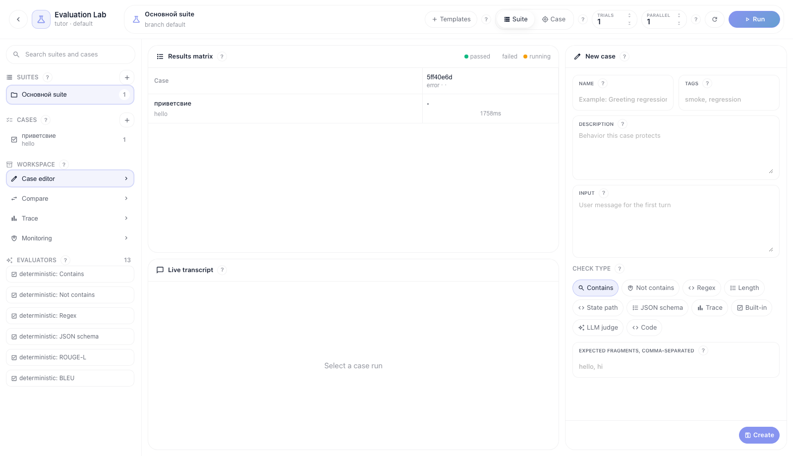
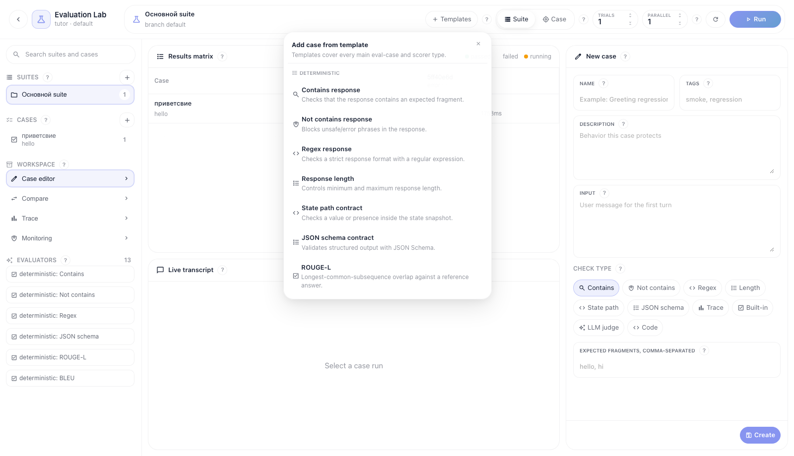
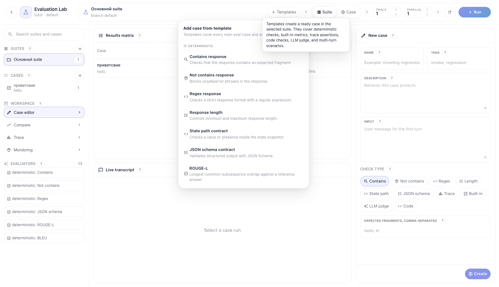

# Evaluation Lab: create and edit test cases

Evaluation Lab is a full-screen workspace for validating flows. The basic cycle is: choose a suite, add a case from a template or manually, run the suite or case, open the result in the matrix, inspect the live transcript and trace, then compare the run with a baseline.

All screenshots below were captured in the light theme.

## Step 1. Open Evaluation Lab

Open a flow and go to a route like `/flows/<flow_id>/evaluation/<branch_id>`. The back button on the left returns to the flow editor. The center always shows the Results matrix and Live transcript; the active workspace panel opens on the right.

What matters on this screen:

- **Suites** — groups of test cases for the flow.
- **Cases** — individual validation scenarios.
- **Templates** — a fast way to create a case from a proven pattern.
- **Suite / Case** — run scope: the whole suite or only the selected case.
- **Trials** — how many times to repeat one case for non-deterministic agents.
- **Parallel** — concurrency of case runs inside a durable TaskIQ job.

## Step 2. Create a case from a template

Click **Templates** in the header. The menu is grouped by check types: deterministic, quality/LLM, safety, tracing, and advanced. Templates cover the main backend check types: `contains`, `not_contains`, `regex`, `length`, `state_path`, `json_schema`, `trace_assertion` (`tool_called`, `node_completed`, `node_failed`), `builtin_metric`, `llm_judge`, `code`, and multi-turn dialog.

Recommended order:

1. For the first smoke test choose **Smoke regression set**.
2. For tool-use validation choose **Tool call in trace**.
3. For RAG/knowledge answers choose **Groundedness** or **Answer relevance**.
4. For safety regression choose **Safety** or **Toxicity**.
5. For strict structured output choose **JSON Schema contract**.

After you pick a template, the case is created in the selected suite and opens in the Case editor.

## Step 3. Create or edit a case manually

If you need a manual case, click `+` next to **Cases**. In the Case editor fill in the name, tags, description, and input. Then choose a check type.

Check type purpose:

- **Contains** — the answer must include one of the expected fragments.
- **Not contains** — the answer must not include forbidden phrases.
- **Regex** — the answer must match a strict regular expression.
- **Length** — the answer must fit min/max length.
- **State path** — the state snapshot must contain the required field or value.
- **JSON schema** — structured output in state must pass JSON Schema.
- **Trace** — workflow history must contain a tool call or a completed node.
- **Built-in** — ready evaluator metrics: ROUGE-L, BLEU, toxicity, safety, groundedness, answer relevance, tool accuracy.
- **LLM judge** — scoring by a versioned rubric through structured output.
- **Code** — isolated code scorer through the runner.

Saving updates the case in the selected suite. For multi-turn templates the editor changes the first turn but keeps the following turns so the scenario does not break when you edit the first message.

## Step 4. Use inline hints

Key areas have `?` hints. They explain what a section does, what data a field expects, and how it maps to the backend evaluation contract.

Hints are available for:

- Templates;
- run scope and run options;
- Suites, Cases, Workspace, Evaluators;
- Case editor and field labels;
- Results matrix;
- Live transcript;
- Compare;
- Trace;
- Monitoring.

## Step 5. Run evaluation

Choose scope:

- **Suite** — runs all enabled cases in the selected suite.
- **Case** — runs only the selected case.

Set **Trials** and **Parallel**, then click **Run**. The run is sent to the backend as a durable TaskIQ job. The UI does not run evaluation synchronously and does not hold an HTTP request.

While it runs:

- Results matrix shows case-run state per cell.
- Live transcript shows the dialog and append-only run events.
- Trace panel opens when you click a matrix cell.

## Step 6. Compare with baseline

Open **Compare**, choose the left run and the current run. Click **Compare**. For a branch you can pin a baseline with **Set baseline**. To compare answer quality directly, use the human pairwise buttons or **LLM pairwise**.

## Step 7. Change an existing case

Select a case in the left list. The Case editor loads its first turn and check. Change input, tags, or check fields and click **Save**. After editing, run the suite or the selected case again to get a new run and compare it with the baseline.
