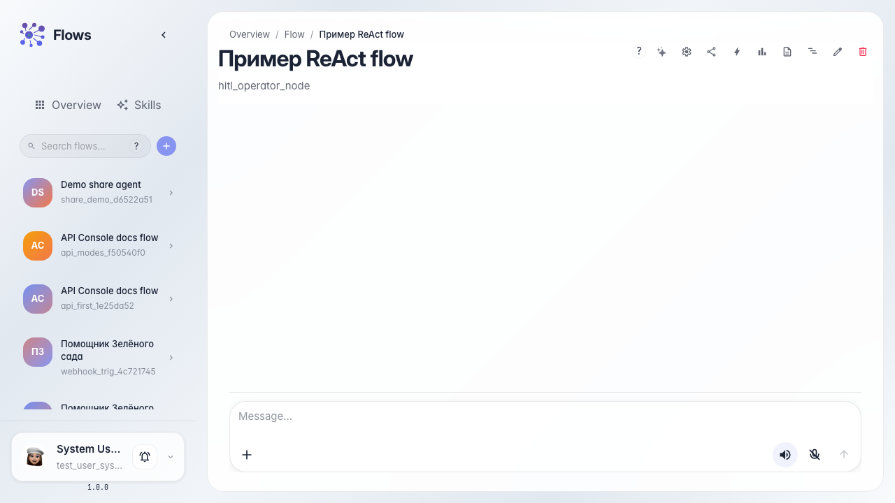
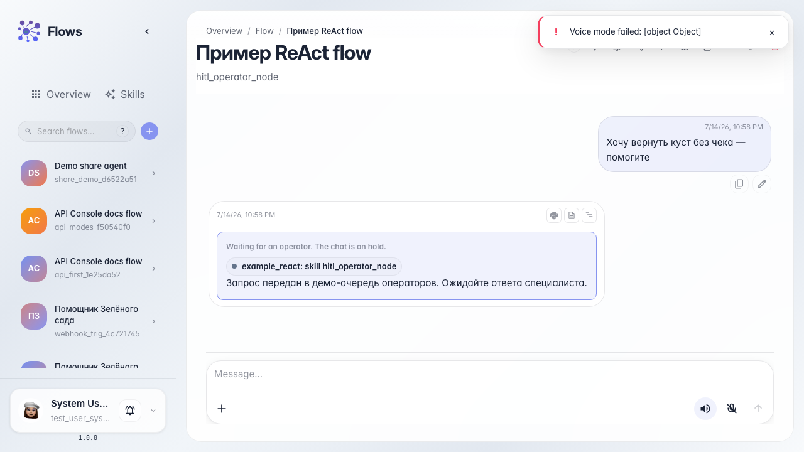

# What the customer sees while waiting for an operator

**What for:** this guide shows chat behavior from the customer's perspective when the agent handed the question to operator Marina.

**Problems it solves:** it is unclear whether the chat froze, whether you can keep typing, and how a human reply will arrive.

**Result:** the customer sees waiting state, a task badge, and the operator's answer in the chat feed.

## Step 1. Open the agent chat as a customer

Open the Green Garden Assistant chat in the demo branch with operator handoff. Here the customer asks questions the same way as in a real store.

## Step 2. Wait for operator handoff

Send a complex question. A waiting banner and task badge appear; the chat did not freeze but waits for a reply from the Customer Support queue.

## Step 3. Check the waiting message for the customer

Make sure the chat shows a clear waiting message — the customer understands the request was passed to a live specialist and the reply will appear here.

