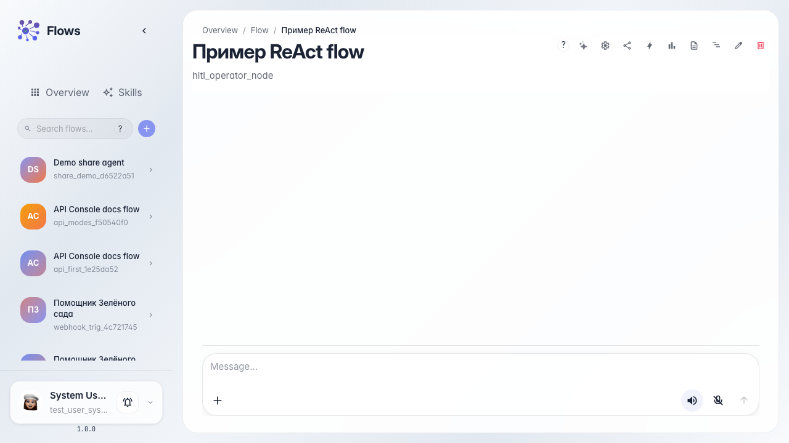
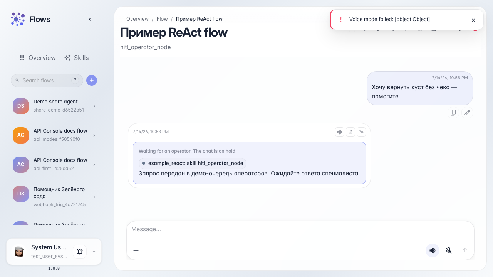

# Что видит покупатель, пока ждёт оператора

**Для чего:** эта инструкция покажет поведение чата глазами покупателя, когда агент передал вопрос оператору Марине.

**Какие проблемы решает:** непонятно, завис ли чат, можно ли писать дальше и как придёт ответ живого человека.

**Результат:** покупатель видит ожидание, карточку задачи и получает ответ оператора прямо в ленте чата.

## Шаг 1. Откройте чат агента как покупатель

Откройте чат «Помощника Зелёного сада» в демо-ветке с передачей оператору. Здесь покупатель задаёт вопросы так же, как в реальном магазине.

## Шаг 2. Дождитесь передачи оператору

Отправьте сложный вопрос. Появится плашка ожидания и значок задачи — чат не завис, а ждёт ответа из очереди «Поддержка клиентов».

## Шаг 3. Проверьте текст ожидания для покупателя

Убедитесь, что в чате виден понятный текст ожидания — покупатель понимает, что запрос передан живому специалисту и ответ придёт в эту же ленту.

