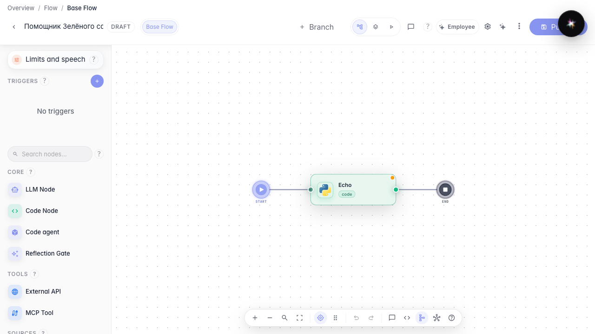
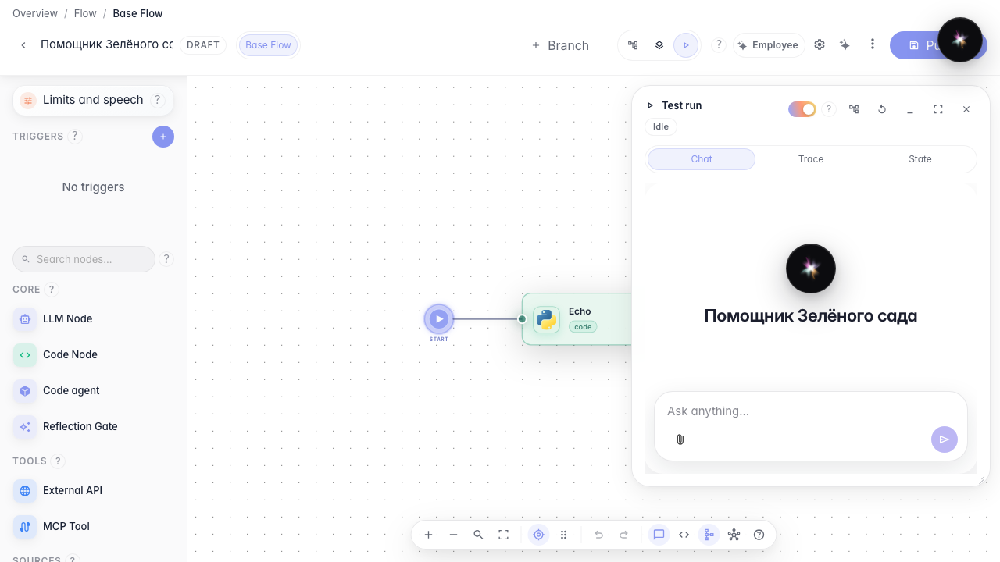

# Debug the agent step by step

**What for:** this guide helps you pause the agent at a specific step and see what happens inside.

**Problems it solves:** when a reply is wrong, it is unclear which graph step went off track.

**Result:** execution paused at a breakpoint and the agent finished the dialog after you continued.

## Step 1. Set a breakpoint on the block

In the Green Garden Assistant editor, enable a breakpoint on the answer block. On the next run, execution stops here so you can inspect the state.

## Step 2. Switch to run mode

Choose Run mode in the editor header. A chat panel opens on the right for a test dialog with breakpoints.

