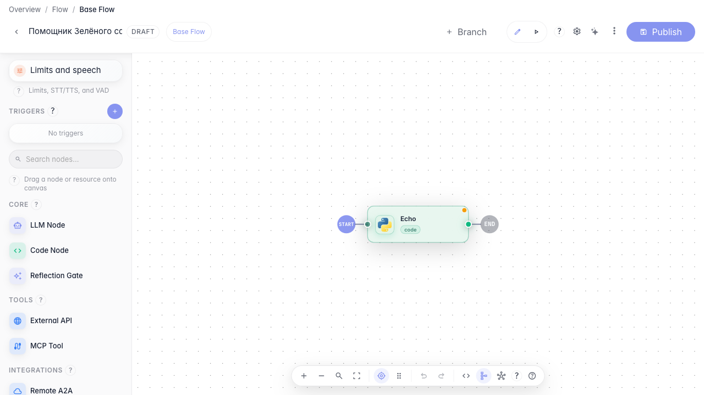
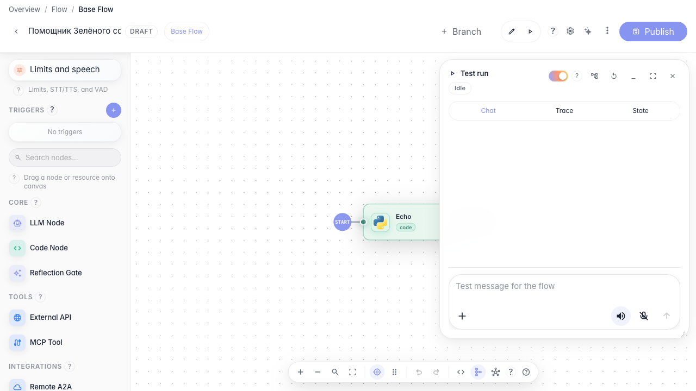
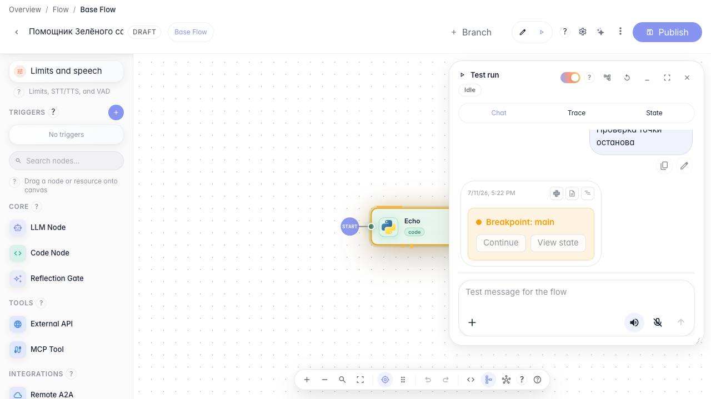
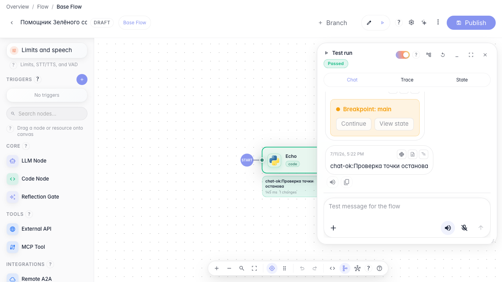

# Отлаживаем агента по шагам

**Для чего:** эта инструкция поможет остановить выполнение агента на нужном шаге и посмотреть, что происходит внутри.

**Какие проблемы решает:** при ошибке в ответе непонятно, на каком шаге граф пошёл не так.

**Результат:** выполнение остановилось на точке останова, после продолжения агент завершил диалог.

## Шаг 1. Поставьте точку останова на блоке

В редакторе «Помощника Зелёного сада» включите точку останова на блоке ответа. При следующем запуске выполнение остановится здесь, и вы сможете осмотреть состояние.

## Шаг 2. Переключитесь в режим запуска

Выберите режим «Запуск» в шапке редактора. Справа откроется панель чата для тестового диалога с точками останова.

## Шаг 3. Дождитесь остановки на точке останова

Отправьте тестовое сообщение. Выполнение остановится на блоке с точкой останова — на канве блок подсветится, а в чате появится кнопка «Продолжить».

## Шаг 4. Продолжите выполнение и проверьте ответ

**Демонстрация результата.** Нажмите «Продолжить» — агент завершит шаг и вернёт ответ в чате запуска. Значит вы контролируете выполнение пошагово.

**Итог.** Теперь вы умеете ставить точки останова и отлаживать агента «Зелёный сад» прямо в редакторе.

