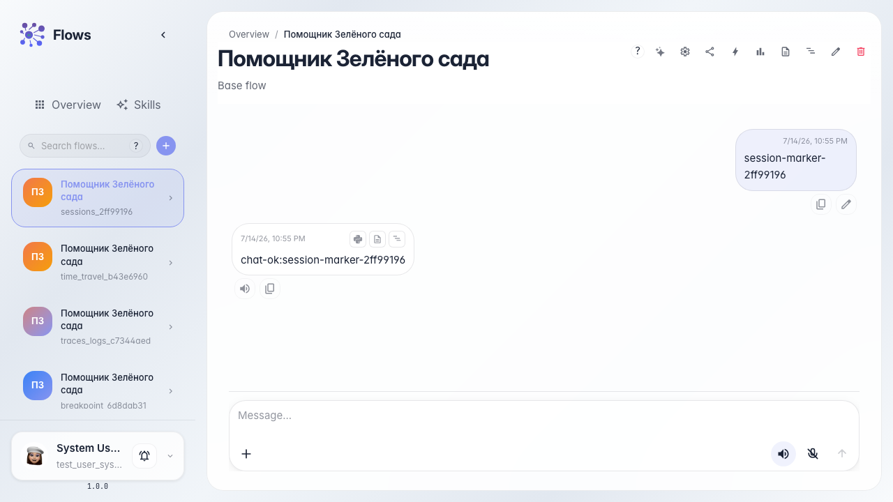
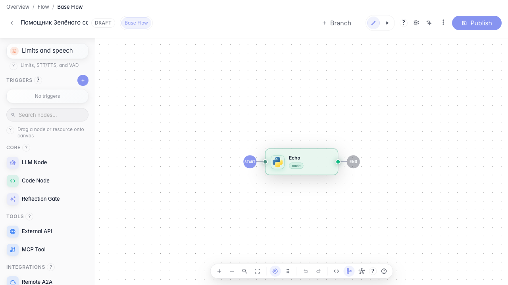
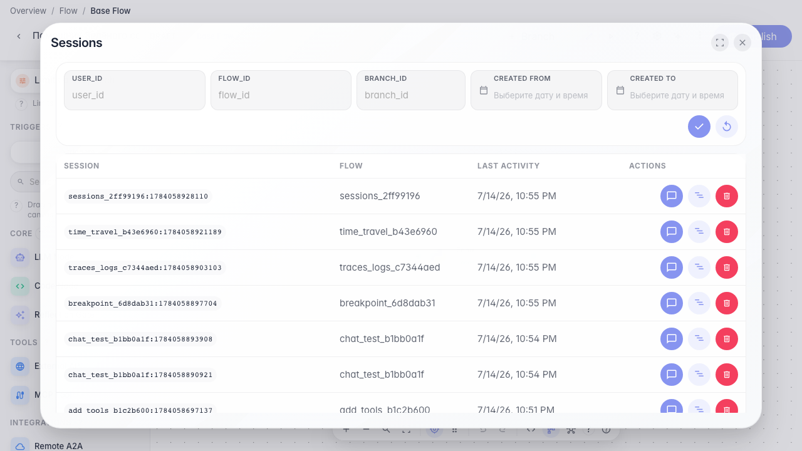
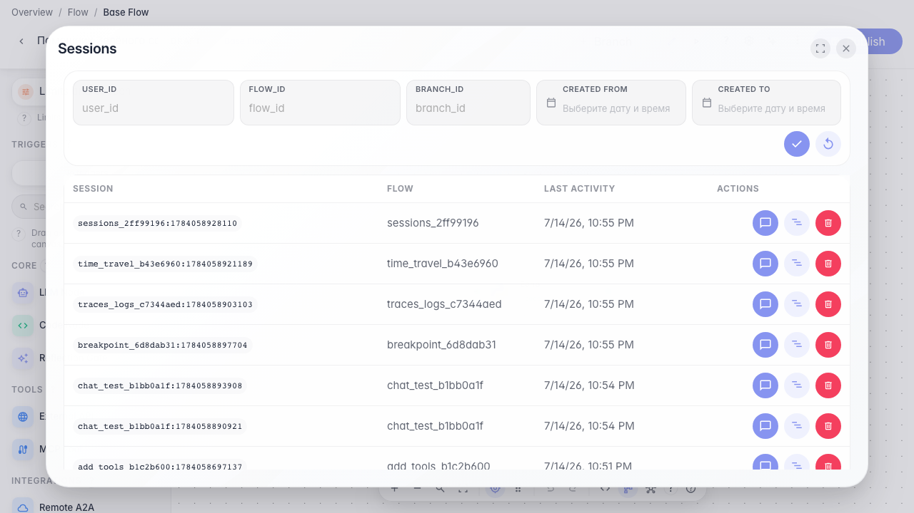

# Find and resume past sessions

**What for:** this guide helps you find a past customer dialog and return to it from the editor.

**Problems it solves:** after several test runs the needed conversation is lost and it is unclear where to look.

**Result:** the sessions list is open from the editor and shows a recent dialog.

## Step 1. Create a test dialog

Open the Green Garden Assistant chat and send a message. This creates a session you can later find in the past dialogs list.

## Step 2. Open the agent in the editor

Go to the same agent editor. The sessions list is available from the overflow menu in the header.

## Step 3. Open the sessions list

In the ⋯ menu choose Sessions. A table of past dialogs opens with last activity dates.

## Step 4. Find the recent dialog in the table

**Result demonstration.** The table has at least one row with recent activity — your test session was saved and you can reopen it.

**Summary.** You can now find past Green Garden dialogs and return to them from the editor.

