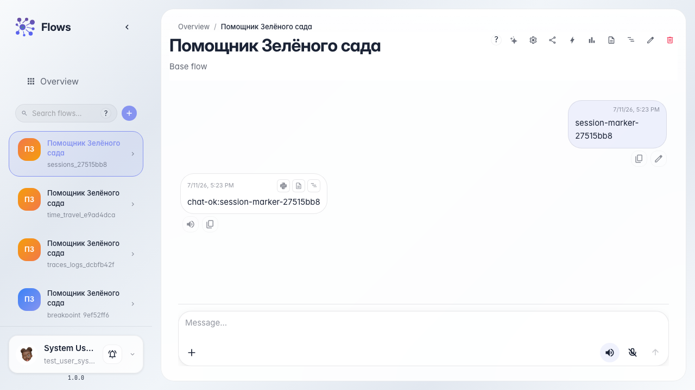
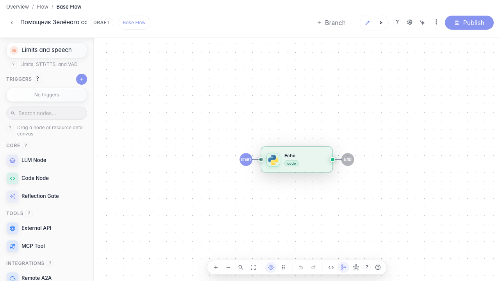
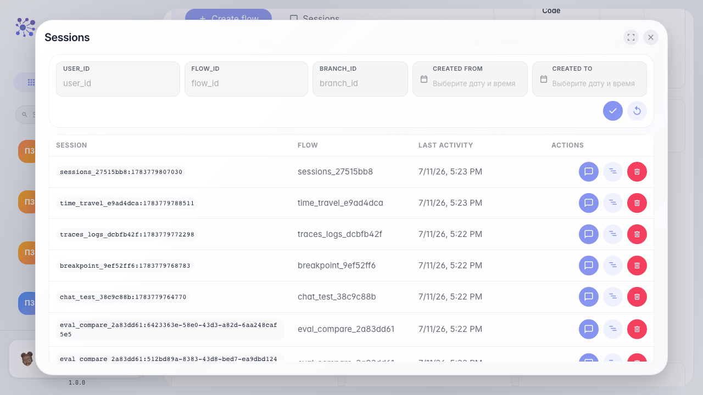

# Находим и продолжаем прошлые диалоги

**Для чего:** эта инструкция поможет найти прошлый диалог покупателя и вернуться к нему из редактора.

**Какие проблемы решает:** после нескольких тестовых запусков теряется нужная переписка, и непонятно, где её искать.

**Результат:** список сессий открыт из редактора, виден недавний диалог.

## Шаг 1. Создайте тестовый диалог

Откройте чат «Помощника Зелёного сада» и отправьте сообщение. Так появится сессия, которую потом можно найти в списке прошлых диалогов.

## Шаг 2. Откройте агента в редакторе

Перейдите в редактор того же агента. Список сессий доступен из меню дополнительных действий в шапке.

## Шаг 3. Откройте список сессий

**Демонстрация результата.** В меню «⋯» выберите «Сессии» — откроется таблица прошлых диалогов с датой последней активности. Недавний тестовый диалог виден в списке.

**Итог.** Теперь вы умеете находить прошлые диалоги «Зелёный сад» и возвращаться к ним из редактора.

