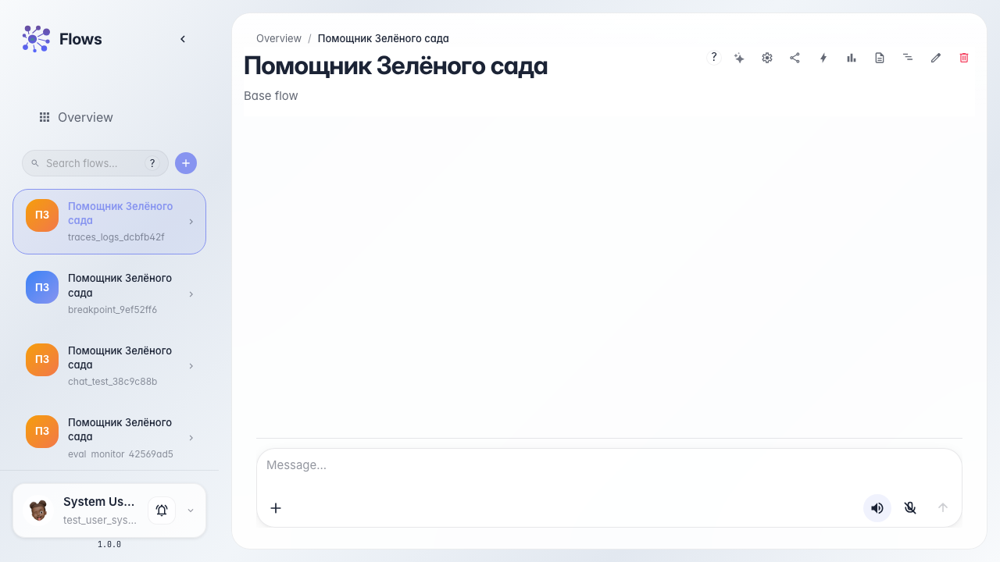
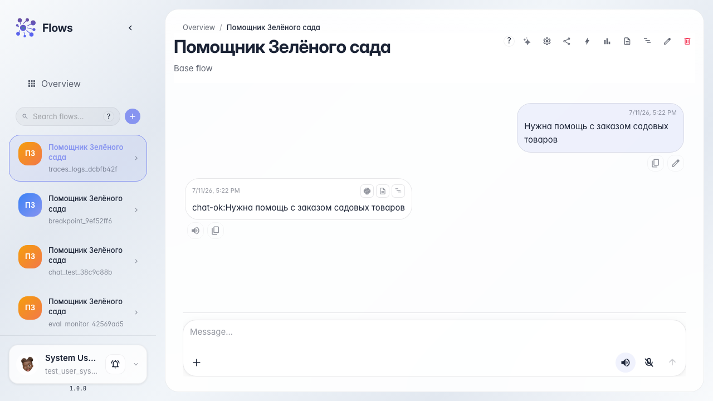
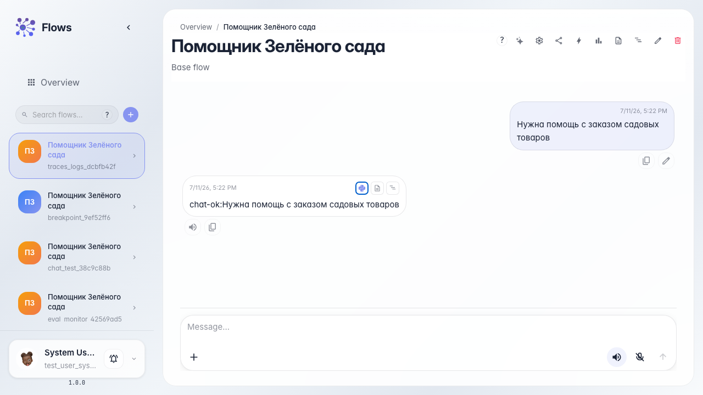

# Inspect traces and logs

**What for:** this guide helps you find why an agent reply was wrong after a run.

**Problems it solves:** after a dialog it is unclear which step went wrong and what the system logged.

**Result:** the trace and logs for the last Green Garden Assistant reply are open.

## Step 1. Open the agent chat

Open the Green Garden Assistant chat. After each reply, trace and log buttons are available under the message.

## Step 2. Run the dialog and wait for the reply

Send a customer question and wait for the reply. Each answer can be inspected with traces and logs.

## Step 3. Open the last reply trace

Under the agent reply, click the trace icon. A step tree opens showing which blocks ran and how long each step took.

