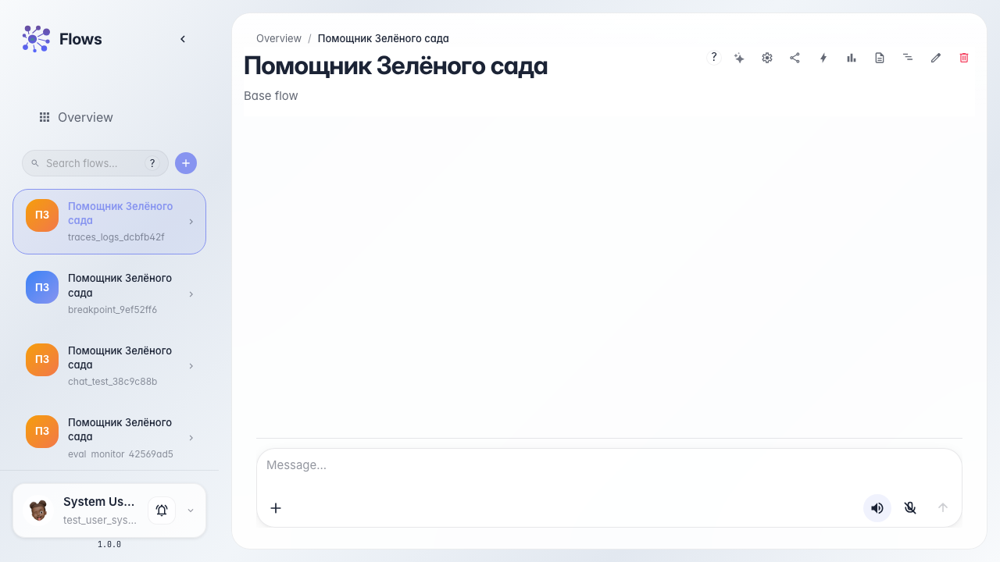
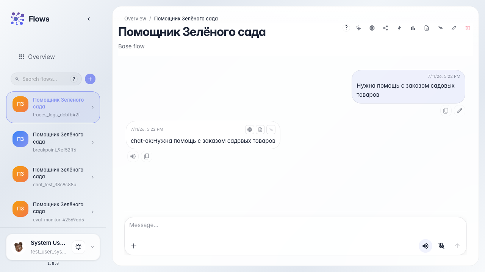
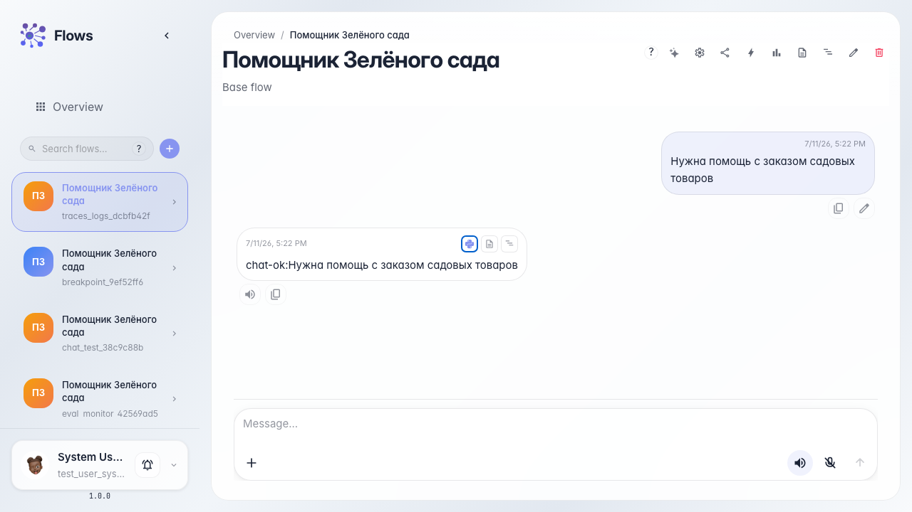

# Разбираем, что произошло: трейсы и логи

**Для чего:** эта инструкция поможет найти причину неверного ответа после прогона агента.

**Какие проблемы решает:** после диалога непонятно, на каком шаге ответ пошёл не так и что писала система в логах.

**Результат:** открыты трейс и логи последнего ответа «Помощника Зелёного сада».

## Шаг 1. Откройте чат агента

Перейдите в чат «Помощника Зелёного сада». После каждого ответа под сообщением доступны кнопки трейса и логов.

## Шаг 2. Запустите диалог и дождитесь ответа

Отправьте вопрос покупателя и дождитесь ответа. К каждому ответу можно открыть трейс и логи для разбора.

## Шаг 3. Откройте трейс последнего ответа

Под ответом агента нажмите значок трейса. Откроется дерево шагов выполнения — по нему видно, какие блоки отработали и сколько времени занял каждый шаг.

