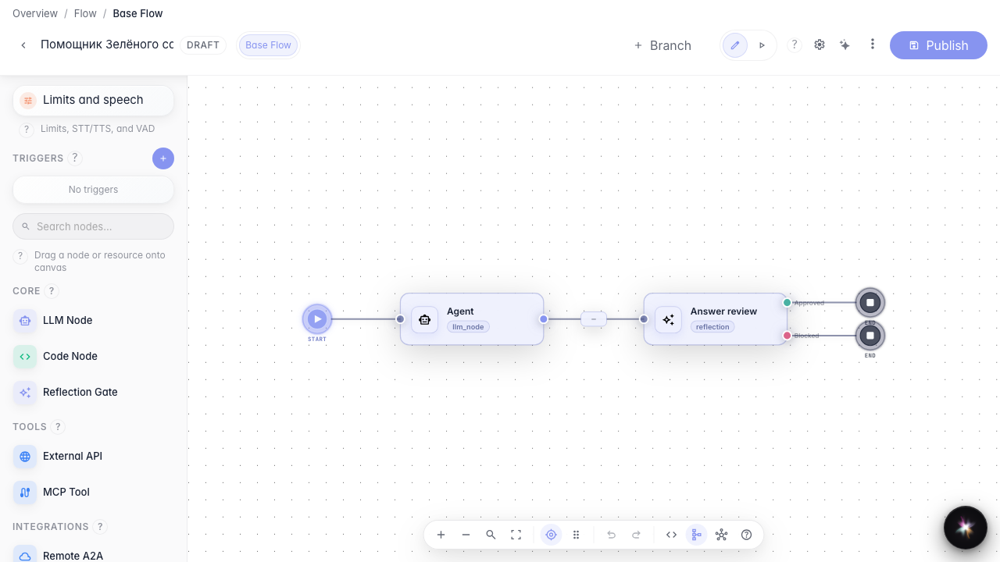
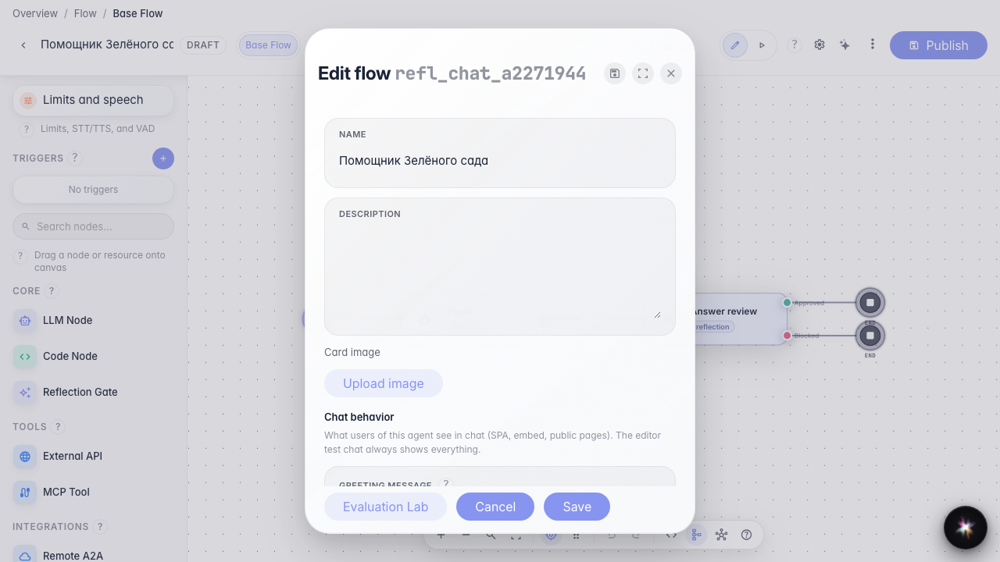
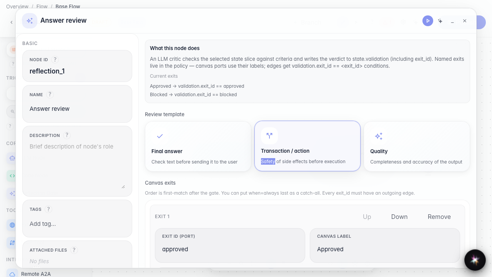
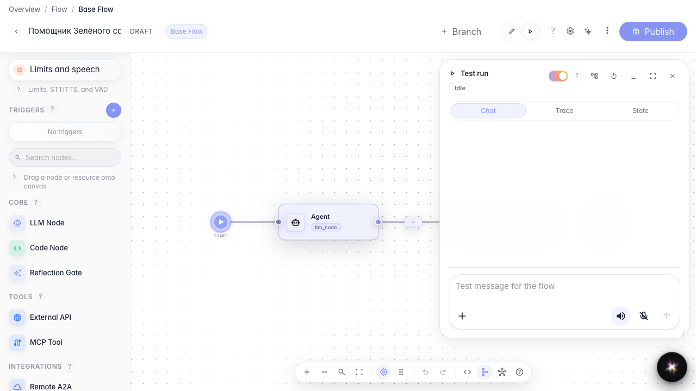
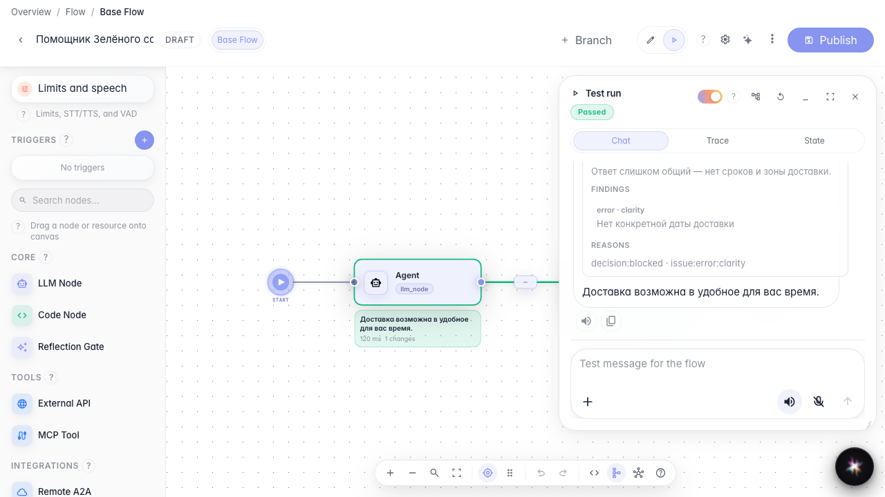

# Configure quality review and see the verdict in chat

**What for:** this guide helps you configure agent answer self-review and understand what the quality-check chip means in the test chat.

**Problems it solves:** it is unclear what each review-node field does, where to show the result to customers, and how the chip tells you the reply was approved, needs revision, or was blocked.

**Result:** you enabled quality-check chips and read the verdict with a rationale under the agent reply.

## Step 1. Open the agent with a review node

In the Green Garden Assistant editor, a **Review** node follows the agent. The model drafts a reply first, then a separate critic scores it against your rules. The review result chooses the next path on the graph (approved / blocked) and what a person sees in chat.

## Step 2. Enable the quality-check chip in chat settings

Open **Agent settings** → chat options and enable **Show quality checks**. This toggle is separate from the review node itself: the node always runs in the graph, while the switch controls whether chat shows a verdict chip. In **Run** test mode the chip is always visible for debugging. For customer chat keep it on for transparency, or turn it off if chips are distracting.

## Step 3. Walk through the review policy fields

Open the review node properties. Field-by-field:

- **Review template** — a starter for final answer, transaction, or quality checks; use it as a base and edit.
- **What we check** — usually **Agent reply** (the text sent to the customer). You can point at another state slice if you review a draft.
- **Instruction for the LLM critic** — guidance for the critic model, not customer-facing copy.
- **Criteria** — explicit rules (for example “must include a delivery date”) and how serious a finding is.
- **Min. confidence** and **Block on severity** — if the critic is unsure or finds an error/critical issue, the reply is not approved.
- **Canvas exits** — port labels such as Approved / Blocked that drive branching after the review.

This example already checks the final answer for clarity. After browsing the fields you can close the panel — the published settings are enough for the test chat.

## Step 4. Open the test chat in Run mode

Switch to **Run**. The same chat you use before publishing for Green Garden customers opens on the right.

## Step 5. Send a question and read the verdict chip

Ask about delivery. Under the agent reply a compact quality-check chip appears. Color and label show the outcome:

- green / “Check passed” — the reply is approved;
- yellow / “Needs revision” — the critic asks for fixes;
- red / “Blocked” — the reply failed the rules (as in this example: too vague, no delivery dates).

The chip label matches the canvas exit name (here — Blocked).

## Step 6. Expand the details and fix the reply from the findings

**Result demonstration.** When the reply is not approved, the card opens automatically. Inside you get three clear blocks:

- **Summary** — the critic’s overall verdict;
- **Findings** — individual issues (severity and wording);
- **Reasons** — technical block reasons for debugging.

Use them to tighten the agent prompt or review criteria before shipping the scenario to customers.

**Summary.** You can configure the review policy and the chat visibility toggle, then read the chip and details to see whether the reply passed quality control.

