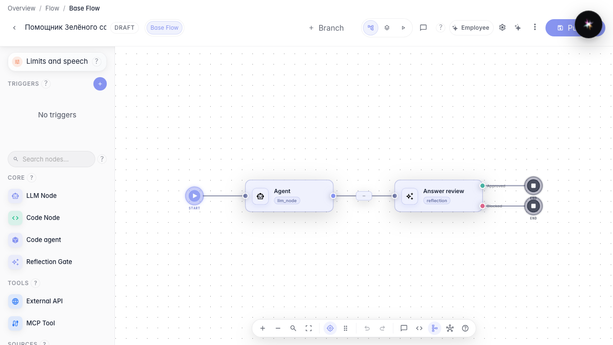
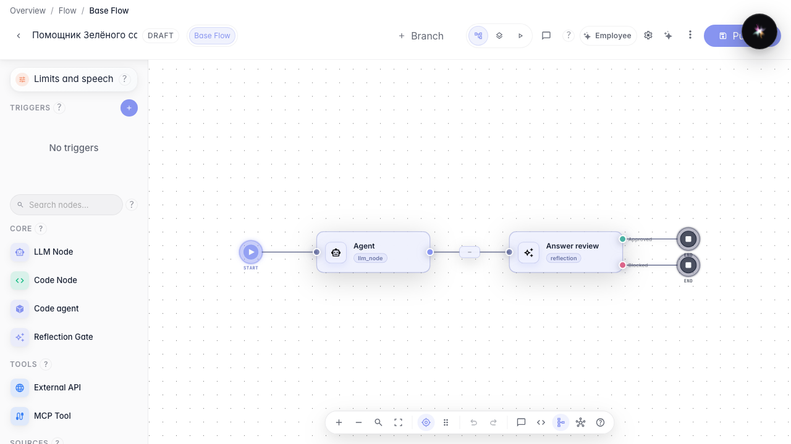
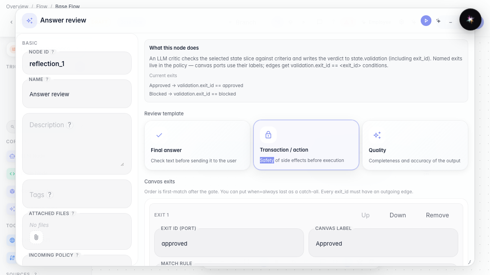
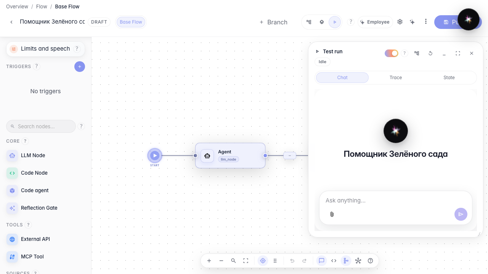

# Как настроить проверку качества и увидеть вердикт в чате

**Для чего:** эта инструкция поможет настроить самопроверку ответа агента и понять, что означает чип проверки в тестовом чате.

**Какие проблемы решает:** непонятно, какие поля в ноде проверки за что отвечают, где включить показ результата покупателю и как по чипу понять, что ответ одобрен, требует доработки или заблокирован.

**Результат:** вы настроили показ проверки качества и прочитали вердикт с обоснованием прямо под ответом агента.

## Шаг 1. Откройте агента с нодой проверки

В редакторе «Помощника Зелёного сада» после блока агента стоит нода **Проверка**. Сначала модель пишет ответ, затем отдельный критик оценивает его по вашим правилам. От результата проверки зависит, какой путь на схеме пойдёт дальше (одобрено / заблокировано) и что увидит человек в чате.

## Шаг 2. Включите показ проверки в настройках чата

Откройте **Настройки агента** → параметры чата и включите **Показывать проверку качества**. Это отдельный рычаг от самой ноды проверки: нода всегда работает в графе, а переключатель решает, видит ли человек в чате чип с вердиктом. В тестовом режиме «Запуск» чип показывается всегда — так удобно отлаживать. Для покупательского чата оставьте переключатель включённым, если нужна прозрачность, или выключите, если чипы мешают.

## Шаг 3. Разберите поля политики проверки

Откройте свойства ноды проверки. Кратко по блокам:

- **Шаблон проверки** — готовый набор для «финального ответа», «транзакции» или «качества»; можно взять за основу и подправить.
- **Что проверяем** — обычно «Ответ агента» (текст, который уйдёт покупателю). Можно указать другой срез, если проверяете черновик в переменных.
- **Инструкция для LLM-критика** — подсказка модели-критику, не текст для покупателя.
- **Критерии** — явные правила (например «должен быть срок доставки») и уровень серьёзности замечания.
- **Мин. уверенность** и **Блокировать при severity** — если критик не уверен или нашёл ошибку/критичное замечание, ответ не считается одобренным.
- **Выходы на канве** — подписи портов вроде «Approved» / «Blocked»; по ним строится ветвление после проверки.

В этом примере уже задана проверка финального ответа на ясность. После просмотра полей можно закрыть панель — для тестового чата достаточно уже опубликованной настройки.

## Шаг 4. Откройте тестовый чат в режиме Запуск

Переключитесь в **Запуск**. Справа откроется тот же чат, которым вы проверяете агента перед публикацией для покупателей «Зелёного сада».

