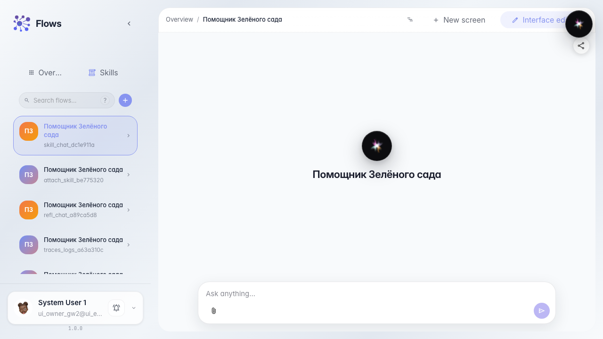

# A Skill unlocks in chat

**What for:** this guide shows how chat reveals that the agent loaded a Skill and used its tools.

**Problems it solves:** it is unclear whether the procedure ran and where the calculator in the reply came from.

**Result:** the chat shows a Skill load chip and a reply with the calculation.

## Step 1. Open the agent chat

Open the Green Garden Assistant chat. The Skill is already attached — the customer just asks about a return.

## Step 2. Prepare the reply check

The agent loads the procedure first, then calculates. Skill load chips can be hidden in chat settings (a separate guide).

