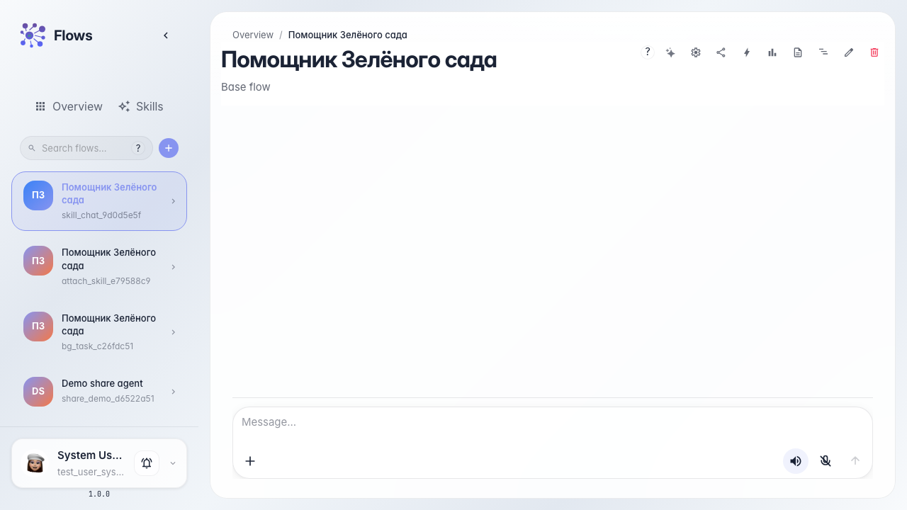
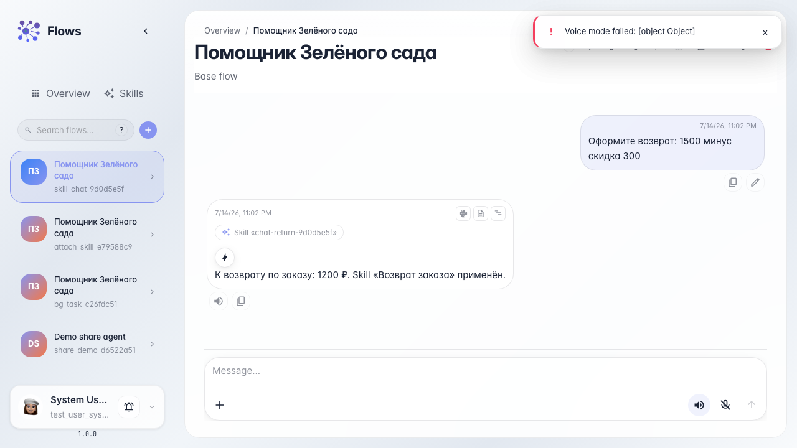
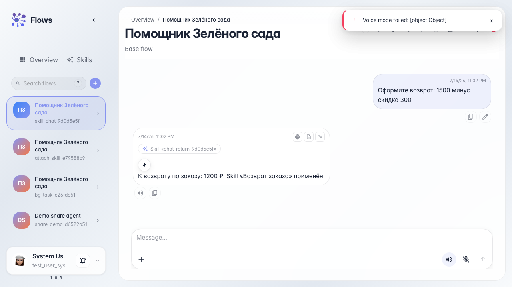

# Skill активируется в чате

**Для чего:** эта инструкция покажет, как в чате видно, что агент загрузил Skill и использовал его инструменты.

**Какие проблемы решает:** непонятно, сработала ли процедура и откуда взялся калькулятор в ответе.

**Результат:** в чате виден чип загрузки Skill и ответ с расчётом.

## Шаг 1. Откройте чат с агентом

Откройте чат «Помощника Зелёного сада». Skill уже привязан к агенту — покупатель просто пишет вопрос о возврате.

## Шаг 2. Подготовьте проверку ответа

Агент сначала загрузит процедуру, затем посчитает сумму. Чип активации Skill в чате можно скрыть в настройках чата (отдельная инструкция).

## Шаг 3. Отправьте вопрос и увидьте чип Skill

Напишите про возврат с суммой. В ленте появится чип, что агент загрузил Skill «Возврат заказа».

## Шаг 4. Проверьте ответ с результатом расчёта

**Демонстрация результата.** В ответе видна сумма после calculator — процедура и инструмент Skill сработали в одном диалоге.

**Итог.** Вы видите активацию Skill в чате и результат unlocked-инструмента.

