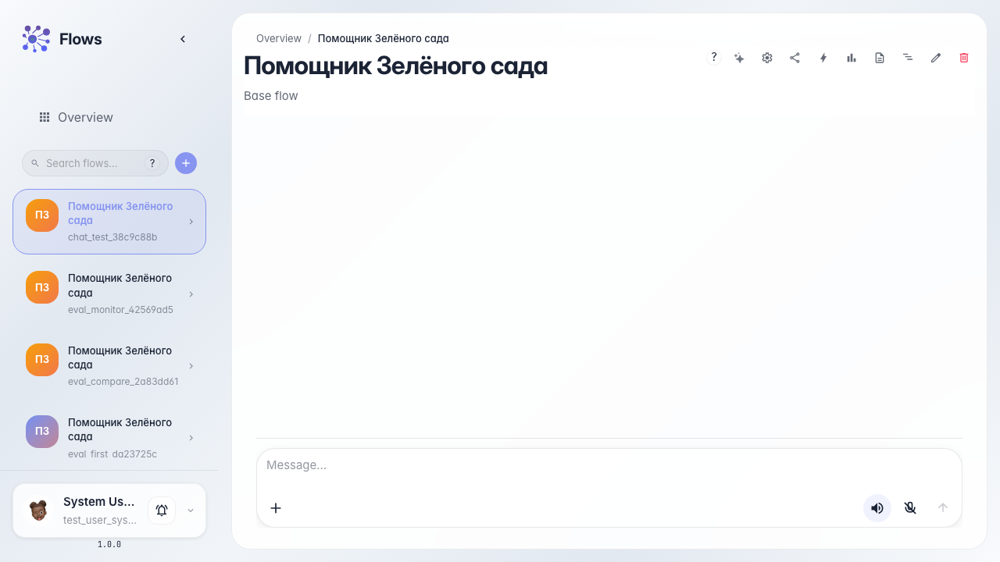
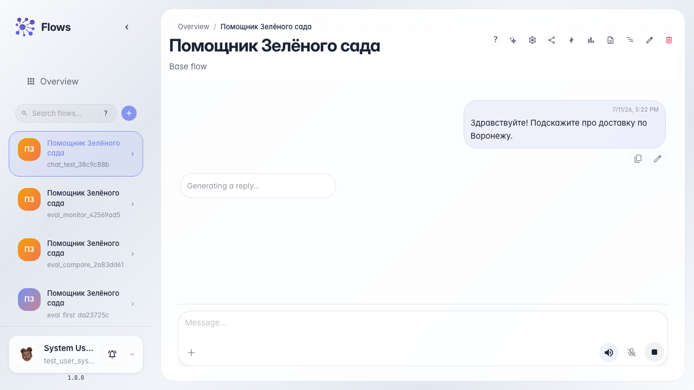
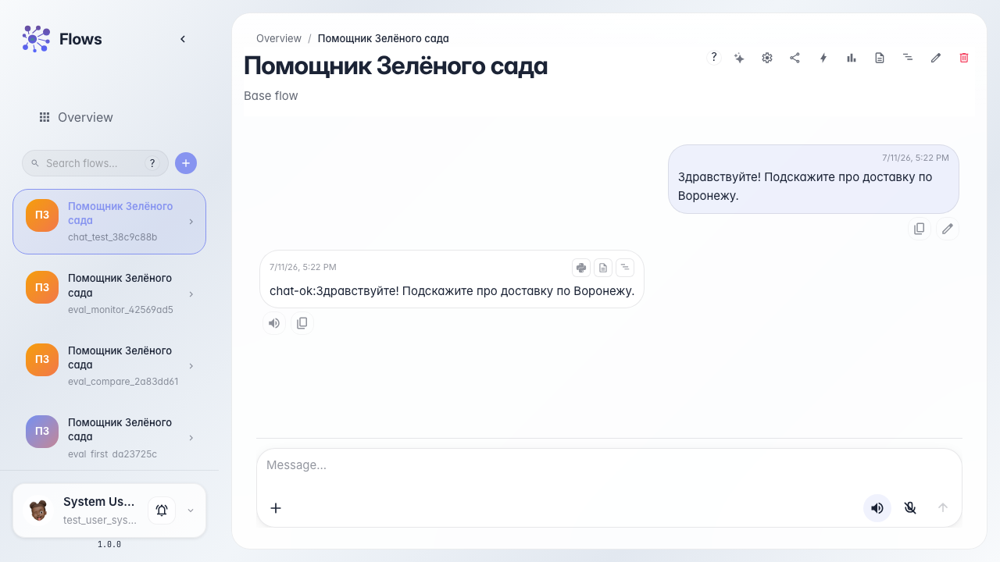
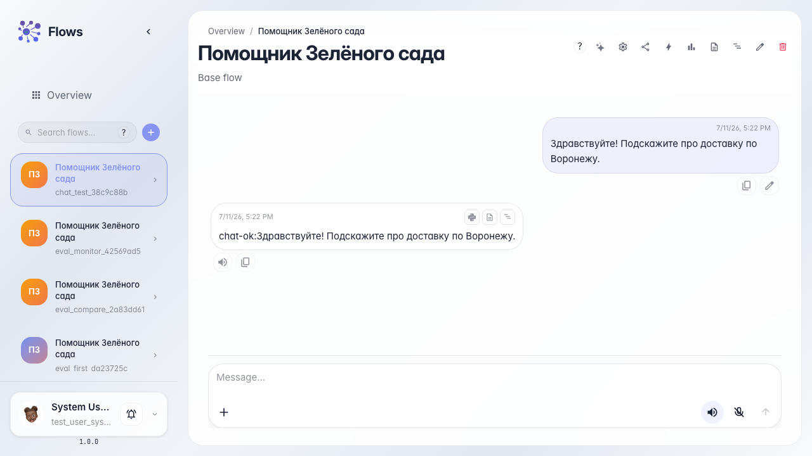

# Test the agent in chat

**What for:** this guide helps you test the Green Garden Assistant the same way a customer would in a dialog.

**Problems it solves:** it is unclear where to open the agent chat and how to confirm it answers a real question.

**Result:** the agent replied to a delivery question in the chat feed.

## Step 1. Open the agent chat

Open the Green Garden Assistant chat. The message feed is in the center and the input field is at the bottom. This is the same interface a customer sees.

## Step 2. Ask about delivery

Type a customer question — for example about delivery to your city — and send it. This tests the agent on a typical Green Garden store request.

## Step 3. Wait for the reply in the feed

Wait until the reply appears in the chat feed. A streaming reply shows the agent is processing the message in real time.

## Step 4. Verify the meaningful reply

**Result demonstration.** An agent reply appeared in the feed, which means the dialog works and the Green Garden Assistant accepts messages.

**Summary.** You can now open the Green Garden agent chat and verify its answer to a customer question.

