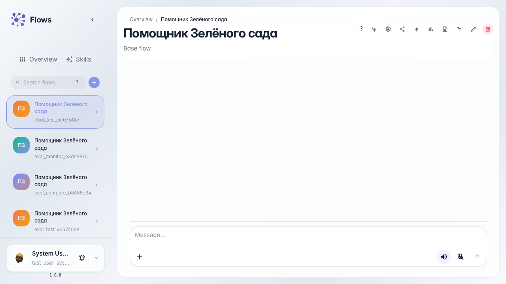
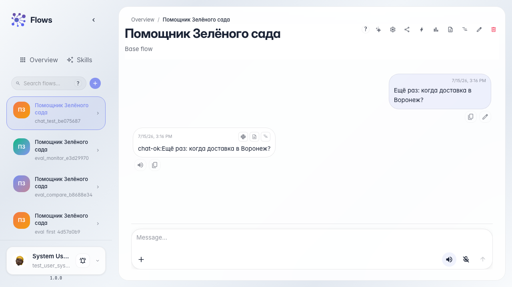

# Test the agent in chat

**What for:** this guide helps you test the Green Garden Assistant the same way a customer would in a dialog.

**Problems it solves:** it is unclear where to open the agent chat and how to confirm it answers a real question.

**Result:** the agent replied to a delivery question in the chat feed.

## Step 1. Open the agent chat

Open the Green Garden Assistant chat. Execution history is available for dialogs that have run at least once.

## Step 2. Ask about delivery

## Step 3. Wait for the reply in the feed

Wait until the reply appears in the chat feed. A streaming reply shows the agent is processing the message in real time.

## Step 4. Start a new conversation

Clear the feed or start a new chat — this checks a fresh-start scenario, like a customer after a previous request. Skill load chips in the dialog are covered in a separate guide.

## Step 5. Verify the meaningful reply

