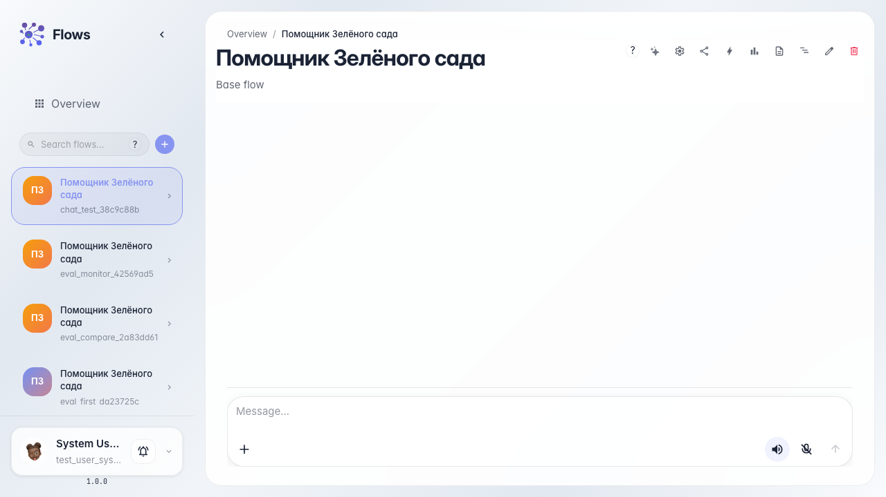
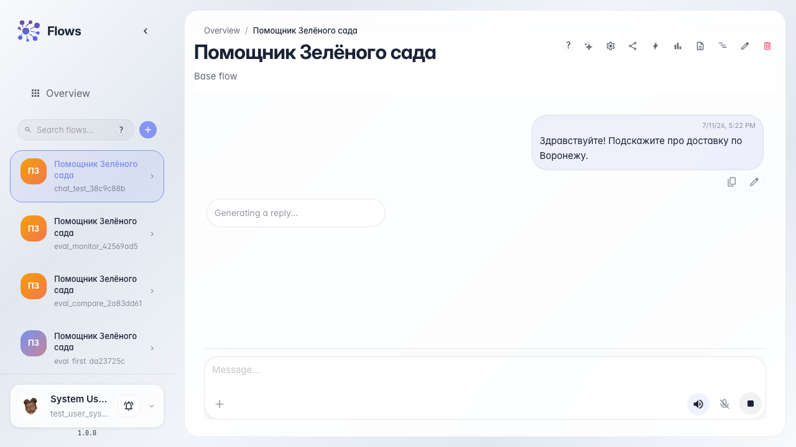
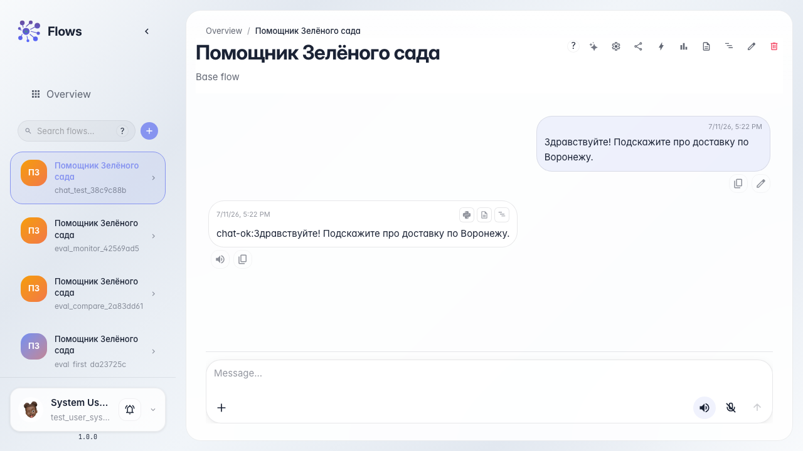
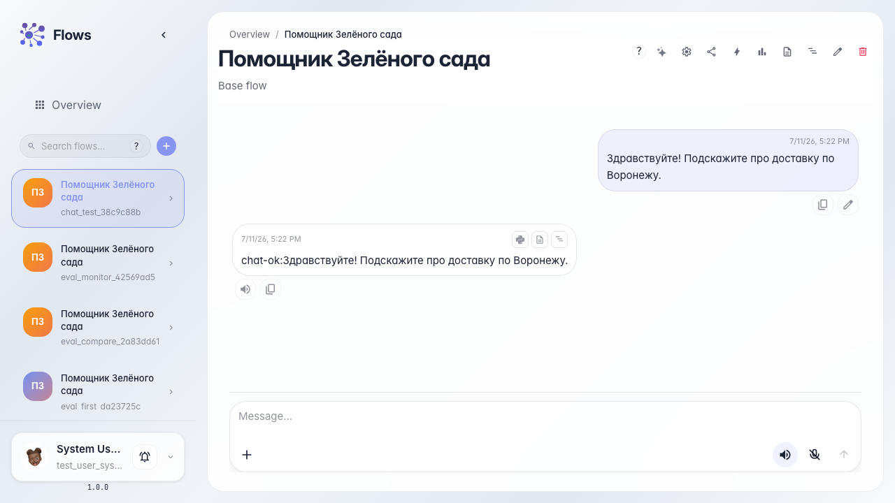

# Тестируем агента в чате

**Для чего:** эта инструкция поможет проверить «Помощника Зелёного сада» так же, как это делает покупатель в диалоге.

**Какие проблемы решает:** непонятно, где открыть чат агента и как убедиться, что он отвечает на реальный вопрос.

**Результат:** агент ответил на вопрос о доставке в ленте чата.

## Шаг 1. Откройте чат агента

Перейдите в чат «Помощника Зелёного сада». В центре — лента сообщений, внизу поле ввода. Это тот же интерфейс, который видит покупатель.

## Шаг 2. Задайте вопрос о доставке

Напишите вопрос покупателя — например, про доставку в ваш город — и отправьте сообщение. Так вы проверяете агента на типичном обращении в магазин «Зелёный сад».

## Шаг 3. Дождитесь ответа в ленте

Подождите, пока ответ появится в ленте чата. Потоковый ответ показывает, что агент обрабатывает сообщение в реальном времени.

## Шаг 4. Проверьте содержательный ответ

**Демонстрация результата.** В ленте появился ответ агента — значит диалог работает и «Помощник Зелёного сада» принимает сообщения.

**Итог.** Теперь вы умеете открыть чат агента «Зелёный сад» и проверить его ответ на вопрос покупателя.

