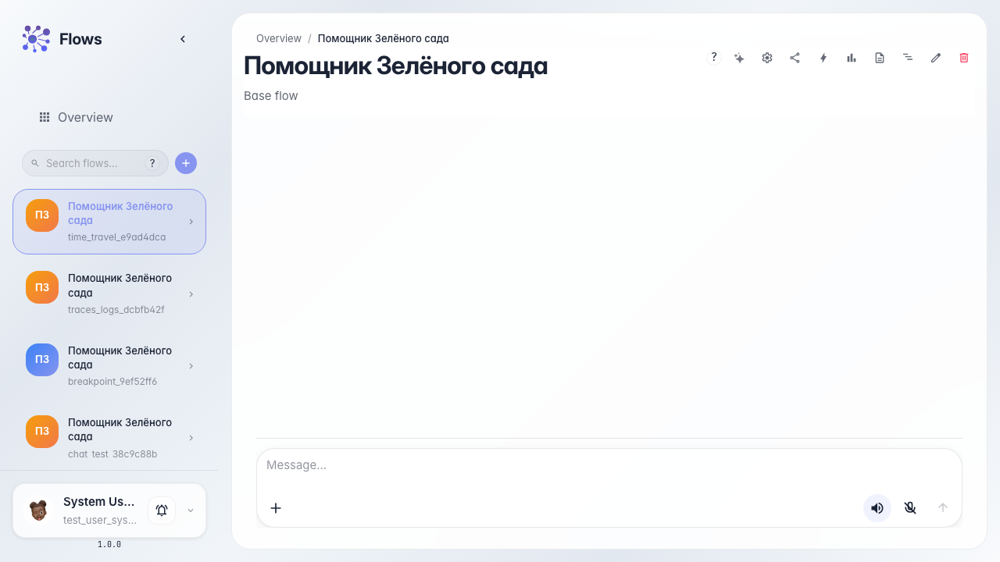
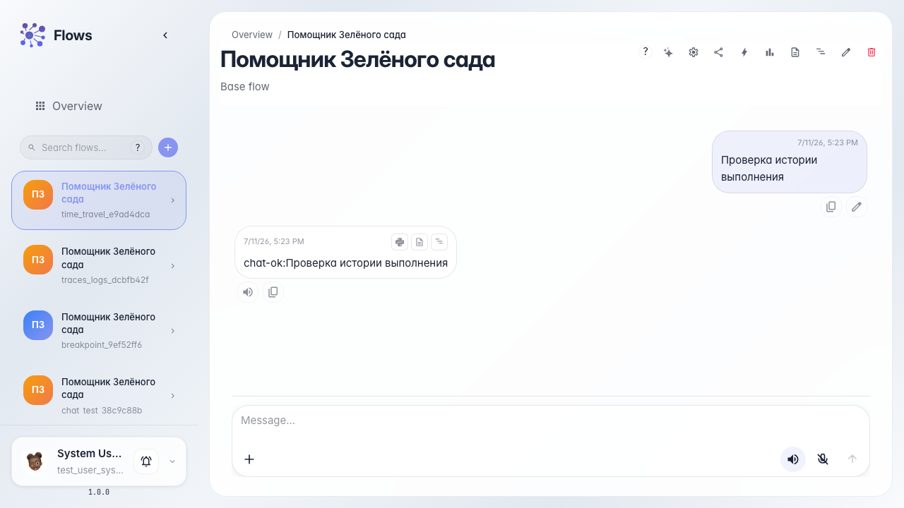

# Time-travel the run history

**What for:** this guide helps you review dialog execution history and find the moment to replay from.

**Problems it solves:** after a failure it is unclear which step failed and you have to restart the whole dialog.

**Result:** execution history is open with a list of events from the last run.

## Step 1. Open the agent chat

Open the Green Garden Assistant chat. Execution history is available for dialogs that have run at least once.

## Step 2. Run the dialog

Send a message and wait for the reply. After the run completes, the system stores the event chain you can navigate.

