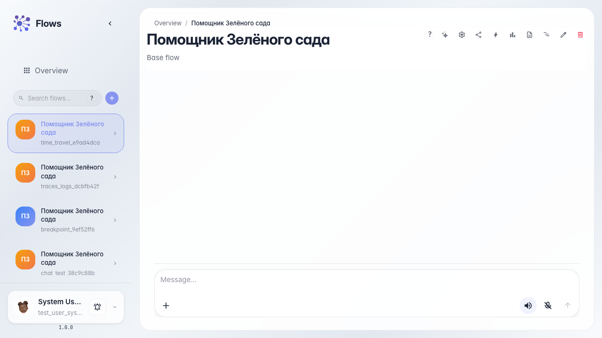
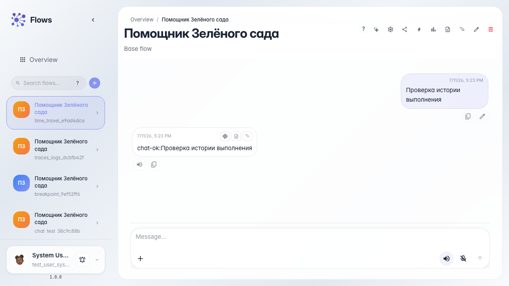
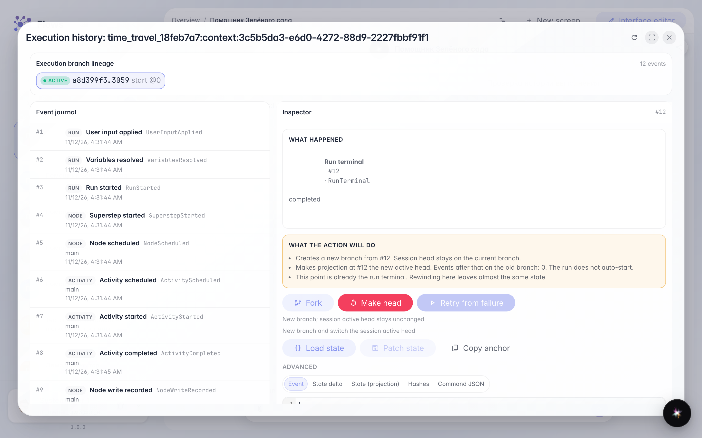

# Возвращаемся к прошлому состоянию

**Для чего:** эта инструкция поможет посмотреть историю выполнения диалога, понять смысл шагов и выбрать момент для ответвления или смены active head.

**Какие проблемы решает:** после ошибки непонятно, на каком шаге всё пошло не так, и приходится начинать диалог заново.

**Результат:** открыта история выполнения с понятным журналом событий и действиями Fork / Make head / Retry.

## Шаг 1. Откройте чат агента

Перейдите в чат «Помощника Зелёного сада». История выполнения доступна для диалогов, которые уже запускались хотя бы один раз.

## Шаг 2. Запустите диалог

Отправьте сообщение и дождитесь ответа. После завершения прогона система сохраняет цепочку событий в durable ledger.

## Шаг 3. Откройте историю выполнения

Нажмите кнопку истории выполнения в чате или выберите пункт в меню. Откроется окно «История выполнения»: сверху — линия execution branch, слева — журнал событий с человеческими названиями, справа — инспектор.

## Шаг 4. Выберите шаг и действие

**Демонстрация результата.** В журнале видны шаги последнего прогона (вход, ноды, финал). В инспекторе — краткое описание, последствия действий и кнопки:

- **Ответвление (Fork)** — новая ветка, active head сессии не меняется.
- **Сделать head (Rewind)** — новая ветка становится active head; run сам не стартует, продолжение — следующим сообщением в чате.
- **Повтор с ошибки** — только на `NodeFailed`.

После команды появится блок результата с новой веткой. Сырой JSON остаётся во вкладках Advanced.

**Итог.** Теперь вы умеете читать историю выполнения и осознанно выбирать fork или смену head.

