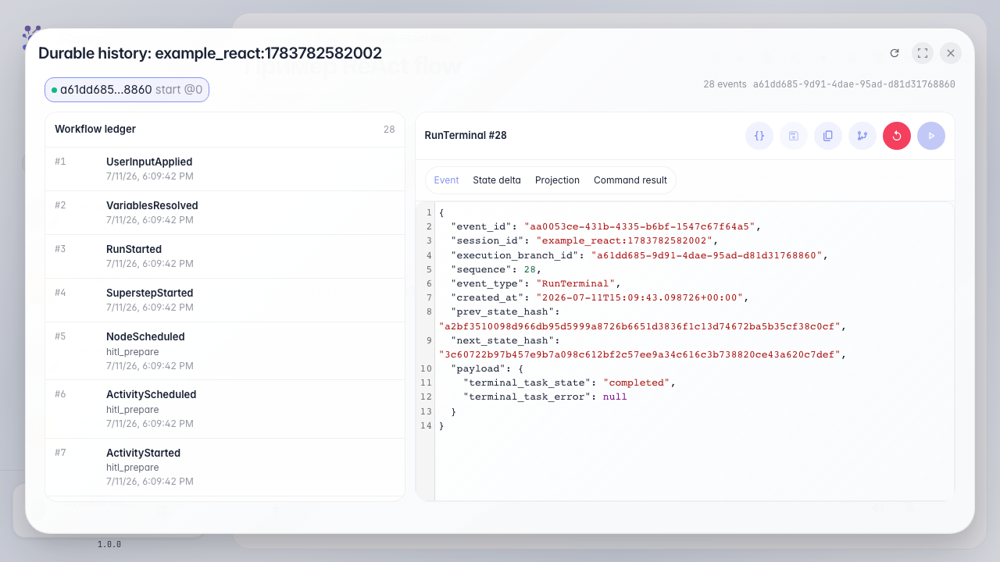

# See the operator handoff in the run history

**What for:** this guide helps you review after a run where the agent handed the dialog to an operator and when it resumed.

**Problems it solves:** a single chat view does not show when and to which queue the task was sent.

**Result:** the run history shows handoff and resume events after the operator replied.

## Step 1. Open the dialog run history

In chat, open run history; it is the log of all agent steps: nodes, tools, operator handoffs, and resumes.

## Step 2. Find the operator handoff event

In the event list, find HandoffRequested; that is when the agent handed the dialog to the Customer Support queue and created an operator task.

## Step 3. Find the resume event after the reply

**Result demonstration.** The HandoffResumed event shows the operator replied and the agent continued the dialog. Together with HandoffRequested it is the full picture of human handoff.

**Summary.** You can now read run history and find operator handoff and dialog resume events.

