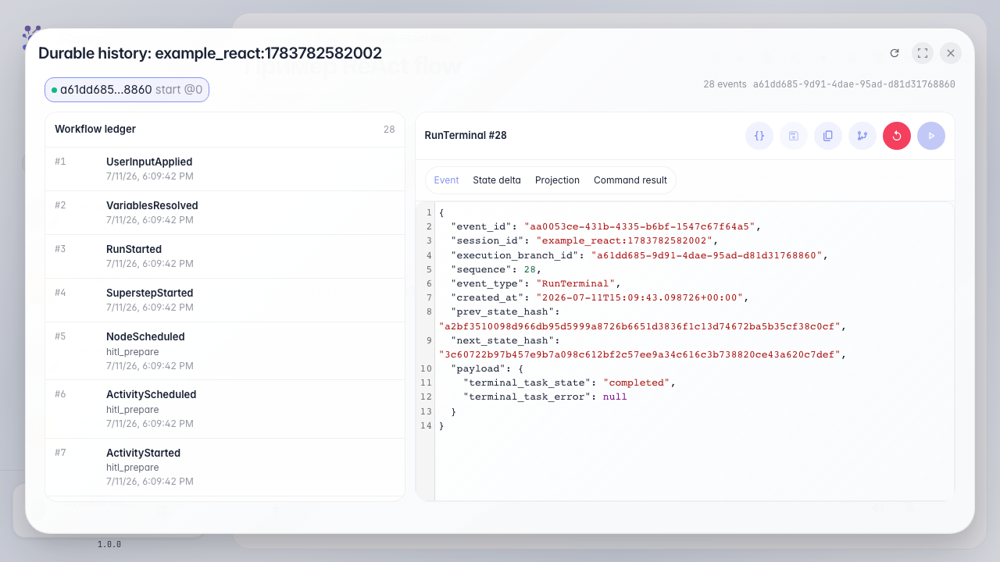

# Смотрим передачу оператору в истории выполнения

**Для чего:** эта инструкция поможет разобрать после прогона, где агент передал диалог оператору и когда диалог возобновился.

**Какие проблемы решает:** по одному чату не видно, в какой момент и в какую очередь ушла задача.

**Результат:** в истории выполнения найдены события передачи и возврата после ответа оператора.

## Шаг 1. Откройте историю выполнения диалога

В чате откройте историю выполнения — это журнал всех шагов агента: ноды, инструменты, передачи оператору и возобновления.

## Шаг 2. Найдите событие передачи оператору

В списке событий найдите HandoffRequested — это момент, когда агент передал диалог в очередь «Поддержка клиентов» и создал задачу для оператора.

## Шаг 3. Найдите событие возврата после ответа

**Демонстрация результата.** Событие HandoffResumed показывает, что оператор ответил и агент продолжил диалог. Вместе с HandoffRequested это полная картина передачи человеку.

**Итог.** Теперь вы умеете читать историю выполнения и находить передачу оператору и возврат диалога агенту.

