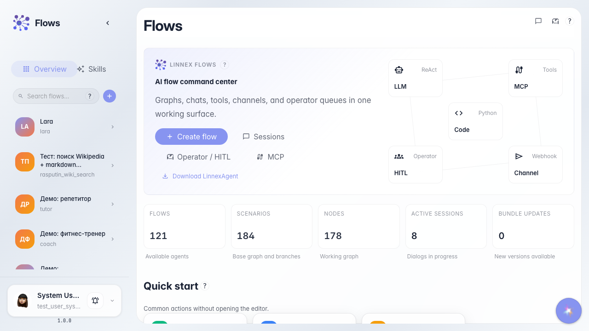
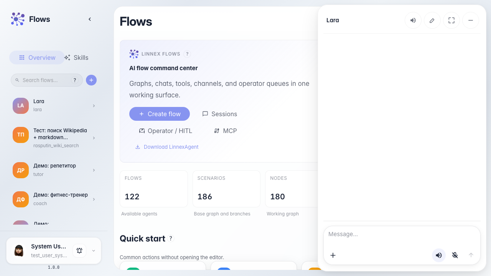
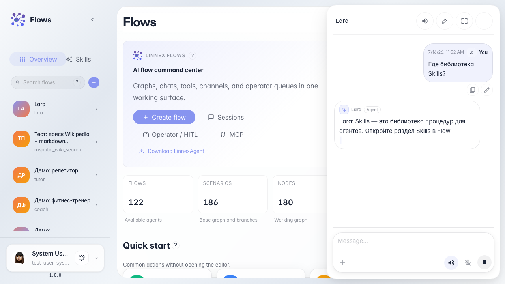

# Chat with Lara — the platform assistant

**What for:** this guide helps you ask Lara how the platform works without configuring your own agent.

**Problems it solves:** a beginner does not know where to get help about Flows and services.

**Result:** you get a Lara reply in chat.

## Step 1. Open the Flows home page

Start from Flows home. From here open chat and launch the built-in Lara platform assistant.

## Step 2. Open Lara chat from the header

Open Flows chat and click the Lara button (AI icon in the header). The built-in platform assistant opens — it answers product questions, not store orders.

## Step 3. Prepare a platform question

Ask a simple question, for example about Skills. Lara replies in the platform assistant drawer.

## Step 4. Read Lara's reply

**Result demonstration.** The drawer shows Lara's reply about Skills — the platform assistant works.

**Summary.** You can open Lara and ask platform questions.

