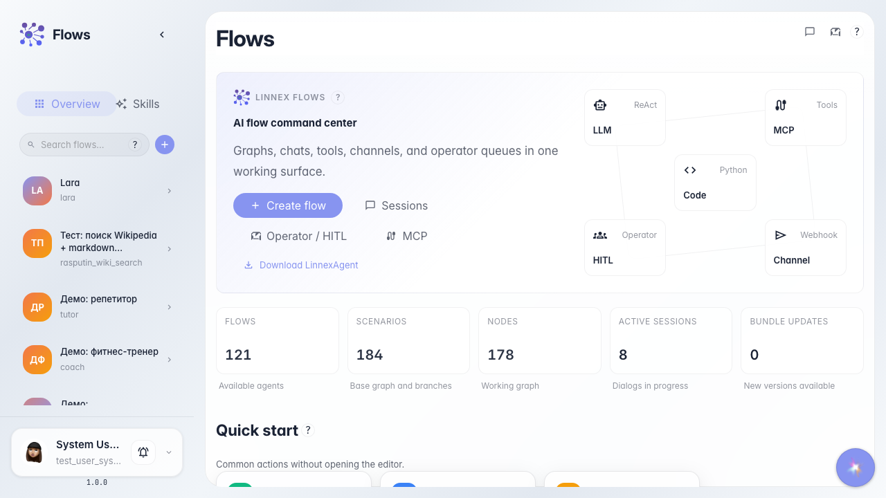
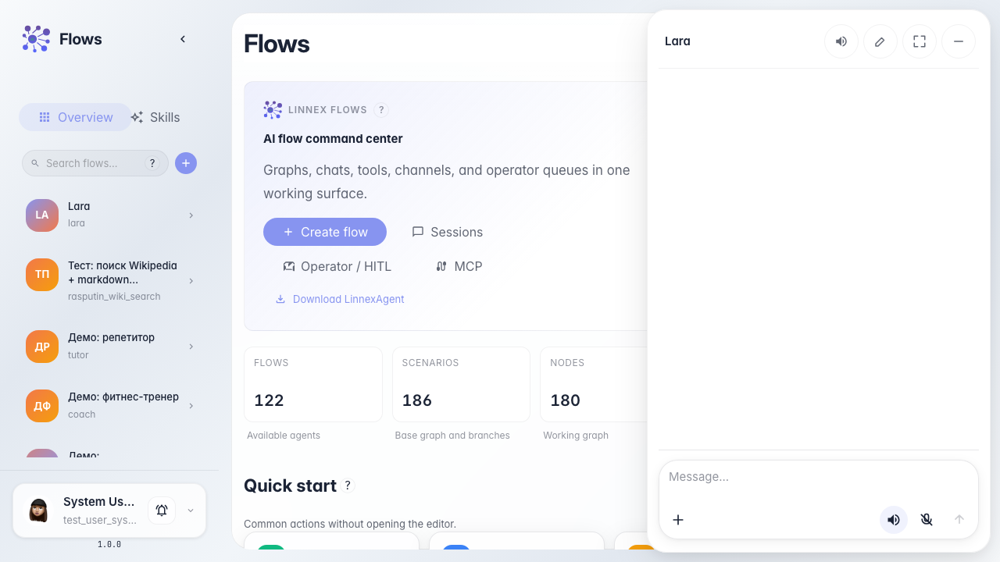
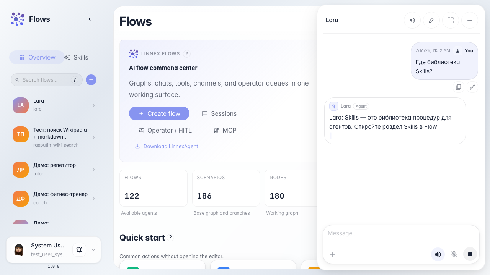

# Чат с Lara — помощником платформы

**Для чего:** эта инструкция поможет спросить у Lara, как устроена платформа, не настраивая своего агента.

**Какие проблемы решает:** новичок не знает, куда обратиться за подсказкой по Flows и сервисам.

**Результат:** вы получите ответ Lara в чате.

## Шаг 1. Откройте главную Flows

Начните с главной Flows. Отсюда удобно перейти в чат и открыть встроенного помощника платформы Lara.

## Шаг 2. Откройте чат Lara из шапки

Откройте чат Flows и нажмите кнопку Lara (иконка AI в шапке). Откроется встроенный помощник платформы — он отвечает на вопросы о продукте, а не о заказах магазина.

## Шаг 3. Подготовьте вопрос про платформу

Сформулируйте простой вопрос, например про Skills. Lara отвечает в drawer помощника платформы.

## Шаг 4. Прочитайте ответ Lara

**Демонстрация результата.** В drawer виден ответ Lara про Skills — помощник платформы работает.

**Итог.** Вы умеете открывать Lara и задавать вопросы о платформе.

