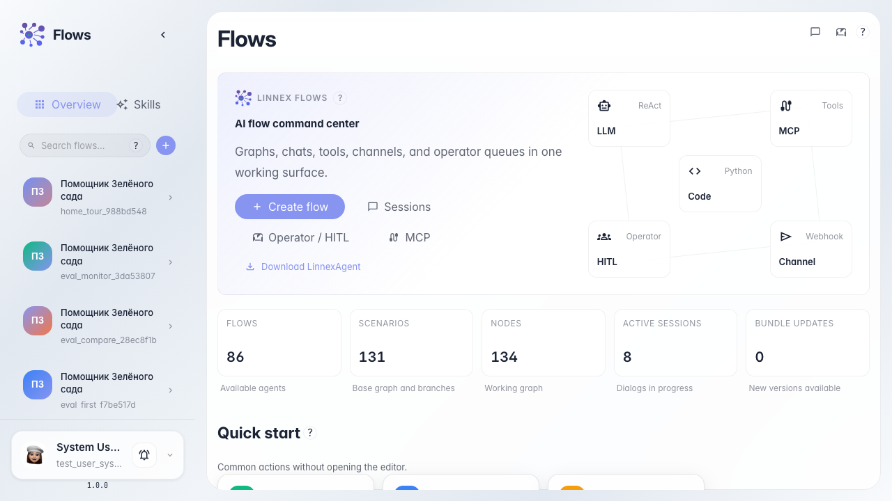
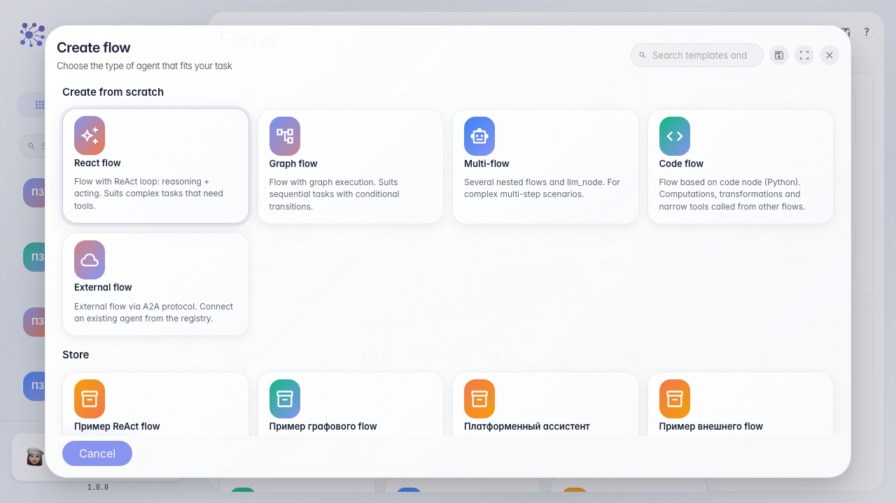
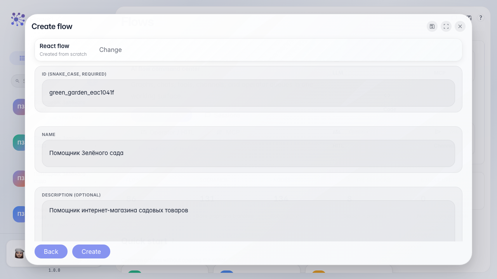
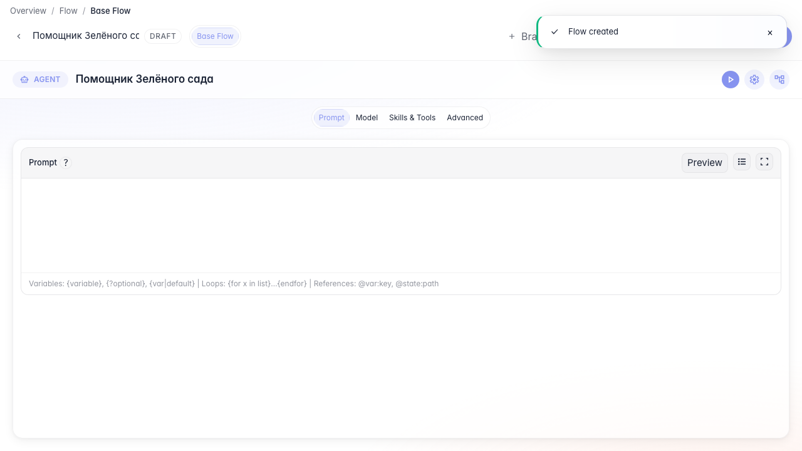

# Create your first agent from a template

**What for:** this guide helps you create your own agent without building a graph from scratch.

**Problems it solves:** beginners aren't sure which template to start from and which fields to fill in when creating an agent.

**Result:** the Green Garden Assistant is created and opened in the editor with ready-made nodes.

## Step 1. Open the agent catalog

On the Flows home, the agent catalog is on the left. Here you can not only search existing assistants but also create a new one.

## Step 2. Choose an agent template

The creation wizard opens. Pick the plain agent template — it already contains an answer node, so the agent can reply to customers immediately.

## Step 3. Fill in name and description

Enter an identifier, the name Green Garden Assistant, and a short description. The identifier is for the system, while the name and description are what colleagues see in the catalog.

## Step 4. Check the new agent in the editor

**Result demonstration.** After creation you land in the editor: a single-LLM template usually opens Studio (prompt, model, Skills and tools on one screen). Switching to the canvas graph is covered in the two editor modes guide.

**Summary.** You can create an agent from a template and recognize which editor opened.

