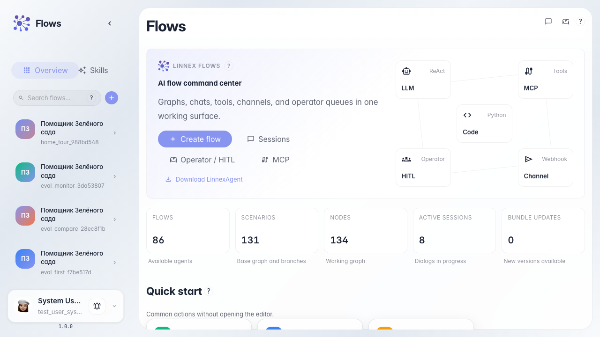
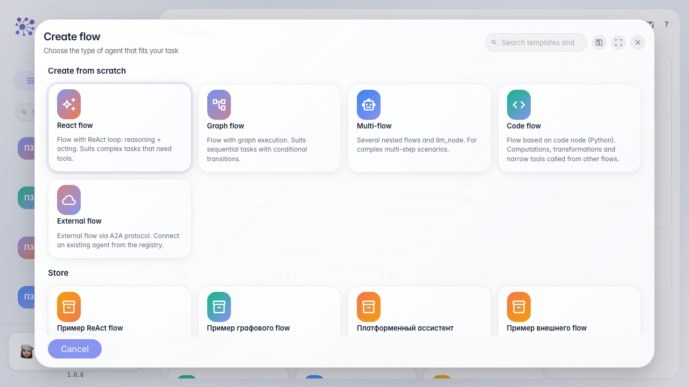
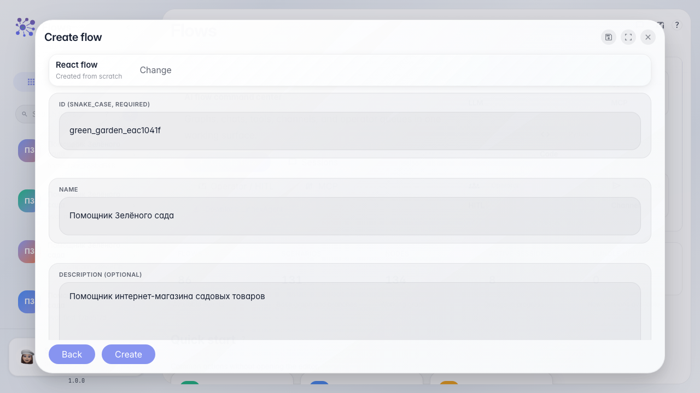
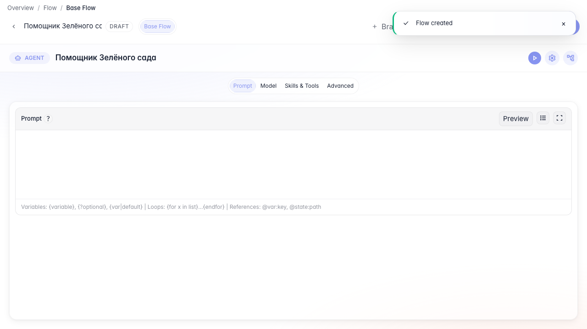

# Создаём первого агента из шаблона

**Для чего:** эта инструкция поможет создать собственного агента, не собирая граф с нуля.

**Какие проблемы решает:** новичку непонятно, с какого шаблона начать и какие поля нужно заполнить при создании.

**Результат:** «Помощник Зелёного сада» создан и открыт в редакторе с готовыми нодами.

## Шаг 1. Откройте каталог агентов

На главной Flows слева находится каталог агентов. Здесь можно не только искать готовых помощников, но и создать нового.

## Шаг 2. Выберите шаблон агента

Откроется мастер создания. Выберите шаблон обычного агента — он уже содержит ноду ответа, поэтому агент сразу сможет отвечать покупателям.

## Шаг 3. Заполните название и описание

Укажите идентификатор, название «Помощник Зелёного сада» и короткое описание. Идентификатор нужен системе, а название и описание увидят коллеги в каталоге.

## Шаг 4. Проверьте нового агента в редакторе

**Демонстрация результата.** После создания вы попадаете в редактор: для шаблона с одной LLM-нодой чаще открывается студия (промпт, модель, Skills и tools в одном экране). Переключение на схему (канву) — в отдельной инструкции про два режима редактора.

**Итог.** Теперь вы умеете создавать агента из шаблона и понимаете, какой редактор открылся.

