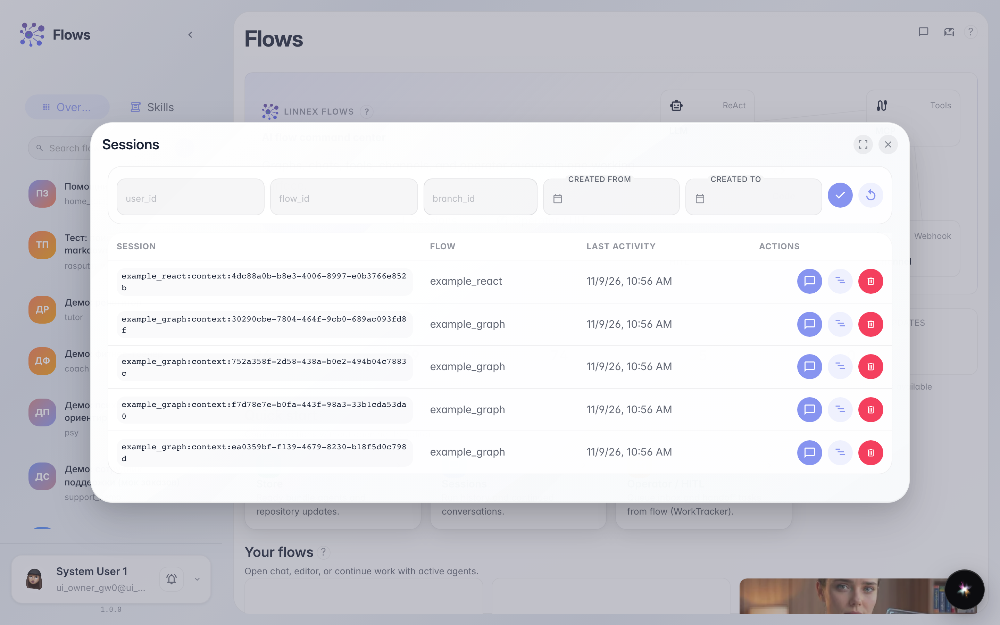
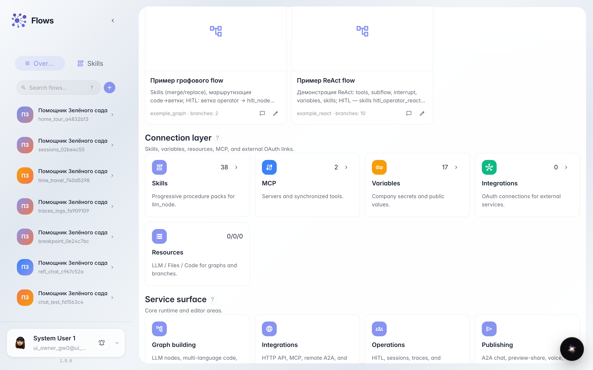

# Getting to know Flows: home and agent catalog

**What for:** this guide helps you get comfortable on the Flows home page and learn how to find an agent and open a chat with it.

**Problems it solves:** new users often can't tell where the agent list is, how to open a dialog or the editor, and what to click first.

**Result:** you will find the Green Garden Assistant in the catalog and open a working chat with it.

## Step 1. Open the Flows home page

Start from Flows home. From here open chat and launch the built-in Lara platform assistant.

## Step 2. Open recent sessions

Sessions opens recent agent conversations. Use the list to resume a dialog or see which agents ran recently.

## Step 3. Review the Skills card and platform assistant

In the connections block, Skills opens the agents' procedure library. The built-in Lara assistant is available from chat.

## Step 4. Find the agent in the catalog

Type part of the name into catalog search. The narrowed list shows the Green Garden Assistant card.

## Step 5. Reveal agent card actions

Hover over the agent card. Chat tests the agent; Editor configures its graph.

## Step 6. Open the agent chat

Click Chat on the card. The dialog lets you test the assistant as a customer.

## Step 7. Check the agent reply

**Result demonstration.** Send a question and wait for the reply in the chat feed; a visible answer confirms the agent is found and working.

**Summary.** You can now navigate the Flows home, use quick actions and sessions, find an agent in the catalog, and open a working chat with it.

