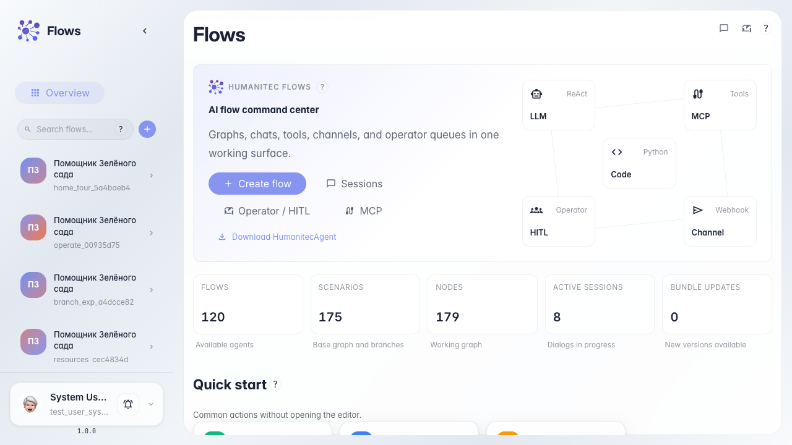
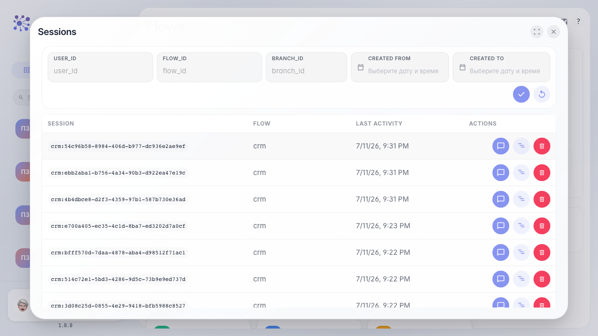
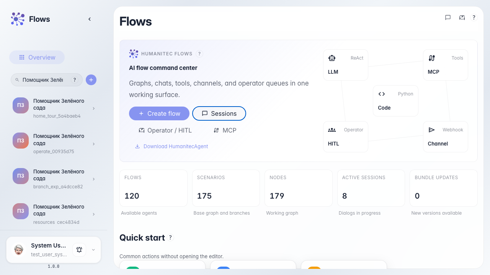
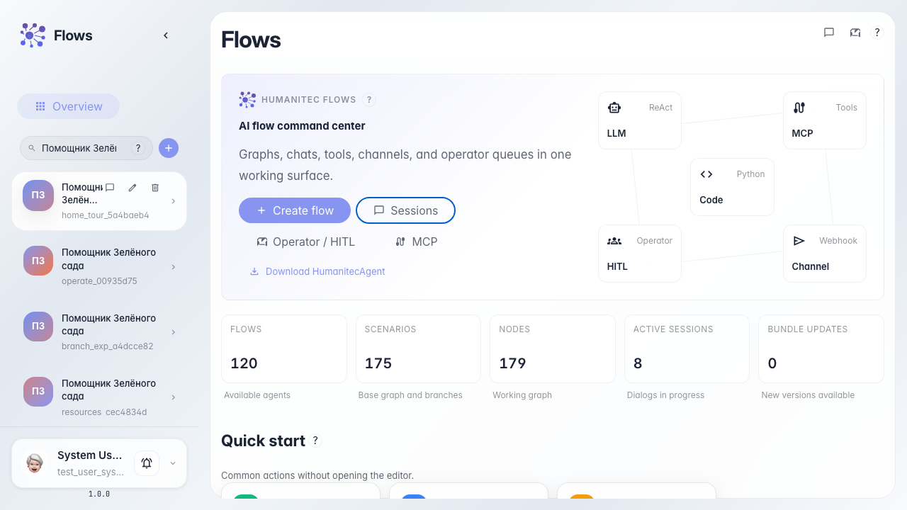
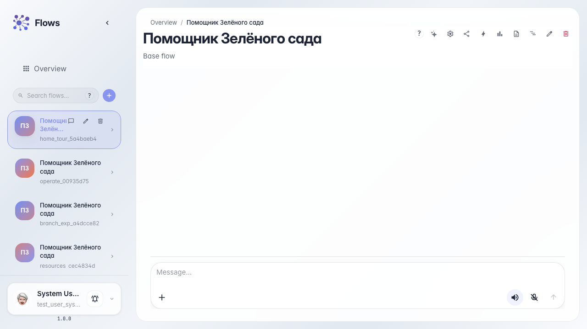
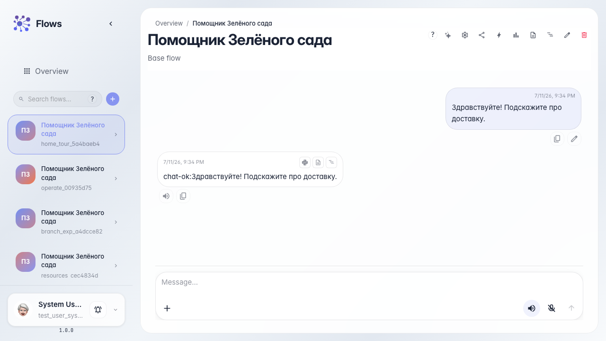

# Getting to know Flows: home and agent catalog

**What for:** this guide helps you get comfortable on the Flows home page and learn how to find an agent and open a chat with it.

**Problems it solves:** new users often can't tell where the agent list is, how to open a dialog or the editor, and what to click first.

**Result:** you will find the Green Garden Assistant in the catalog and open a working chat with it.

## Step 1. Open the Flows home page

Open the Flows service. In the center you see the welcome block and quick actions, and on the left the catalog of your agents. This shows you where to start right away.

## Step 2. Review quick actions and the LinnexAgent download link

The quick actions block includes Sessions, Operator / HITL, and a Download LinnexAgent link for the desktop client. From here you can open operator tasks or download the app for pairing and Platform MCP.

## Step 3. Open recent sessions

The Sessions button opens a list of recent agent conversations. Here you can resume a dialog or see which agents ran recently.

## Step 4. Find the agent in the catalog

Type part of the name into the catalog search. The list narrows to matching agents, which is handy when you have many. The Green Garden Assistant card appears.

## Step 5. Reveal agent card actions

Hover over the Green Garden Assistant card. Chat and Editor buttons appear — chat to try the agent, editor to configure the graph.

## Step 6. Open the agent chat

Click the chat icon on the agent card. A dialog opens where you can talk to the assistant like a regular customer. This is the main way to try the agent in action.

## Step 7. Check the agent reply

**Result demonstration.** Send a question and wait for the reply in the chat feed; a visible answer confirms the agent is found and working.

**Summary.** You can now navigate the Flows home, use quick actions and sessions, find an agent in the catalog, and open a working chat with it.

