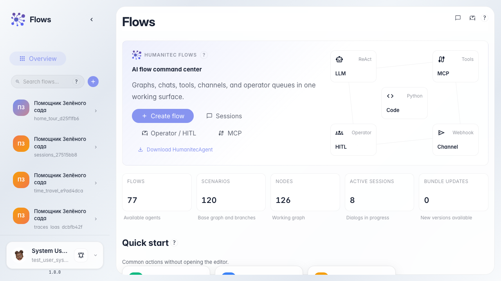
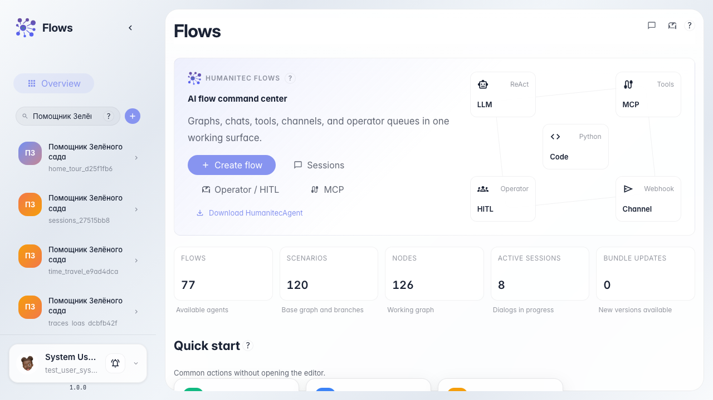
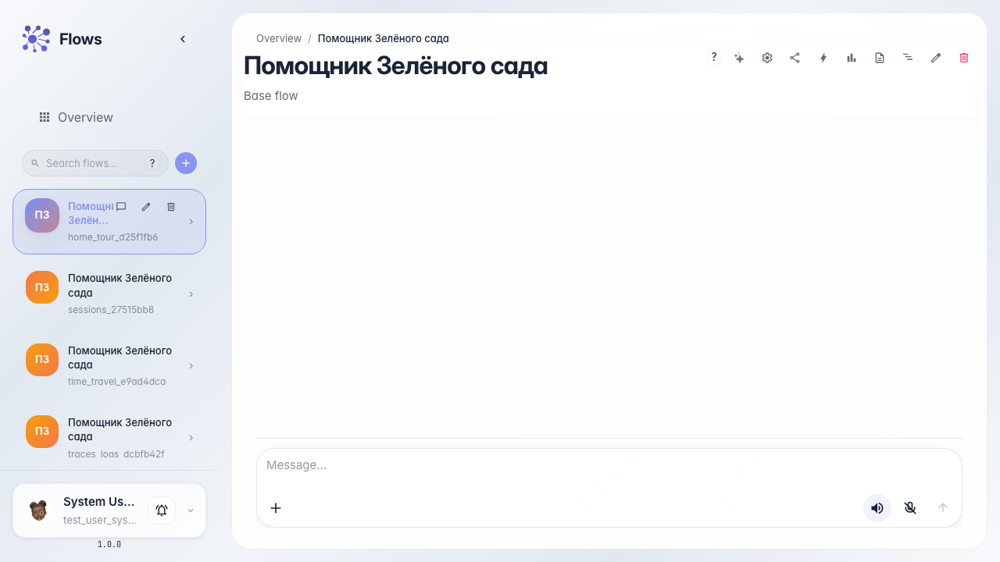
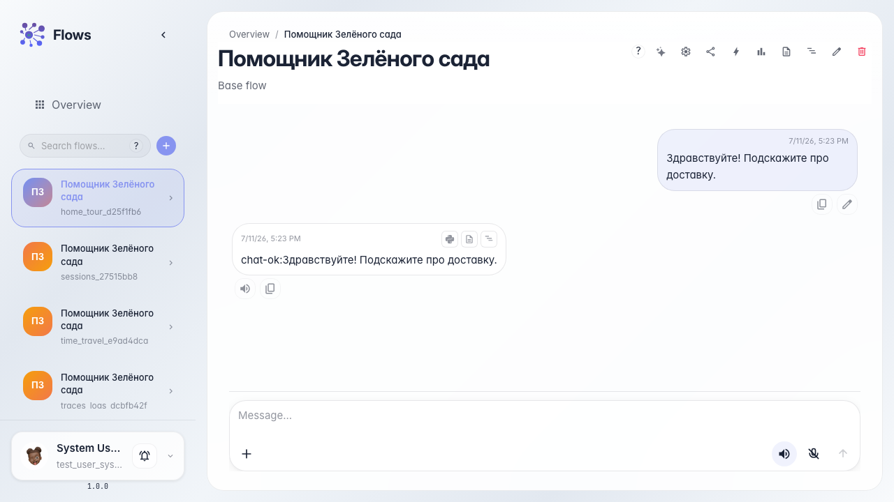

# Знакомство с Flows: главная и каталог агентов

**Для чего:** эта инструкция поможет освоиться на главной странице Flows и научиться находить нужного агента и открывать с ним чат.

**Какие проблемы решает:** новый пользователь часто не понимает, где список агентов, как открыть диалог или редактор и куда нажимать в первую очередь.

**Результат:** вы найдёте «Помощника Зелёного сада» в каталоге и откроете с ним рабочий чат.

## Шаг 1. Откройте главную Flows

Перейдите в сервис Flows. В центре — приветственный блок и быстрые действия, а слева каталог ваших агентов. Так вы сразу видите, с чего начать работу.

## Шаг 2. Найдите нужного агента в каталоге

Введите часть названия в поиск каталога. Список сузится до подходящих агентов — так удобно находить нужного помощника, когда их много. Появится карточка «Помощника Зелёного сада».

## Шаг 3. Откройте чат агента

Нажмите значок чата на карточке агента. Откроется диалог, в котором можно общаться с помощником как обычный покупатель. Это главный способ проверить агента в деле.

## Шаг 4. Проверьте ответ агента

**Демонстрация результата.** Отправьте вопрос и дождитесь ответа в ленте чата — видимый ответ подтверждает, что агент найден и работает.

**Итог.** Теперь вы умеете ориентироваться на главной Flows, находить агента в каталоге и открывать с ним рабочий чат.

