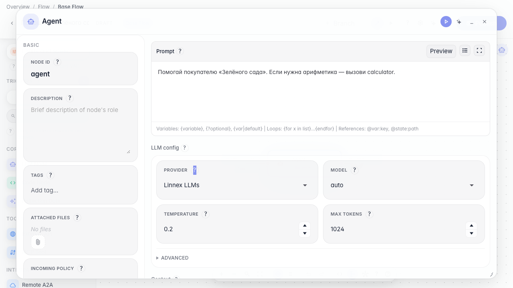
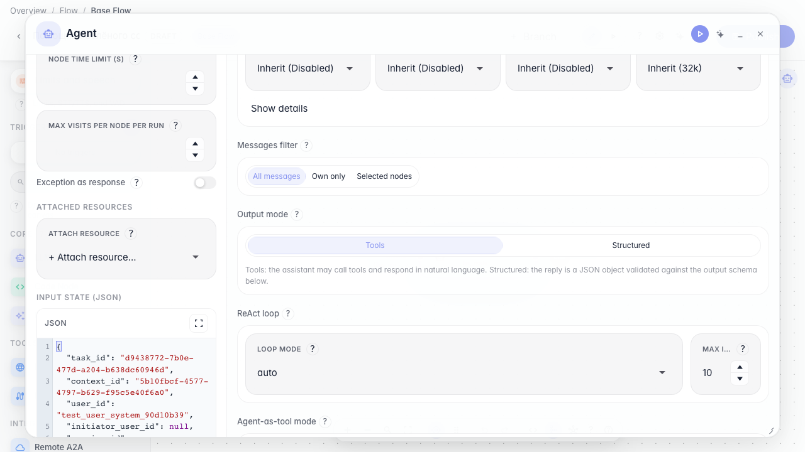
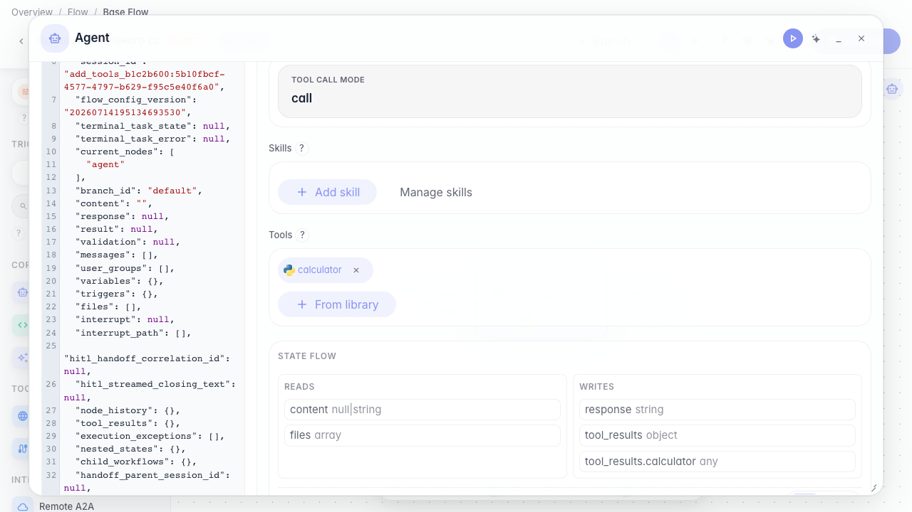
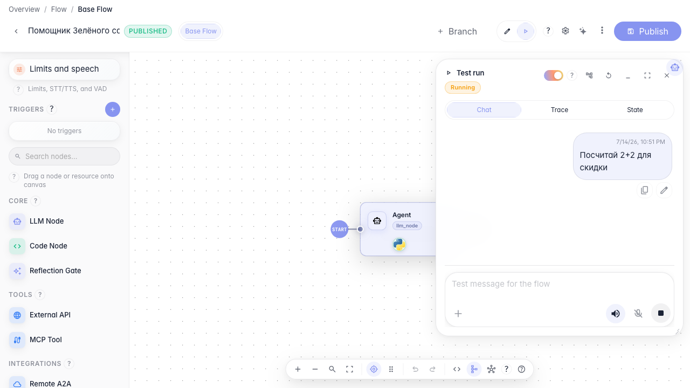

# Give the agent tools

**What for:** this guide shows how to attach tools to an agent so it can take actions, not only reply in text.

**Problems it solves:** without tools the agent is limited to words and cannot call store services or internal operations.

**Result:** the Green Garden Assistant gets a calculator from the library, and a test run shows the tool call.

## Step 1. Open the agent in the editor

Open the agent on the canvas and open settings. Here you set behavior and tools. Skills (procedures) are a separate section nearby; attaching them is covered in the Skills guide.

## Step 2. Switch the node to tools mode

In Output mode choose Tools. In this mode the agent can call operations. Structured mode is not for tools or Skills.

## Step 3. Add a tool from the library

Click From library and pick calculator. After selection it appears as a chip in the node tool list.

## Step 4. Run the agent and see the tool call

**Result demonstration.** Switch to Run mode, ask a calculation question — the agent calls calculator and the reply shows the result.

**Summary.** You can enable tools mode, add a library tool, and verify the call in a test run.

