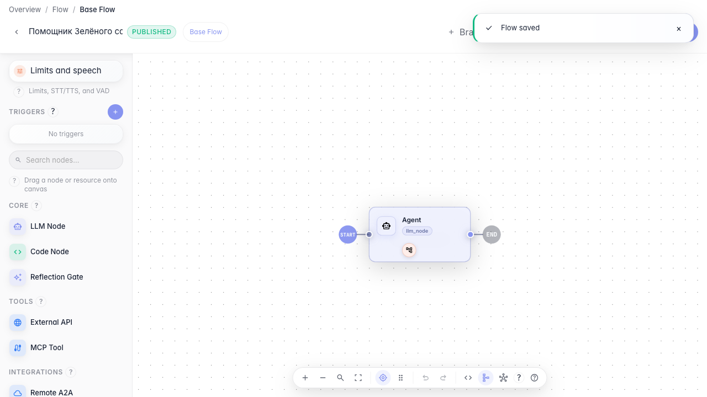

# Give the agent tools

**What for:** this guide shows how to attach tools to an agent so it can take actions, not only reply in text.

**Problems it solves:** without tools the agent is limited to words and cannot call store services or internal operations.

**Result:** the Green Garden Assistant gets a library tool and a published version.

## Step 1. Open the agent in the editor

Open the agent on the canvas and go to its settings. This is where you set behavior and the list of tools the agent can call on its own.

## Step 2. Switch the node to tools mode

In the Output mode block keep Tools selected. In this mode the agent can call attached operations and use their results in the reply.

## Step 3. Add a tool from the library

Click From library and pick a suitable tool. After selection it appears as a chip in the node tool list.

## Step 4. Publish the agent with the tool

**Result demonstration.** Click Publish — the tool stays in the node list and the saved agent version includes the attached tool.

**Summary.** You can enable tools mode, pick a tool from the library, and publish a working agent version.

