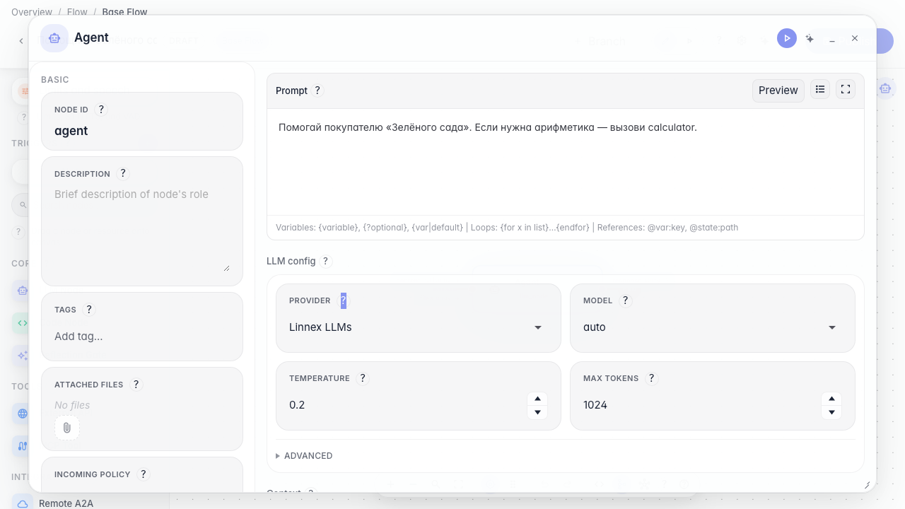
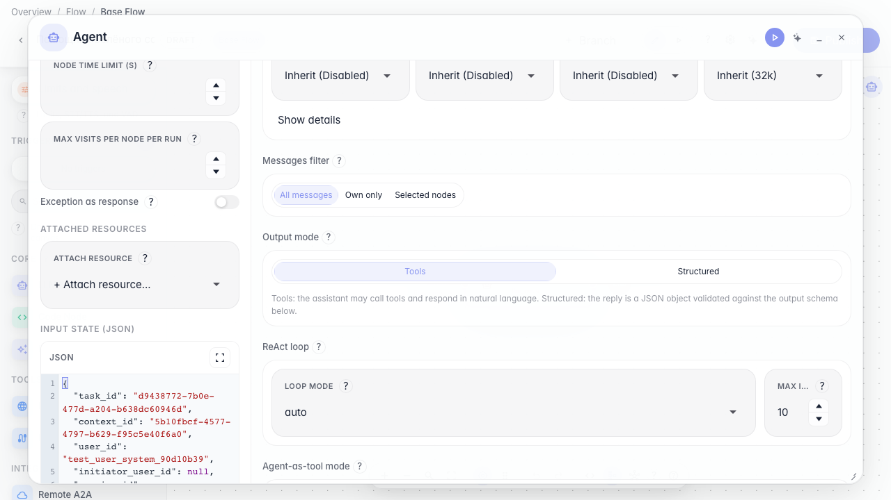
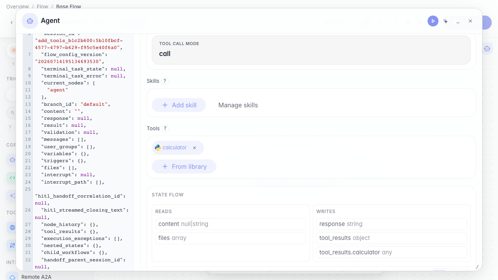
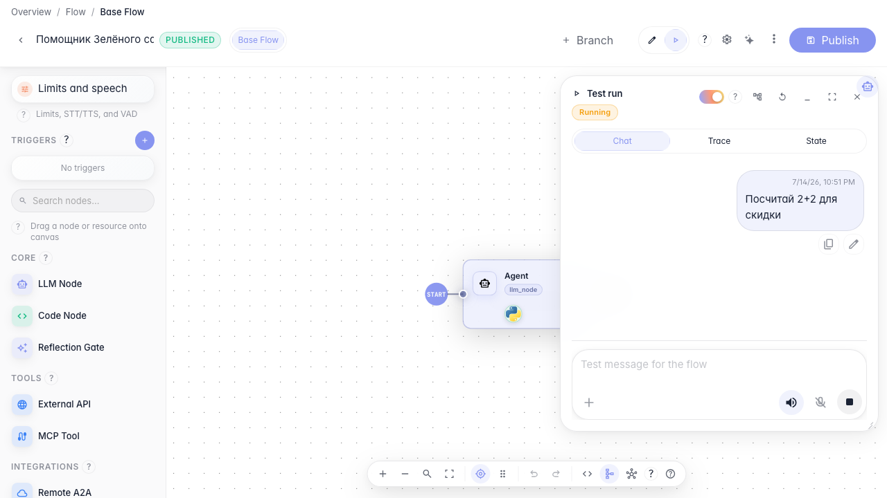

# Даём агенту инструменты

**Для чего:** эта инструкция научит подключать к агенту инструменты, чтобы он мог выполнять действия, а не только отвечать текстом.

**Какие проблемы решает:** без инструментов агент ограничен словами и не может обращаться к внешним сервисам или внутренним операциям магазина.

**Результат:** у «Помощника Зелёного сада» появится калькулятор из библиотеки, и в тестовом запуске будет виден вызов инструмента.

## Шаг 1. Откройте агента в редакторе

Откройте агента на канве и перейдите в настройки. Здесь задаётся поведение и список инструментов. Skills (процедуры) — отдельная секция рядом; их подключение описано в инструкции про Skills.

## Шаг 2. Переключите ноду в режим инструментов

В блоке «Режим вывода» выберите «Инструменты». В этом режиме агент может вызывать операции. Режим «Структурированный» для tools и Skills не подходит.

## Шаг 3. Добавьте инструмент из библиотеки

Нажмите «Из библиотеки» и выберите calculator. После выбора он появится чипом в списке инструментов ноды.

## Шаг 4. Запустите агента и увидьте вызов инструмента

**Демонстрация результата.** Перейдите в режим запуска, задайте вопрос с расчётом — агент вызовет calculator, и в ответе появится результат.

**Итог.** Теперь вы умеете включать режим инструментов, добавлять tool из библиотеки и проверять вызов в тестовом запуске.

